# Очередь прослушивания во вкладке «Аудио» (25 октября 2026)

Общие правила для сайта (`services/web`) и приложения (`clients/iqro_mobile`). Касается только
канала «Аудио» (listening). Мусхаф, заучивание, курсы и их плееры не меняются.

Макет, согласованный владельцем: https://claude.ai/artifact/6cpb7pEL1ViGgciK5PyC1S

## Данные

Новых эндпоинтов нет. Клиенты используют то, что API уже отдаёт:

- `GET /api/v1/recitations?reciter_id=…` — записи чтеца. Какие суры загружены, видно по
  `coverage.surah_numbers` (по возрастанию). Пустой список или его отсутствие (старый каталог)
  значит «все 114».
- `GET /api/v1/recitations/{id}/surahs/{n}` — трек и таймкоды одной суры.

**Вид чтения** — одна запись (`RecitationEdition`) этого же чтеца с правом `listen`: стиль
(муратталь, муджаввад, муаллим…) и риваят (`quran_edition.riwayah`). Список видов строится так же,
как во вкладке «Аудио» (последняя версия каждой записи, только `capabilities.listen`). Подпись:
`<стиль> · <риваят>`. Переключатель показывается, когда видов два и больше.

Сборники (рукья, джуз целиком) появятся отдельным PR: в данных их пока нет.

## Режим «После суры»

| Режим | Значение | Что после естественного конца суры |
| --- | --- | --- |
| `stop` | «Стоп» | воспроизведение заканчивается, как раньше |
| `next` | «Дальше» (по умолчанию) | ближайшая следующая сура, которая есть в записи; после последней — стоп |
| `loop` | «По кругу» | как «Дальше», но после последней — снова первая из загруженных; если сура одна — она же |

- Повтор суры (прежний повтор в плеере) важнее режима: сура повторяется.
- Таймер сна и пауза пользователя ничего не переключают.
- Режим — настройка устройства, переживает перезапуск.

## Кнопки и экран блокировки

- «Предыдущая / следующая сура»: ближайшая загруженная сура в эту сторону. В режиме «По кругу»
  они переходят через край (после последней — первая, перед первой — последняя), иначе на краю
  неактивны.
- Экран блокировки и уведомление (приложение: `audio_service`; сайт: Media Session
  `previoustrack` / `nexttrack`) переключают суры, а не аяты.
- «Весь Коран с начала» (в очереди и во вкладке «Аудио»): первая загруженная сура; режим «Стоп»
  при этом меняется на «Дальше», «По кругу» остаётся.
- Строка «Далее: N · название» показывает суру, которая заиграет по режиму; в режиме «Стоп»
  её нет.

## Карточка уведомления и экран блокировки (приложение)

Пять кнопок — столько Android показывает в медиакарточке. Код:
`clients/iqro_mobile/lib/core/audio/listening_media_controls.dart`.

| Где | Кнопки |
| --- | --- |
| Android 10–12 | ↺ 10 с · ⏮ сура · ⏯ · ⏭ сура · скорость (свёрнутая карточка: ⏯ ⏭ скорость) |
| Android 13+ | ⏮ ⏯ ⏭ рисует система, в два свободных места — скорость и ↺ 10 с |
| iOS Now Playing | ⏮ ⏭ или ±10 с — как решит система, скорость — системной командой |

- Полоса перемотки тянется (`MediaAction.seek`).
- Скорость: по кругу 0,75 → 1 → 1,25 → 1,5 → 2, как в плитке скорости плеера, в обе
  стороны синхронно; значок показывает текущую скорость. На Android 10–12 кнопка может
  отправить только медиаклавишу, поэтому она идёт клавишей «стоп» (остановка в приложении
  и так означала паузу); смахивание карточки — пауза. На Android 13+ — своя команда
  `forum.iqro.app.audio.speed`.
- Вперёд 10 с на Android не помещается (вперёд перематывает полоса), остаётся для
  iOS, Wear и Android Auto. Повтора в карточке нет: места нет ни в одной раскладке,
  повтор — в плеере.
- Пока звуком владеет Мусхаф или заучивание, в карточке только «воспроизвести»
  (возврат к «Аудио»), как и раньше.

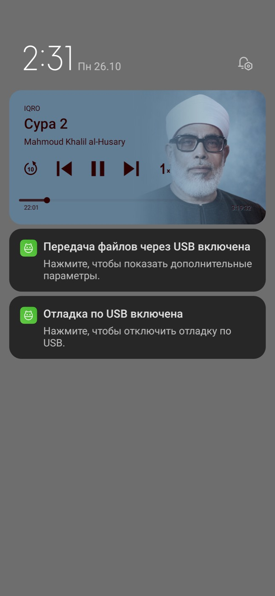
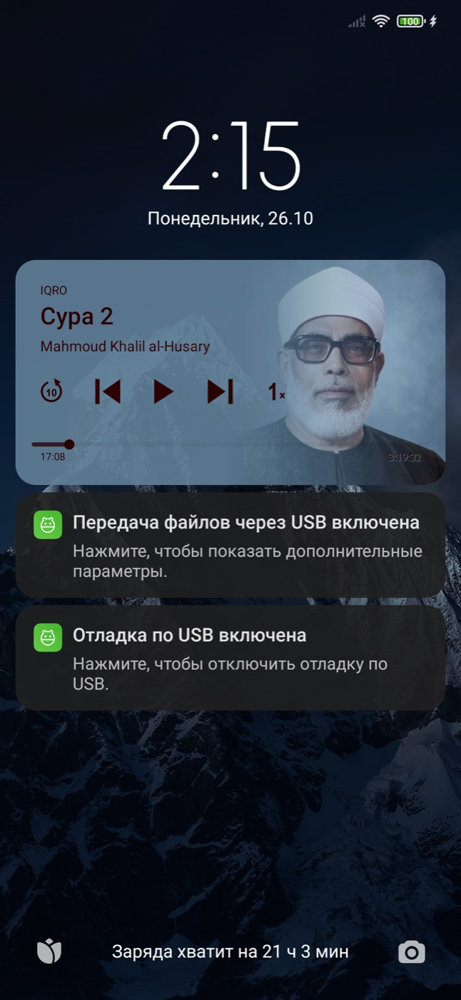
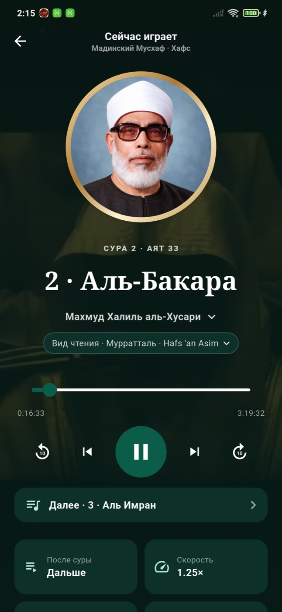

## Как плеер называет суру

- Заголовок плеера, мини-плеера и строки «Далее» — «2 · Аль-Бакара» (номер и название на языке
  интерфейса); пока названий нет — «Сура 2».
- В списке очереди у каждой суры номер и арабское название надписью Мусхафа (шрифт заставок сур QUL).
  Надпись строится по номеру, поэтому она есть и без каталога названий.
- Заголовок суры в полном плеере больше не выпадающий список: список сур — это очередь (карточка
  «Далее» и плитка «После суры»), касание заголовка тоже открывает её.
- Приложение не сохраняет пустой каталог сур и не верит сохранённому пустому: такой ответ однажды
  оставил на телефоне пустые списки и «Сура 2» вместо названий на сутки.

## Смена вида чтения

Та же сура, если она есть в новой записи; иначе ближайшая следующая загруженная; иначе последняя.
Позиция — с начала суры. Если звук шёл, он продолжается.

## Список очереди

- Загруженные суры по порядку: номер, название, длительность, если известна; текущая отмечена.
- Подряд идущие отсутствующие суры — одна строка «суры a–b не загружены» (одна сура — «сура a
  не загружена»).
- Если загружены не все суры — подпись «есть N из 114 сур».
- Тап по суре включает её; дальше очередь идёт по режиму.

## Без паузы между сурами

Когда сура начинает играть, клиент заранее запрашивает следующую суру по режиму. В конце суры
новый источник ставится сразу, без сетевого запроса, — это нужно, чтобы очередь шла дальше
в фоне и при заблокированном экране.

## Сохранение места

Сохраняются вид чтения, сура, позиция и режим: не реже раза в 5 секунд во время
воспроизведения, при паузе и при уходе со страницы или сворачивании приложения. При следующем
открытии плеер восстанавливается на паузе в этом месте.

- Сайт: `localStorage["iqro_listening_v1"]`; восстановление — один запрос
  `GET /recitations/{id}/surahs/{n}` после загрузки страницы, только если снимок есть.
- Приложение: прежний снимок `audio_playback_v1` (трек, позиция, повтор) плюс поле `queue_mode`;
  синхронизация позиции с сервером для аккаунта — как раньше.

## Проверка и скриншоты (26 октября 2026)

- Сайт на настоящем каталоге (локальный сервер читает публичный API iqro.forum): Аль-Фатиха → Аль-Бакара
  сама, «По кругу» 114 → 1, смена муратталь ↔ муджаввад на той же суре без остановки, после перезагрузки —
  «Продолжить с места: Сура 2 · 2:06».
- Приложение на Redmi Note 7 (production API): при заблокированном экране 112 → 113 → 114 сами, кнопки
  ⏮/⏭ экрана блокировки переключают суры, «По кругу» переживает перезапуск, аят в Мусхафе играет как раньше.

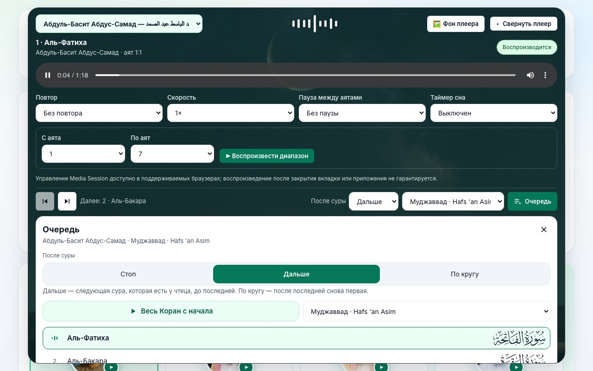
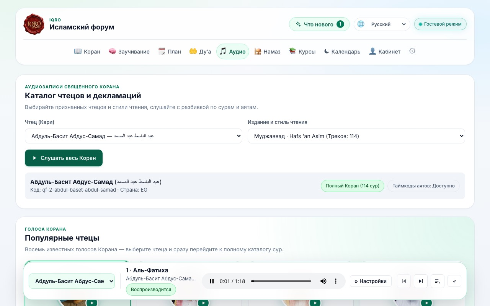
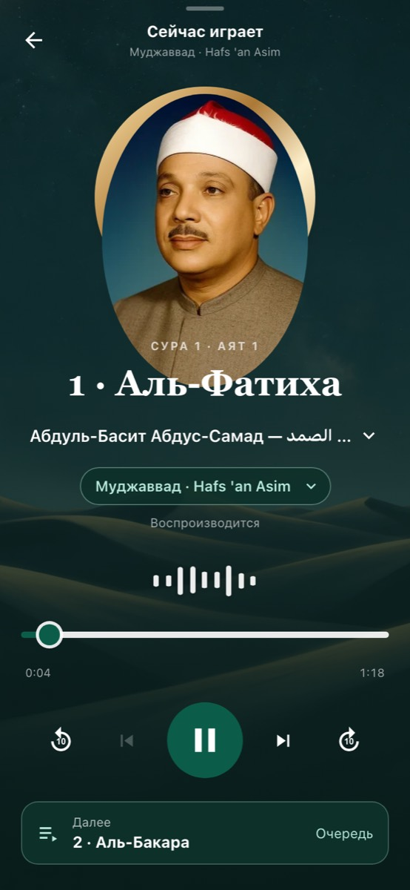
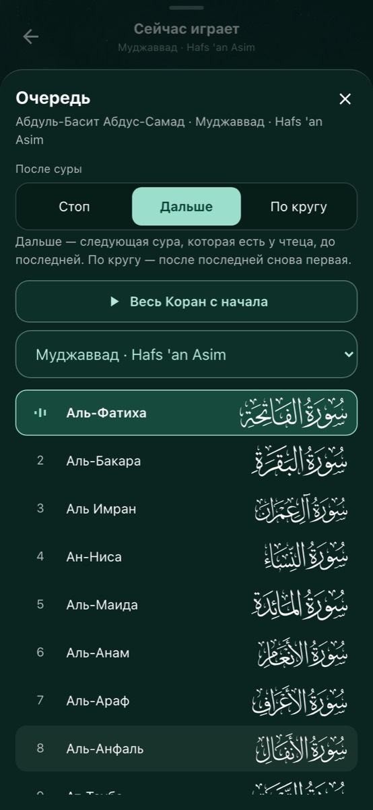
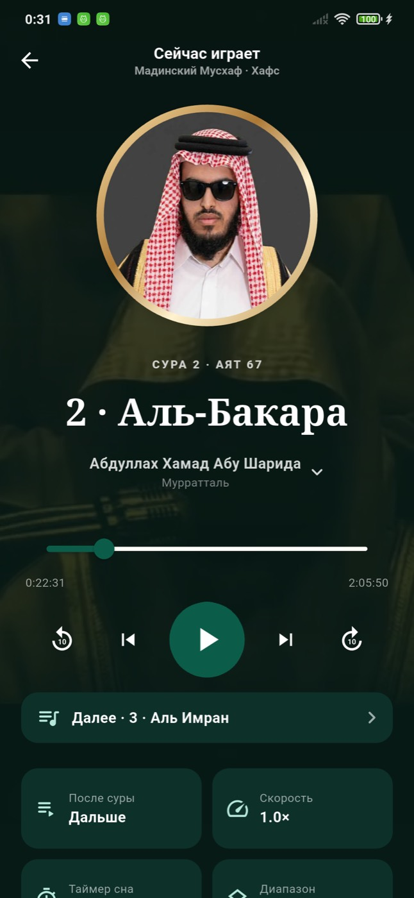
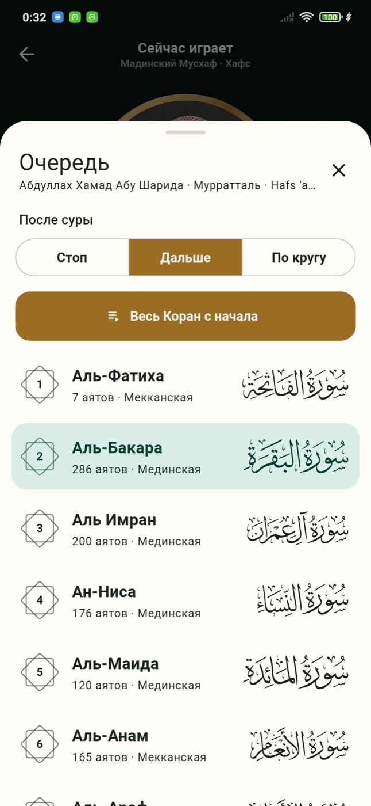
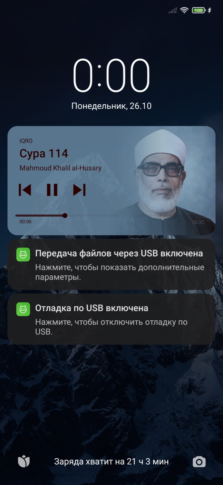
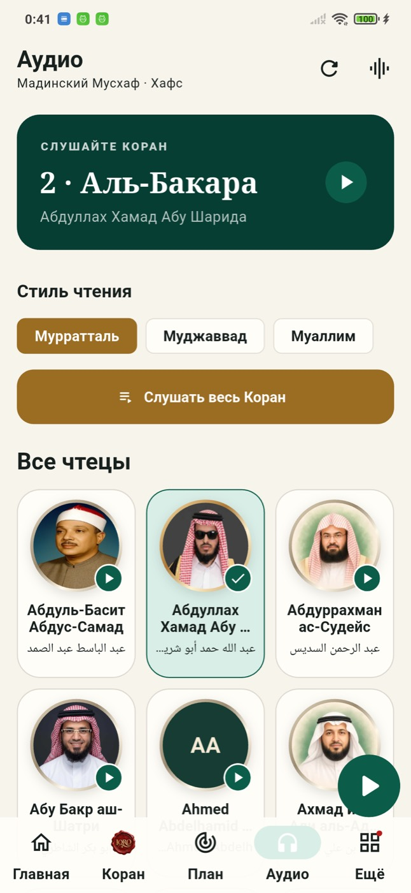
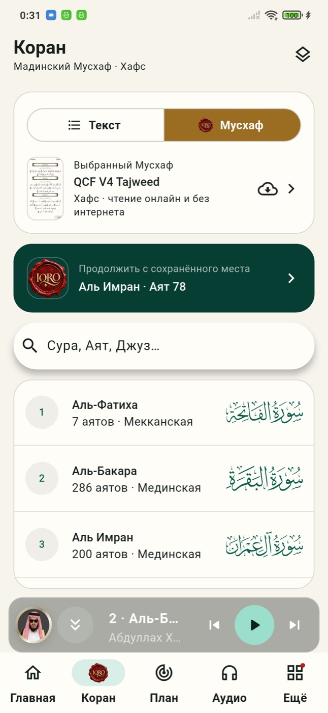
