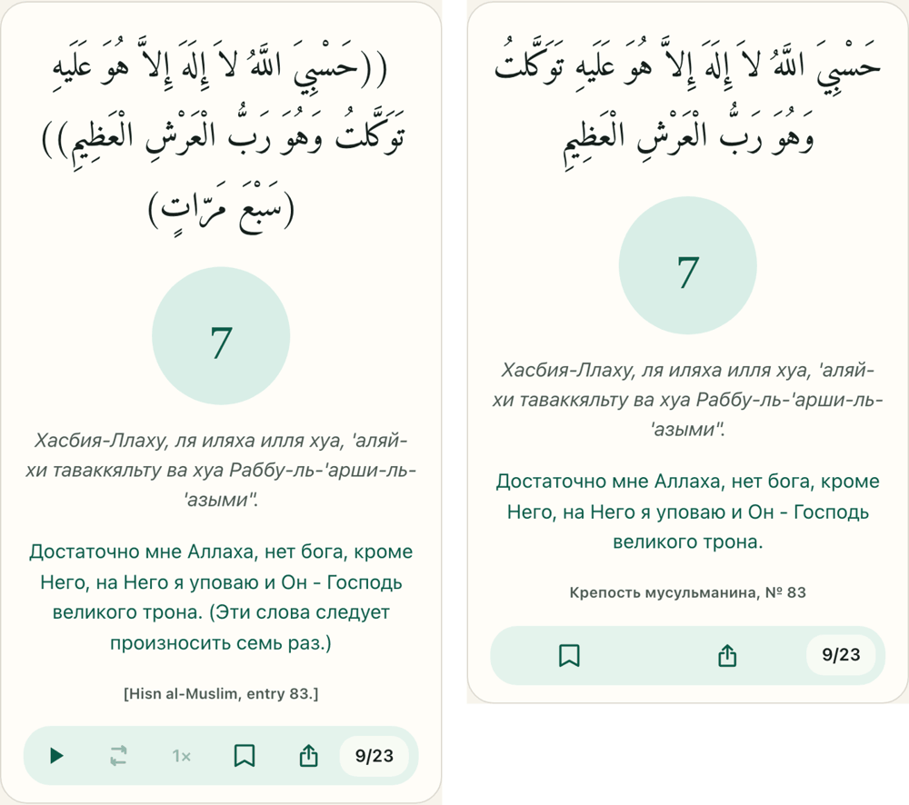
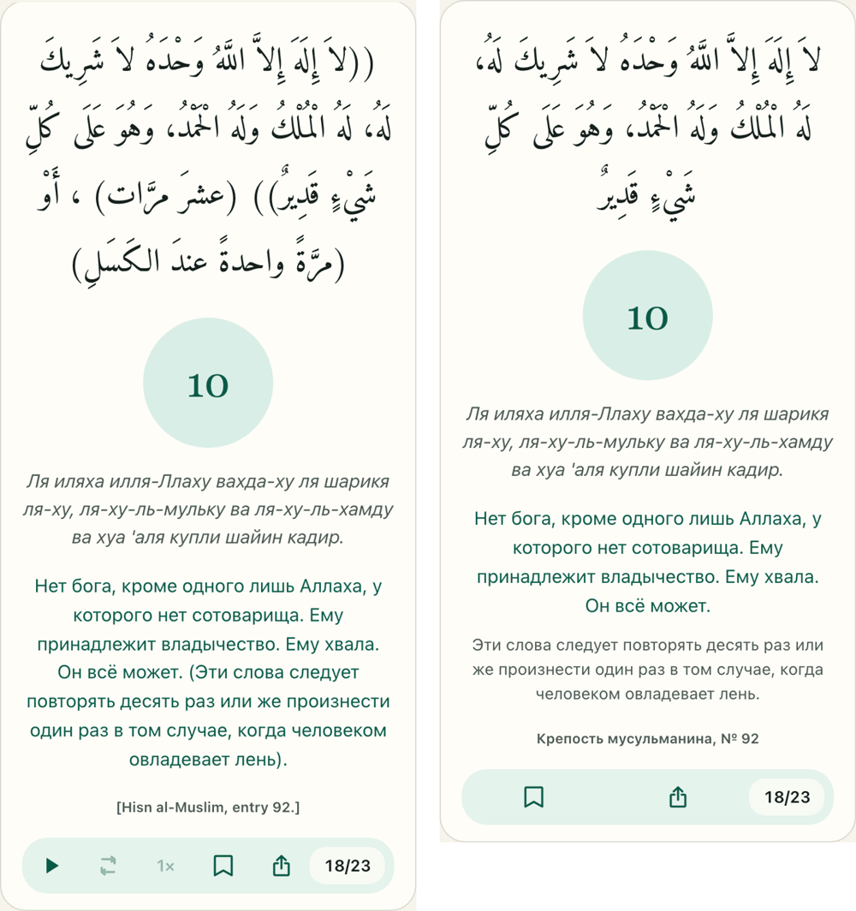
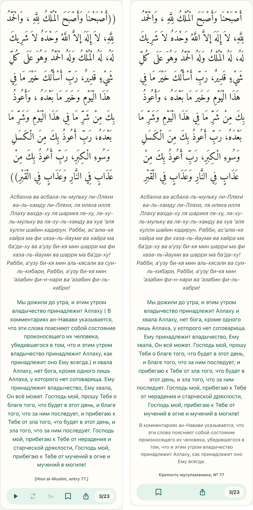
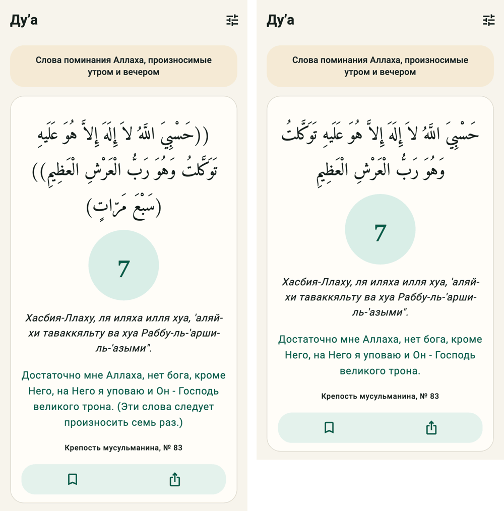
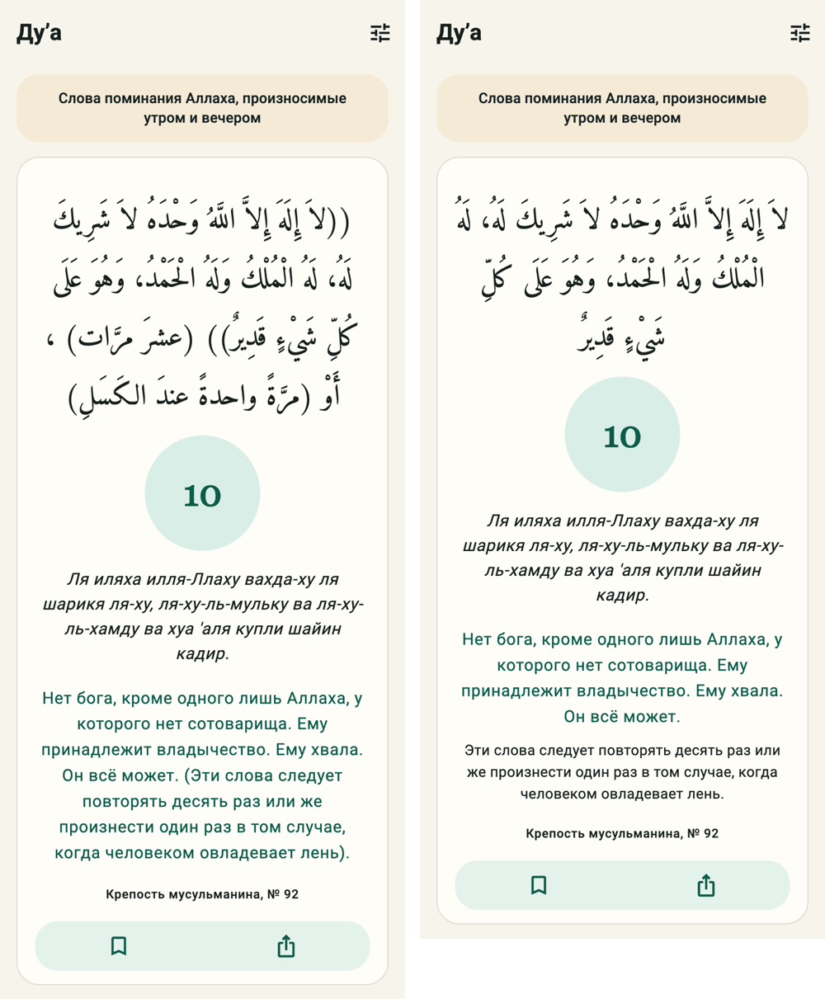
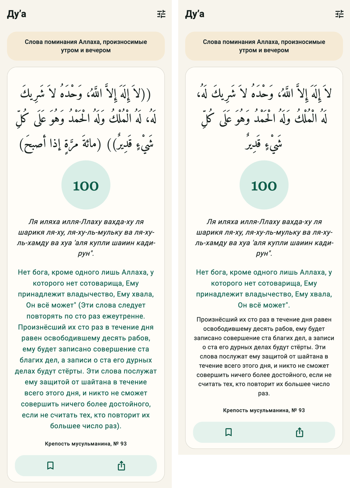

# Тексты ду’а без скобок

Сделано 4 ноября 2026 года по просьбе владельца («что за скобки везде в дуа? … надо убрать»).
Затронуты обе коллекции — «Крепость мусульманина» (Хисн аль-Муслим) и «Мольбы из Корана» —
на всех четырёх языках, на сайте и в приложении.

## Что было

Тексты пришли из источников со скобками:

- арабский ду’а обёрнут в двойные скобки `(( … ))`, а за ним в скобках стоит число повторов —
  `(ثلاثَ مرَّاتٍ)`, `(مائةَ مرَّةٍ إذا أصبحَ)`;
- в квадратных скобках — добавки из других риваятов: `[وَلَكَ الْحَمْدُ]`, «[Hamd sanadır]»;
- в переводах в скобках пояснения переводчика («умертвил нас (то есть, послал нам сон…)»),
  указания («(Эти слова следует повторять трижды. …)»), ссылки на суры, номера аятов «( 1 )»,
  пометки о времени суток («(Это следует говорить утром.)»);
- строка источника под карточкой — по-английски и в квадратных скобках: «[Hisn al-Muslim,
  entry 75.]».

## Как убрано

Правила одни для всех языков:

1. `(( ))` вокруг ду’а убраны. Там, где в одной записи несколько цитат с повествованием между
   ними (хадисы о хадже, о посещении больного), цитата взята в кавычки «…».
2. Пометка о повторах убрана, если счётчик показывает то же число. Если в пометке есть то, чего
   счётчик не передаёт («или один раз, когда одолевает лень», «по сто раз в день», «после
   утренней и закатной молитвы»), она стала примечанием. Если число в пометке относится только
   к части текста или не совпадает со счётчиком («Астагфиру-Ллах — трижды» при одном повторе),
   оно осталось в тексте после тире.
3. Добавки из других риваятов `[ … ]` остались словами, без скобок.
4. Короткие вставки переводчика («[presently]», «(meydana gelecek olan)») — без скобок, на
   месте; пояснения в одну фразу — через тире или запятые («— то есть послал нам сон…, —»);
   длинные пояснения, польза хадиса, указания и ссылки на суры — в примечание.
5. В главе 27 (утренние и вечерние азкары) пометки о времени суток убраны там, где их видно в
   карточках «Утренние/Вечерние азкары» (варианты из `docs/dua/morning-evening-readings-2026-11-03.md`
   и записи 94, 95, 97, у которых вариантов нет). В полной главе 27 книги текст — утренний,
   а вечерние слова стоят в примечании: «Вечером: …» / «In the evening: …» / «وإذا أمسى قال: …».
6. Орнаментальные скобки ﴿ ﴾ вокруг аятов Корана оставлены: так принято обозначать цитату из
   Корана. Кавычки «» тоже.
7. Ни одно слово ду’а и перевода не переписано: менялись только скобки, знаки препинания вокруг
   них, удалённые пометки о повторах и времени и перенос пояснений в примечание. Это проверено
   пословным сравнением «было → стало + примечание» по каждой правке.

Не трогали то, что к скобкам не относится: цифры сносок в турецком тексте («Kürsüsü1»),
переносы («şerrin-den»), непарные кавычки и заголовки следующих глав, попавшие в текст
источника (например, в записях 26, 32, 51, 115). Это отдельная чистка.

## Примечание под переводом

- Новое поле `note` у `DuaEntryTranslation` и `DuaEntryTimeVariant` (миграция
  `dua/0010_dua_text_without_brackets`, в админке — «Примечание под переводом»).
- API отдаёт его в `translation.note` и в каждом `time_variants.<время>.note`.
- Карточка показывает его отдельной строкой под переводом, мельче и приглушённым цветом: сайт —
  `.dua-note` в `DuaEntryCard.tsx`, приложение — `dua-note` в `dua_screen.dart`.
- Переключатель «Перевод» в «Что показывать» прячет и примечание. На арабском перевода нет,
  поэтому арабское примечание видно всегда.
- «Поделиться» отправляет текст без скобок; примечание в карточку для отправки не входит, а
  строка источников в ней прежняя — как в окне источника.

## Данные

- Очищенные тексты лежат в
  `services/backend/src/quran_backend/modules/dua/data/dua_text_cleanup_v1.json`: по записи и
  языку — `meaning_text`, `transliteration`, `note`, а для арабского — `arabic_text` (смысл
  арабского издания — сам ду’а, миграция ставит его равным арабскому тексту). Так же и для
  утренних и вечерних вариантов. 206 записей «Крепости мусульманина», 26 мольб из Корана.
- Миграция `dua/0010` записывает их в базу. Чистка данными, а не скрытием скобок при показе:
  сайт и приложение читают один и тот же текст, поиск ищет по нему же, а решения по каждой
  записи (что в примечание, что убрать) сделаны вручную — кодом их не повторить.
- Исходные файлы книги (`hisn_al_muslim_full_v1.json`, `supplications_from_quran_jmapps_v1.json`)
  не менялись: их защищает контрольная сумма миграции 0004/0008, и по ним видно, что было.
- Файл привязан к версиям `hisn-full-2026-08-28` и `jmapps-bd4eef1`. Новая версия сборника из
  `import_dua_catalog` придёт со скобками источника — для неё чистку нужно повторить.
- Тест `test_published_dua_texts_have_no_brackets` проверяет, что ни в одном опубликованном
  тексте, переводе, транскрипции и примечании скобок нет.
- Приложение подняло версию кэша ду’а (`_entryCacheVersion` → `v5`), иначе до истечения
  кэша показывало бы старый текст.

## Строка источника

Под карточкой — на языке интерфейса и без скобок:

| Сборник | ru | en | tr | ar |
|---|---|---|---|---|
| Хисн аль-Муслим | Крепость мусульманина, № 75 | Hisn al-Muslim, No. 75 | Hısnu'l-Müslim, No. 75 | حصن المسلم، رقم 75 |
| Мольбы из Корана | Коран, 2:126 | Quran 2:126 | Kur'an, 2:126 | القرآن، 2:126 |

Полные ссылки — хадисы, сноски книги, адрес издания — по-прежнему открываются по нажатию на эту
строку. Сайт — `duaReference` в `lib/dua-presentation.ts`, приложение — `duaReference` в
`dua_presentation.dart`.

## Примеры

Правок около 600 (запись × язык × поле), поэтому полный список здесь не приводится: «было» —
исходные файлы книги, «стало» — `dua_text_cleanup_v1.json`, по номеру записи их легко сравнить.
Несколько характерных случаев:

| № | Где | Было | Стало |
|---|---|---|---|
| 83 | AR | «((حَسْبِيَ اللَّهُ … الْعَظِيمِ)) (سَبْعَ مَرّاتٍ).» | «حَسْبِيَ اللَّهُ … الْعَظِيمِ.» — счётчик показывает 7 |
| 83 | RU | «…Господь великого трона. (Эти слова следует произносить семь раз.)» | «…Господь великого трона.», примечания нет |
| 92 | AR | «((لاَ إِلَهَ إِلاَّ اللَّهُ …)) (عشرَ مرَّات) ، أَوْ (مرَّةً واحدةً عندَ الكَسَلِ).» | текст без скобок; примечание «عشرَ مرَّات، أَوْ مرَّةً واحدةً عندَ الكَسَلِ.» |
| 92 | RU | «…Он всё может. (Эти слова следует повторять десять раз или же произнести один раз в том случае, когда человеком овладевает лень).» | «…Он всё может.»; примечание — та же фраза без скобок |
| 86 | RU, утро | «…Слышащий, Знающий!" ( Эти слова следует повторять трижды. Ничто не повредит тому, кто станет повторять их по три раза утром. )» | текст без пояснения; примечание «Ничто не повредит тому, кто станет повторять эти слова по три раза утром.» |
| 1 | RU | «…Он умертвил нас (то есть, послал нам сон, являющийся братом смерти), и к Нему воскресение.» | «…Он умертвил нас — то есть послал нам сон, являющийся братом смерти, — и к Нему воскресение.» |
| 32 | TR | «…efendisisin. [Hamd sanadır. Sen göklerin, yerin … Rabbisin] [Hamd sanadır. …]» | те же слова без квадратных скобок |
| Коран 8 | RU | «Прошу Тебя защитить ее (Марьям) и ее потомство…» | «Прошу Тебя защитить ее — Марьям — и ее потомство…» |
| 75 | источник | «[Hisn al-Muslim, entry 75.]» | «Крепость мусульманина, № 75» |

Как проверено:

- **Пословное сравнение.** Каждую часть правок (арабский; русский, английский и турецкий — по
  две части) прогнал скрипт: «было» против «стало + примечание». Пропавшие слова — только
  пометки о повторах и времени суток, добавленные — только связки («то есть», «Вечером:»).
- **Независимая вычитка.** Отдельные проверяющие прочитали весь список по каждому языку. Их
  замечания внесены, кроме возврата пометок о времени суток в записи 94, 95, 97: эти записи
  стоят прямо в карточках утра или вечера.
- **Итоговая проверка.** Миграции 0004 → 0009 → 0010 проиграны на исходных данных: ни в одной
  из 1376 строк (запись × язык × книга/утро/вечер) скобок нет, и ни одна утренняя или вечерняя
  карточка не упоминает другое время суток.

## Снимки

Слева — как было, справа — как стало; телефон 390 px, русский интерфейс, карточка «Утренние
азкары».

- Сайт: слева — прод `iqro.forum/ru/dua/topics/morning` 4 ноября до выкладки, справа — сборка
  этой ветки с очищенными текстами главы 27 (кнопок аудио справа нет только потому, что у
  тестовых данных нет записей).
- Приложение: экран ду’а с текстом записи до и после чистки (оба снимка — с кодом этой ветки,
  поэтому строка источника уже по-русски с обеих сторон).

| | |
|---|---|
| № 83, сайт: счётчик 7, пометка «семь раз» ушла |  |
| № 92, сайт: «или один раз при лени» — в примечании |  |
| № 77, сайт: пояснение ан-Навави — в примечании |  |
| № 83, приложение |  |
| № 92, приложение |  |
| № 93, приложение: «по сто раз ежеутренне» ушло, польза — в примечании |  |
