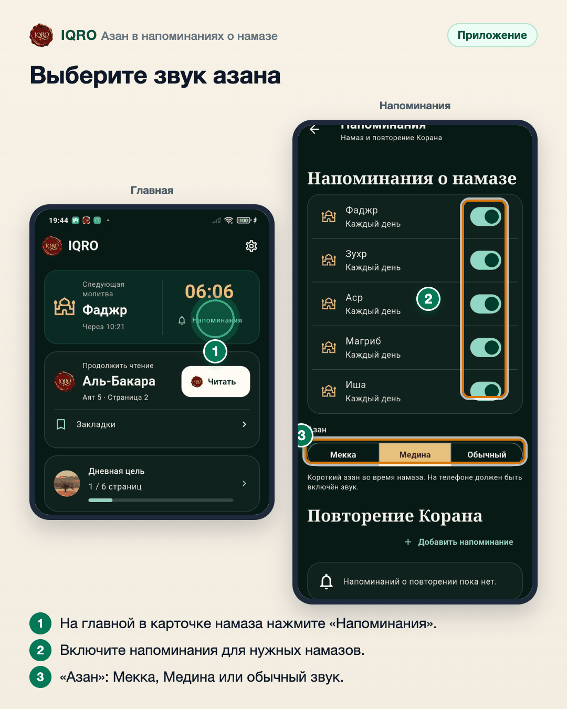

# Азан в напоминаниях о намазе

Напоминание о намазе может звучать коротким азаном. Выберите азан Мекки или Медины — или обычный звук уведомления.

**Где найти:** «Главная» → карточка намаза → «Напоминания» (или «Ещё» → «Время намаза» → «Напоминания о намазе»).

**Сайт и приложение:** это приложение. На телефоне должен быть включён звук уведомлений: если он выключен, приложение предупредит об этом.

## Выберите звук азана

Откройте «Напоминания» из карточки намаза на главной. Включите напоминания для тех намазов, о которых нужно напомнить, и выберите звук в строке «Азан»: азан Мекки, азан Медины или обычный звук уведомления. Короткий азан прозвучит во время намаза — если на телефоне включён звук.

---

Основа снимков: Redmi, IQRO Test 1.0.4 (сборка из main 59c9b99b), 4 ноября 2026.
