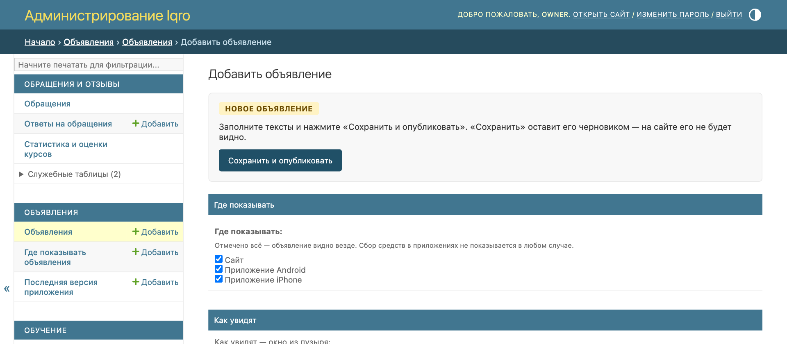
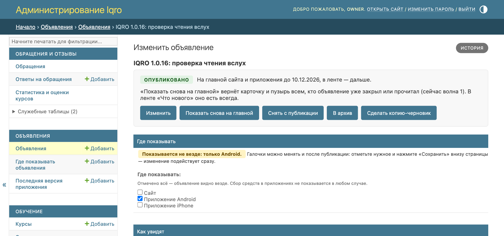
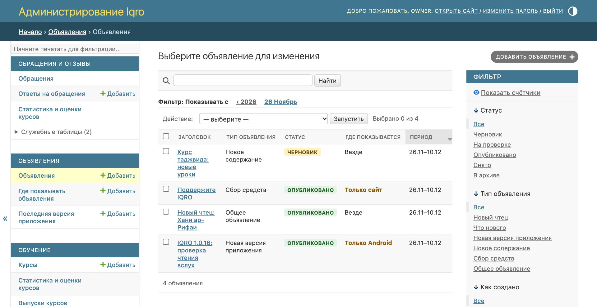
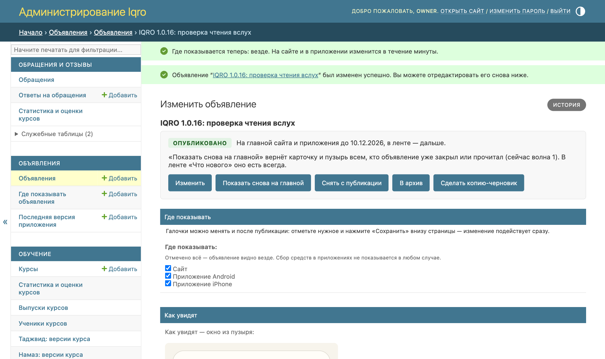

# Админка: где показывать объявление

Картинки для владельца и сотрудников: как выбрать, где видно объявление — на сайте, в приложении Android, в приложении iPhone. Это не карточки для постов, а обычные снимки экрана.

Админка → «Объявления» → нужное объявление. Блок «Где показывать» стоит вверху страницы, сразу под панелью «Публикация».

## 1. Новое объявление: отмечено всё

Три галочки: «Сайт», «Приложение Android», «Приложение iPhone». У нового объявления отмечены все — оно будет видно везде. Снимите галочку, только если объявление действительно не для всех, например про функцию, которой нет на сайте.

## 2. Пометка, если показывается не везде

Если отмечено не всё, над галочками жёлтая пометка: «Показывается не везде: только Android». Галочки доступны и у опубликованного объявления: «Изменить» нажимать не нужно.

## 3. В списке объявлений

В списке есть столбец «Где показывается»: «Везде» или, жёлтым, «Только Android», «Только сайт» и так далее. Сбор средств всегда «Только сайт»: в приложениях он не показывается.

## 4. Поменяли и сохранили

Отметьте нужное и нажмите «Сохранить» внизу страницы. Вверху появится «Где показывается теперь: везде». На сайте и в приложении изменение видно в течение минуты. Публиковать заново не нужно: те, кто объявление уже закрыл, снова его не увидят, счётчики показов остаются.

Убрать объявление отовсюду — кнопка «Снять с публикации»: она выключает его и на сайте, и в приложениях сразу.
