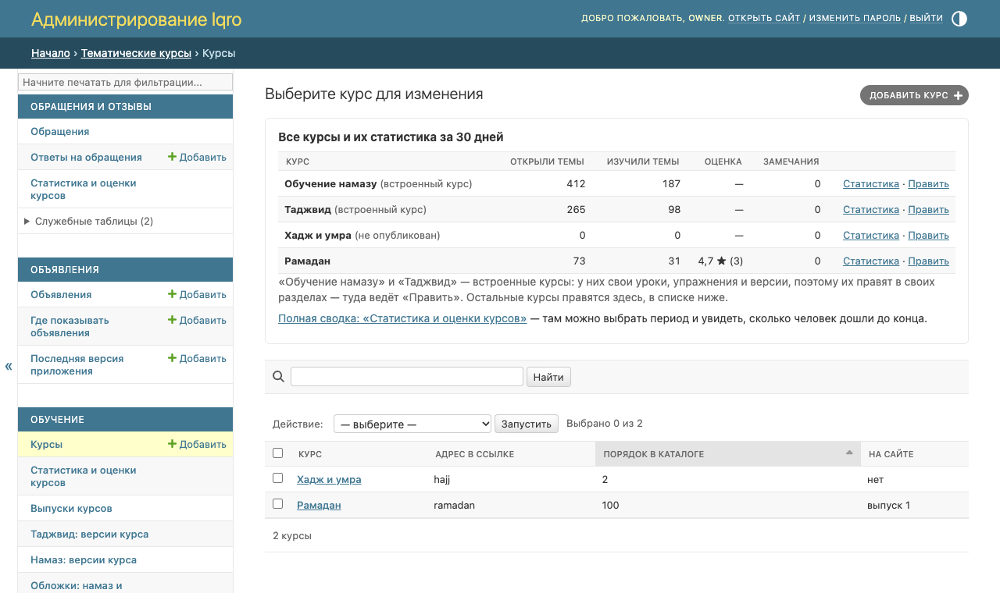
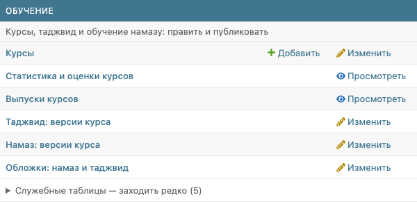

# Админка: все курсы и их статистика в одном месте

Картинки для владельца и сотрудников, не для постов пользователям. Снимки сделаны на локальной копии с примерными цифрами, не с рабочего сайта.

**Где найти:** админка → плитка «Курсы» (или раздел «Обучение» → «Курсы»).

## 1. Все курсы на одной странице

1. Сверху таблица «Все курсы и их статистика за 30 дней»: сначала «Обучение намазу» и «Таджвид», потом курсы каталога.
2. У каждого курса короткие цифры: сколько раз открыли темы, сколько раз отметили изученными, средняя оценка и число замечаний. У намаза и таджвида оценки нет — там прочерк.
3. «Статистика» открывает подробную страницу курса: по каким темам идут и где бросают.
4. «Править» у курса каталога открывает его карточку. У «Обучения намазу» и «Таджвида» — их собственный раздел с версиями: это встроенные курсы, у них свои уроки и упражнения, поэтому правят их там.
5. «Полная сводка» под таблицей открывает «Статистика и оценки курсов» — там можно выбрать 7, 30 или 90 дней.
6. Ниже — обычный список курсов каталога с поиском, как раньше.

Цифры и ссылки «Статистика» видит тот, у кого есть право смотреть статистику курсов (владелец, «Редактор курсов», «Публикатор»). Остальным сотрудникам показываются только названия курсов.

## 2. Статистика рядом с курсами

«Статистика и оценки курсов» теперь стоит и в разделе «Обучение», сразу под «Курсами». В разделе «Обращения и отзывы» она тоже осталась — это одна и та же страница.
