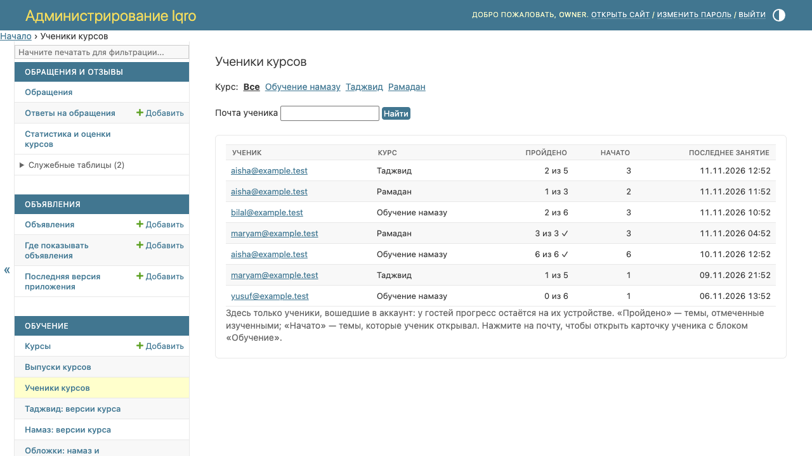
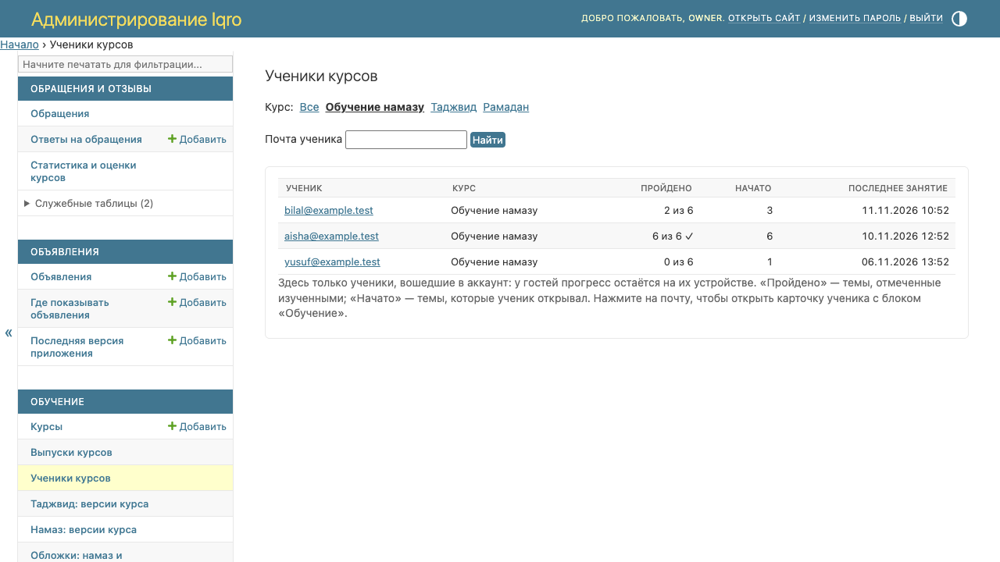
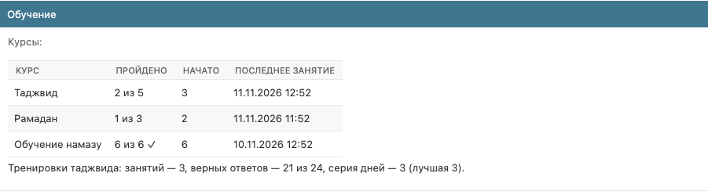

# Админка: ученики курсов и их прогресс

Картинки для владельца и сотрудников, не для постов пользователям. Снимки сделаны на локальной копии с выдуманными учениками, не с рабочего сайта.

**Где найти:** админка → раздел «Обучение» → «Ученики курсов».

**Кто видит:** владелец и сотрудники с правом просмотра прогресса учеников (в списке прав — `courses | … | view_learnerprogress`). Редакторам курсов оно по умолчанию не выдано — добавьте его нужному сотруднику или группе в «Пользователи и доступ».

**Кто попадает в список:** только ученики, вошедшие в аккаунт. У гостей прогресс остаётся на их устройстве. Строка появляется, когда ученик открывает курс в обновлённом приложении или на сайте.

## 1. Все ученики

1. Одна строка — один ученик в одном курсе. Сверху те, кто занимался последним.
2. «Пройдено» — сколько тем отмечено изученными из тех, что сейчас есть в курсе. Галочка — курс пройден целиком.
3. «Начато» — сколько тем ученик открывал.
4. Поиск по почте — поле «Почта ученика».

## 2. Ученики одного курса

Нажмите название курса в строке «Курс» над таблицей. То же откроется по ссылке «Ученики этого курса» на странице статистики курса.

## 3. Карточка ученика

Нажмите на почту ученика в списке. Внизу карточки пользователя — блок «Обучение»: все его курсы и итоги тренировок таджвида (сколько занятий, сколько верных ответов, сколько дней подряд занимается).

Всё только для чтения: изменить или удалить прогресс ученика из админки нельзя. Он удаляется вместе с аккаунтом.
