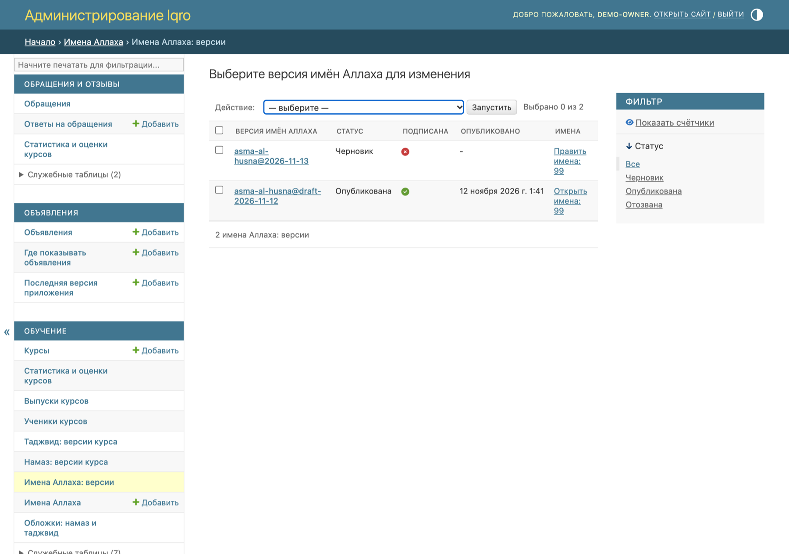
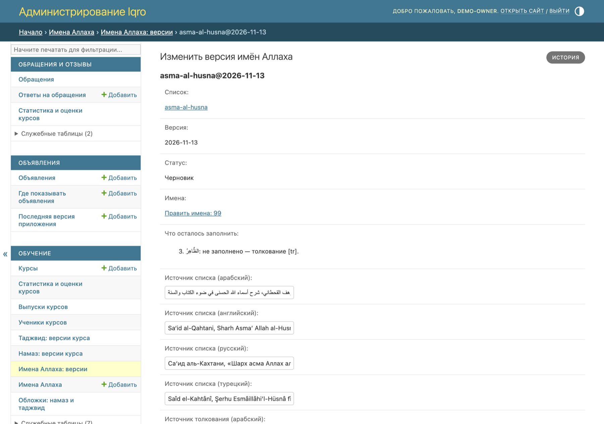
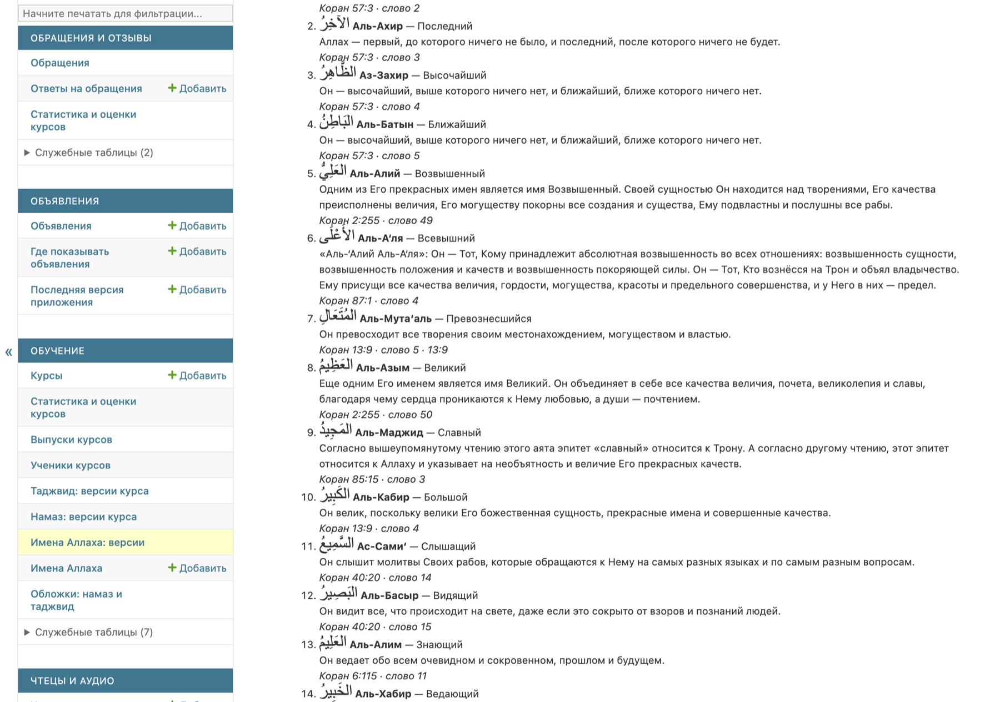
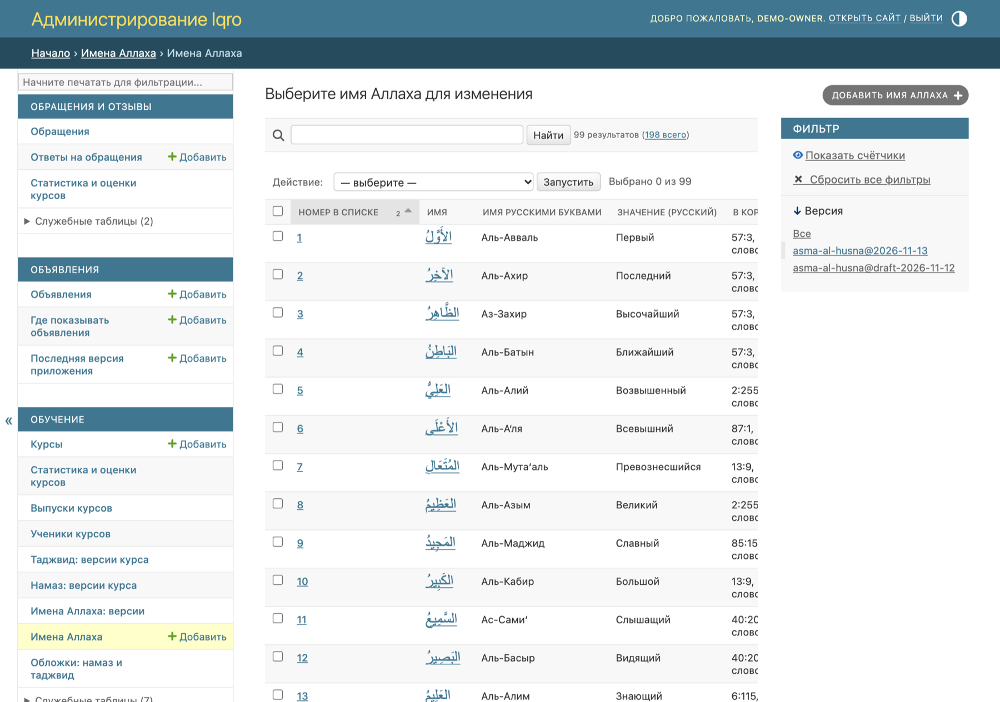
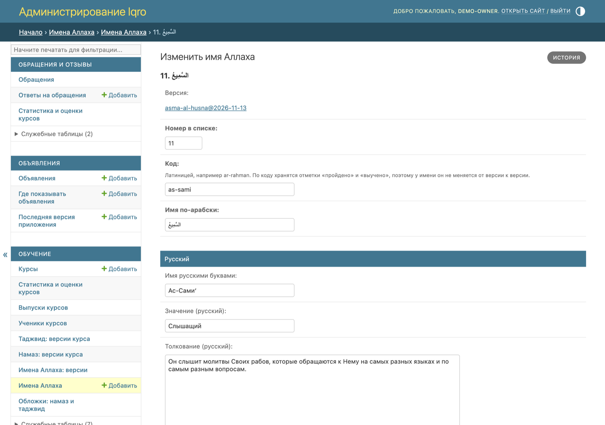

# Админка: имена Аллаха

Картинки для владельца и сотрудников, не для постов пользователям. Снимки сделаны на локальной копии с черновиком списка, не с рабочего сайта.

**Где найти:** админка → раздел «Обучение» → «Имена Аллаха: версии» и «Имена Аллаха».

**Главное правило:** на сайте и в приложении виден только опубликованный список. Черновик можно править сколько угодно; подписанная и опубликованная версии не меняются. Чтобы исправить опубликованное, создают черновик-копию, правят его, подписывают и публикуют — он заменит прежний список.

## 1. Версии списка

1. Каждая строка — версия списка: черновик, опубликованная или отозванная.
2. Отметьте версию галочкой и выберите действие вверху: «Подписать: религиозная проверка пройдена», «Опубликовать» или «Создать черновик-копию для правок».
3. «Править имена» в строке открывает имена этой версии.

## 2. Страница версии

1. «Что осталось заполнить» — список того, без чего версию нельзя подписать: не переведённые тексты, пропущенные номера. Когда всё готово, здесь написано «Всё заполнено».
2. Ниже — книги-источники на четырёх языках: книга списка и книга толкований. Их называет каждая карточка имени.

## 3. Список для проверки

Внизу страницы версии — все имена по-русски подряд: арабское написание, имя, значение, толкование, аят и номер слова. Прочитайте его перед подписью: после подписи версия уже не правится.

## 4. Имена версии

«Имена Аллаха» открывают имена той версии, над которой идёт работа: черновика, а если его нет — опубликованной. Нажмите на номер или имя, чтобы править. Справа можно выбрать другую версию.

## 5. Правка имени

1. Сверху — номер в списке, код (латиницей, не меняется от версии к версии) и имя по-арабски.
2. Дальше блоки по языкам: имя буквами языка, значение и толкование.
3. «В Коране и звук»: сура, аят и номер слова, которое произносит чтец. Если номер слова пуст, в карточке не будет кнопки «Слушать»; если пусты сура и аят — не будет ссылки «В Коране».
4. «Источник толкования» заполняют, только если текст этого имени взят не из книги, указанной у версии.
