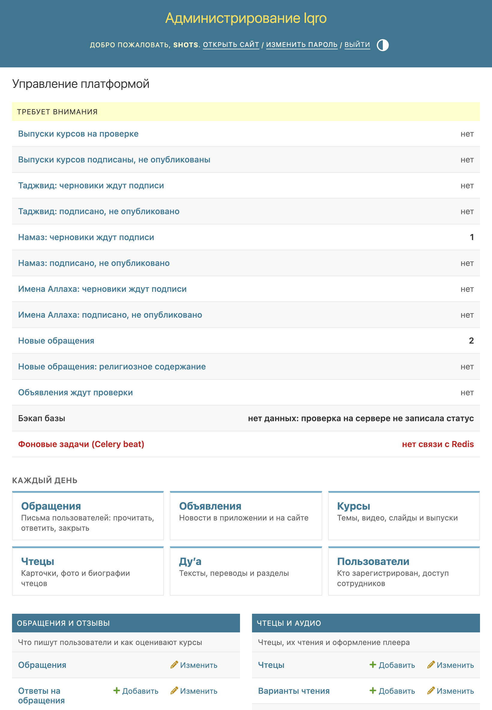
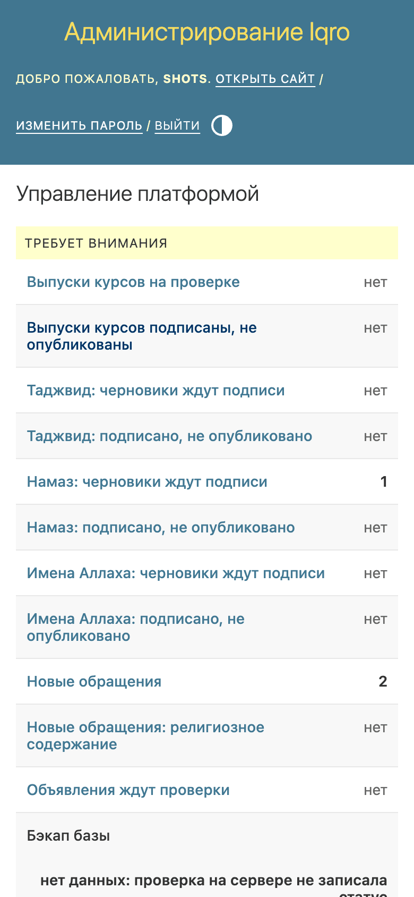
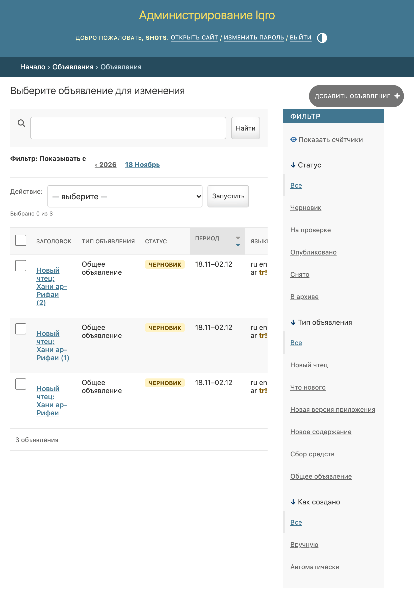
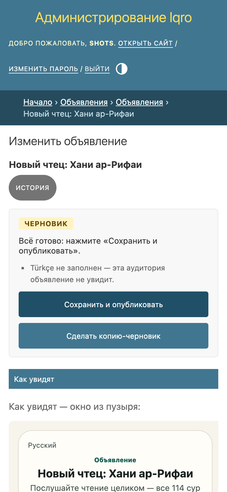
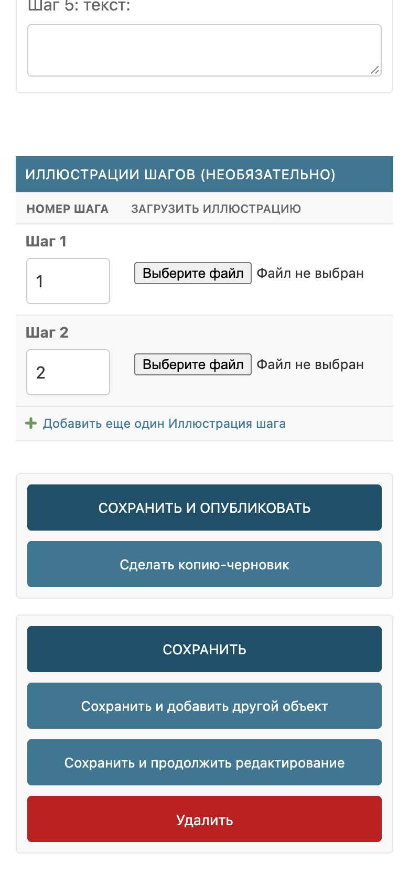

# Админка на телефоне и планшете

Картинки для владельца и сотрудников: как выглядит админка на планшете и телефоне. Это не карточки для постов, а обычные снимки экрана. На компьютере ничего не изменилось.

## 1. Главная на планшете

1. «Требует внимания» и плитки «Каждый день» занимают всю ширину экрана.
2. Разделы идут в две колонки. Каждую строку удобно нажать пальцем.
3. Боковой панели слева нет — она занимала треть экрана. Вернуться к разделам: «Начало» в тёмной полосе под шапкой.

## 2. Главная на телефоне

Всё в одну колонку: сначала «Требует внимания», потом плитки по две в ряд, ниже разделы. Длинный ответ (например, про бэкап) переносится под свою строку.

## 3. Список на планшете

1. Поиск и кнопка «Добавить» — сверху, фильтр — справа.
2. Если таблица шире экрана, двигайте пальцем саму таблицу влево-вправо: страница при этом стоит на месте.
3. На телефоне фильтр находится под таблицей — прокрутите вниз.

## 4. Объявление на телефоне

Вверху — состояние объявления и кнопки публикации во всю ширину. Ниже — предпросмотр и поля: подпись над полем, поле во всю ширину экрана.

## 5. Кнопки сохранения

Внизу формы те же кнопки: «Сохранить и опубликовать», «Сохранить», «Удалить». Они стоят одна под другой и не закрывают поля.
