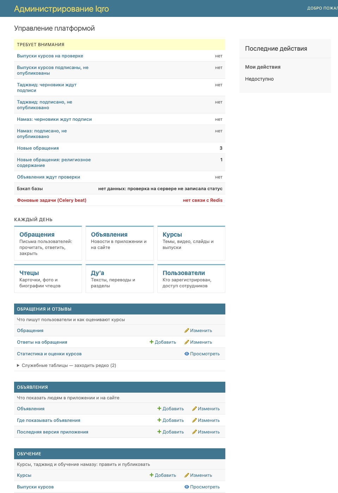
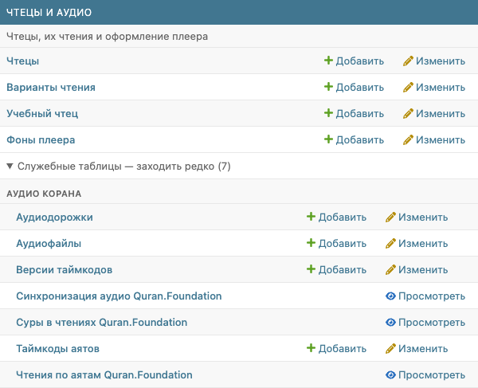
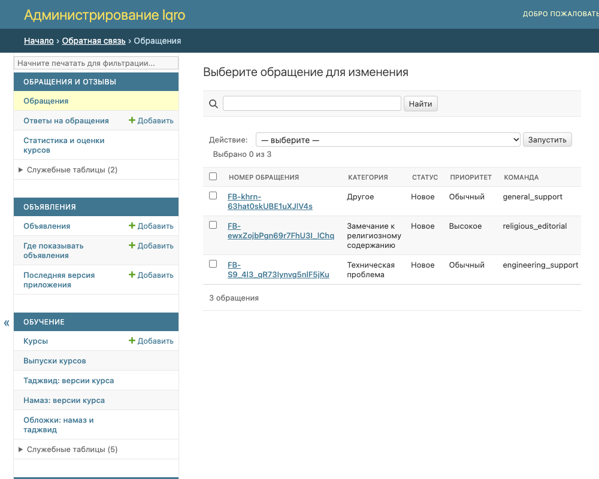

# Админка: разделы и главные таблицы

Картинки для владельца и сотрудников: как устроена главная страница админки. Это не карточки для постов, а обычные снимки экрана.

## 1. Главная страница

1. «Требует внимания» — что ждёт вашего действия. Нажмите строку, откроется готовый список.
2. «Каждый день» — шесть плиток с тем, куда заходят чаще всего: обращения, объявления, курсы, чтецы, ду’а, пользователи.
3. Ниже — восемь разделов. Под названием раздела написано, что в нём делают, затем идут главные таблицы.

## 2. Служебные таблицы

Журналы, версии и технические таблицы свёрнуты в строку «Служебные таблицы — заходить редко». Нажмите её, чтобы раскрыть. Число в скобках — сколько там таблиц.

## 3. Боковая панель

Слева на любой странице те же разделы и главные таблицы. Поле «Начните печатать…» ищет по всем таблицам, в том числе служебным.
