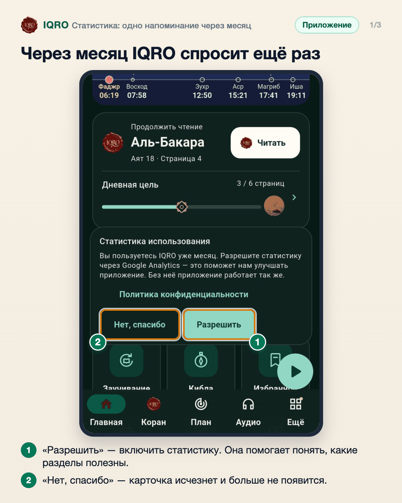
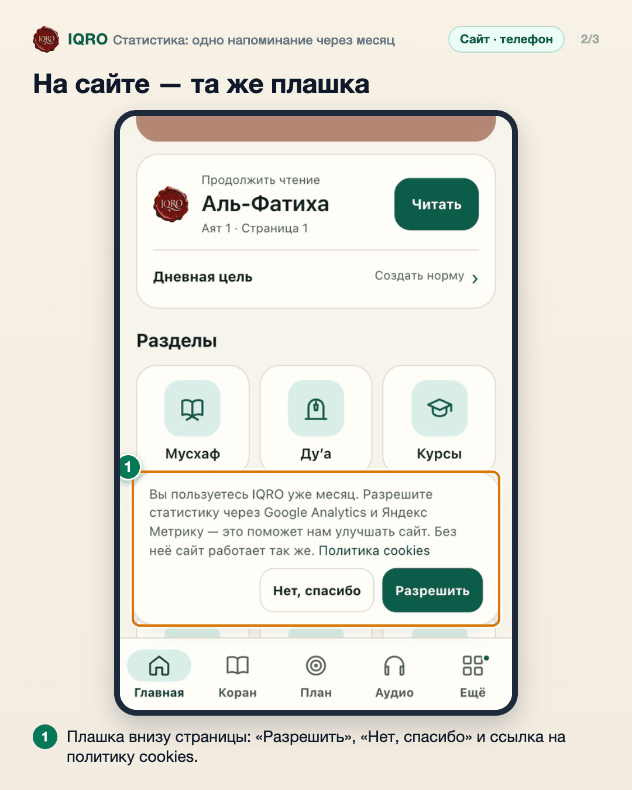
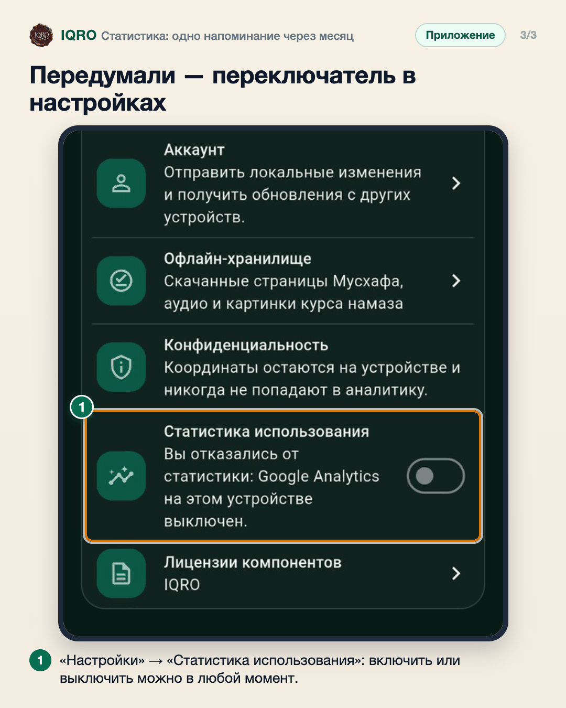

# Статистика: одно напоминание через месяц

IQRO считает использование только с вашего согласия. Если вы отказались, через месяц IQRO один раз спросит ещё раз — вдруг вы передумали. Ответ «Нет, спасибо» окончательный: больше вопрос не появится. Всё в приложении и на сайте работает одинаково при любом ответе.

**Где найти:** карточка над нижним меню в приложении, плашка внизу страницы на сайте. Появляется не раньше чем через 30 дней после отказа и только если вы открывали IQRO хотя бы в 5 разных дней.

**Сайт и приложение:** в приложении выбор меняется в «Настройках» → «Статистика использования», на сайте — на странице «Политика cookies».

## Через месяц IQRO спросит ещё раз

Если вы отказались от статистики, через месяц над нижним меню один раз появится карточка с тем же вопросом. Она ничего не закрывает: можно ответить сразу или пользоваться приложением дальше. Приложение работает одинаково при любом ответе.

## На сайте — та же плашка

На сайте iqro.forum всё так же: через месяц после отказа плашка внизу страницы один раз спросит снова. После «Нет, спасибо» она больше не появится.

## Передумали — переключатель в настройках

Выбор всегда можно поменять самому: в приложении — шестерёнка на главной, строка «Статистика использования»; на сайте — страница «Политика cookies».

---

Основа снимков: приложение — Redmi Note 7, сборка этой ветки поверх «IQRO тест» 1.0.14, 21 ноября 2026, отказ 31 день назад задан для снимка; сайт — локальная сборка этой ветки, 21 ноября 2026.
