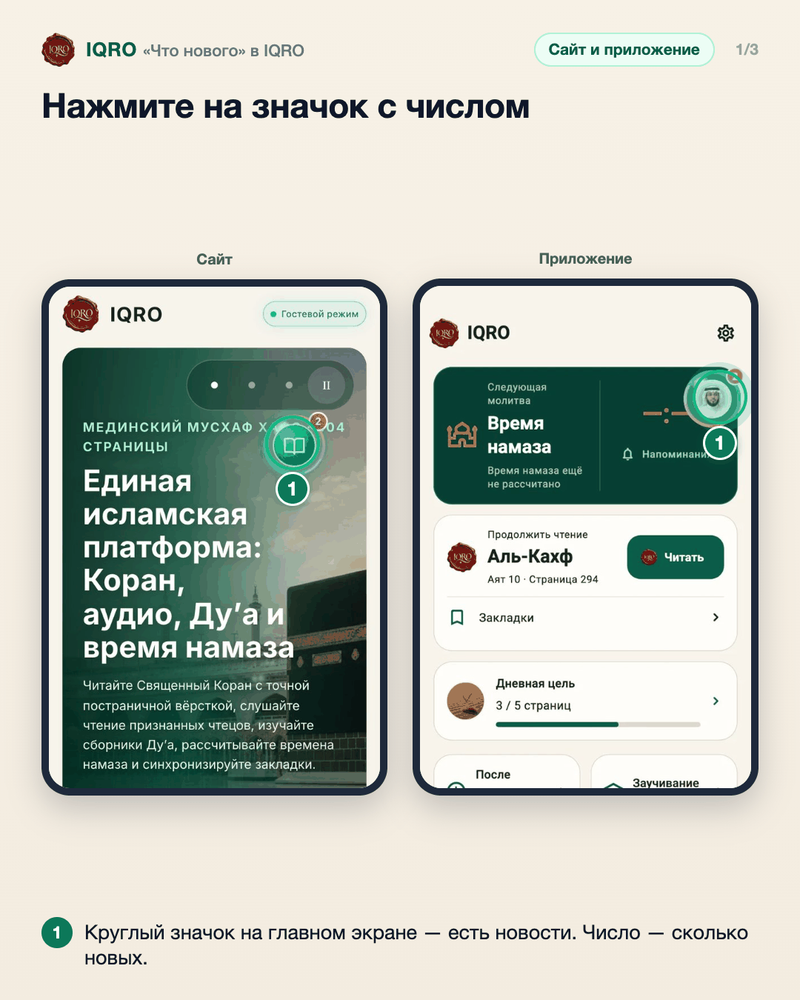
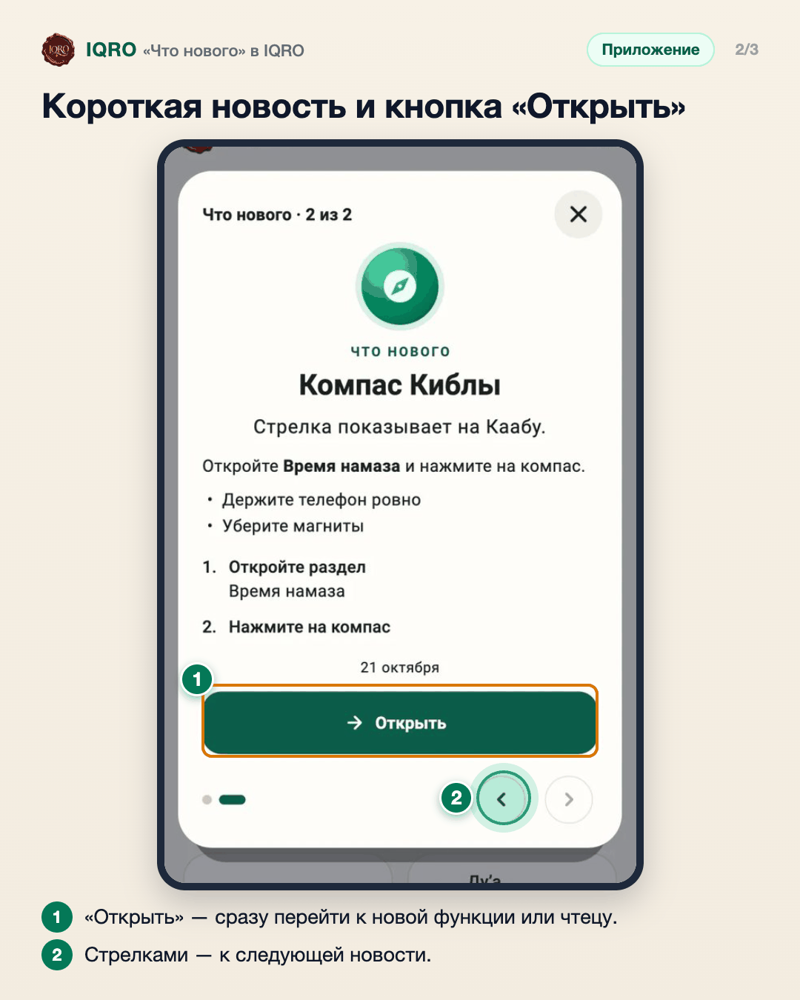
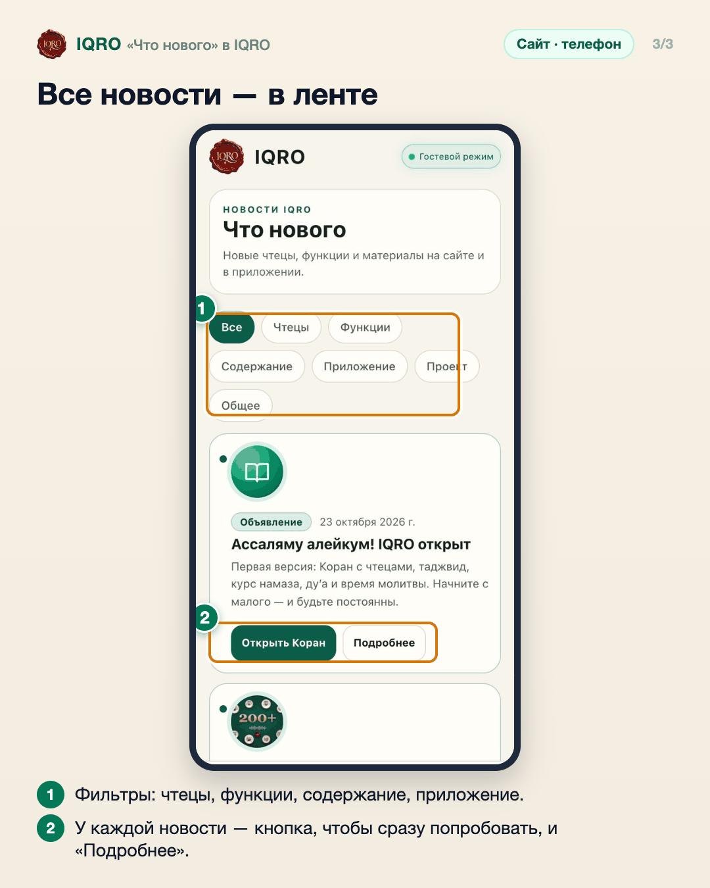

# «Что нового» в IQRO

О новых чтецах, функциях и материалах IQRO рассказывает сам: на главном экране появляется круглый значок с числом новостей. Все новости собраны в ленте «Что нового».

**Где найти:** значок на главном экране; лента — «Ещё» → «Что нового» (на компьютере — кнопка «Что нового» вверху).

**Сайт и приложение:** на телефоне — плавающий значок, на компьютере — карточка на главной и кнопка «Что нового» в шапке. Новостей на почту IQRO не присылает.

## Нажмите на значок с числом

Когда в IQRO появляется что-то новое, на главном экране плавает круглый значок с числом непрочитанных новостей. Нажмите на него.

## Короткая новость и кнопка «Открыть»

Откроется окно с новостью: что появилось и как этим пользоваться. Кнопка «Открыть» ведёт прямо туда, стрелки внизу листают новости.

## Все новости — в ленте

В ленте «Что нового» — все новости по порядку. Фильтры сверху оставляют только нужное: новые чтецы, функции, материалы. У каждой новости есть кнопка действия и «Подробнее».

---

Основа снимков: сайт iqro.forum, 4 ноября 2026; приложение — `docs/announcements/screenshots/`.
