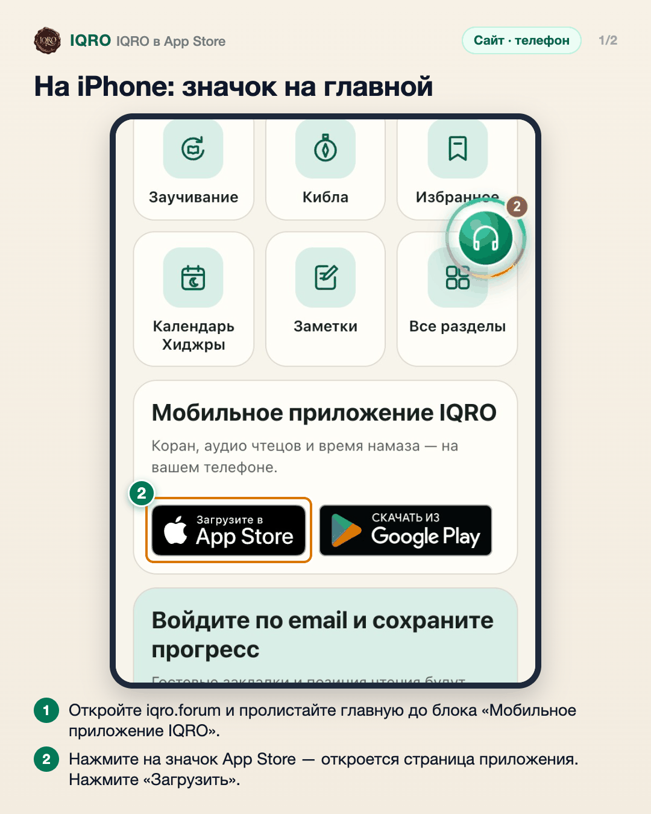

# IQRO в App Store

Приложение IQRO для iPhone и iPad можно установить прямо с сайта: нажмите на значок App Store — откроется страница приложения в магазине.

**Где найти:** главная страница сайта iqro.forum — блок «Мобильное приложение IQRO» под разделами; на других страницах значок внизу. В Safari на iPhone и iPad вверху сайта появится полоска IQRO с кнопкой «Загрузить» или «Открыть».

**Сайт и приложение:** значок есть только на сайте — он ведёт в приложение. Рядом остаётся значок Google Play для Android.

## На iPhone: значок на главной

Откройте iqro.forum на iPhone, пролистайте главную до блока «Мобильное приложение IQRO» и нажмите на значок App Store. Откроется страница приложения — останется нажать «Загрузить». В Safari то же самое можно сделать из полоски IQRO вверху страницы.

## На компьютере: на главной и внизу других страниц

На компьютере значок App Store стоит на главной в блоке приложения и внизу остальных страниц. Нажмите на него — страница приложения откроется в новой вкладке; оттуда приложение можно найти на iPhone по названию IQRO.

---

Основа снимков: сайт iqro.forum (локальная сборка с включённой ссылкой на App Store), 27 ноября 2026. Полоску Safari рисует сам iPhone, на снимках её нет.
