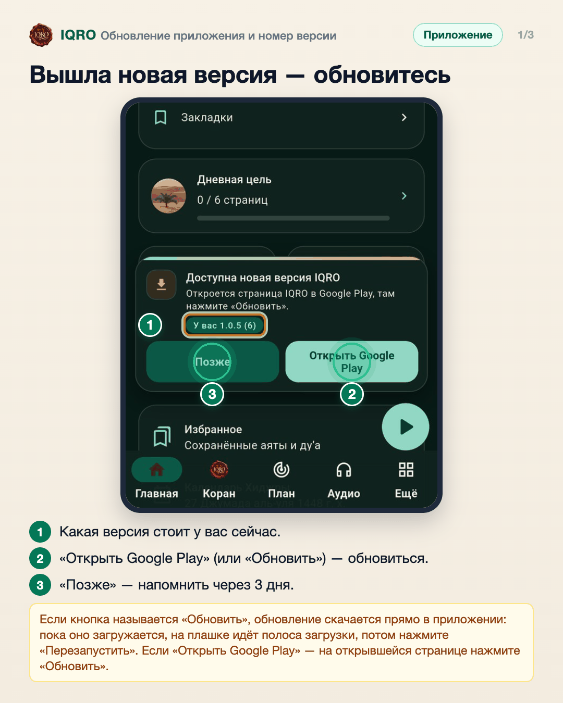
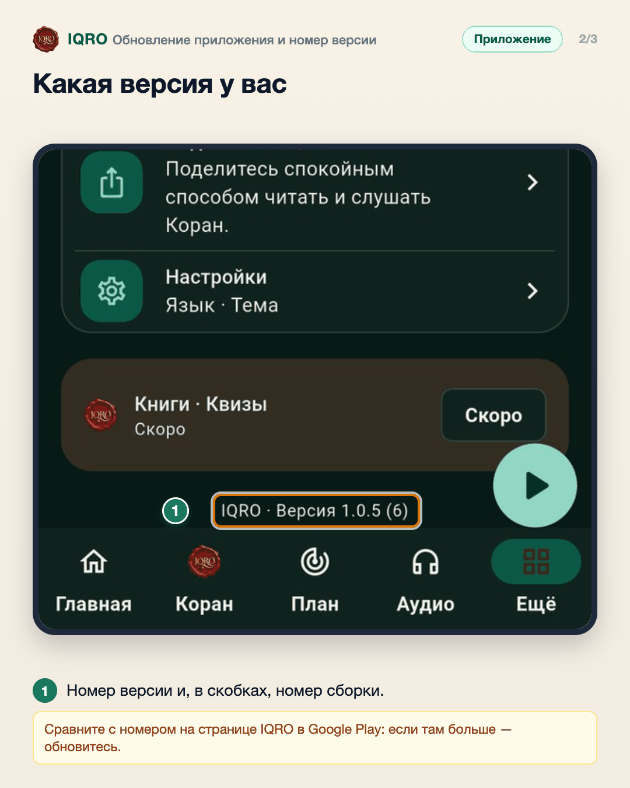
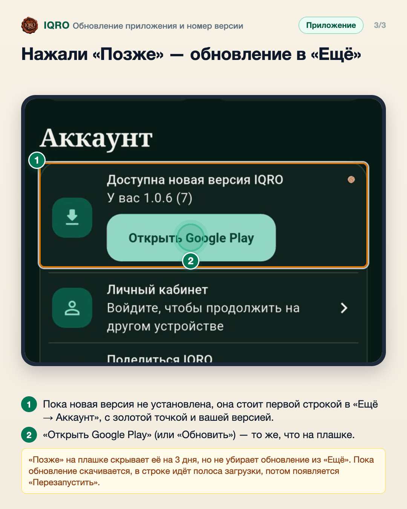

# Обновление приложения и номер версии

Когда выходит новая версия IQRO, внизу главного экрана появляется плашка «Доступна новая версия IQRO». На ней видно, какая версия стоит у вас, и одной кнопкой можно обновиться. Пока обновление не установлено, его всегда можно найти в «Ещё → Аккаунт», даже после «Позже». Номер версии всегда видно внизу экрана «Ещё».

**Где найти:** плашка — над нижней панелью, при запуске приложения; обновление — «Ещё», первая строка «Аккаунта»; номер версии — «Ещё», в самом низу.

**Сайт и приложение:** это только в приложении для Android из Google Play. Сайт обновляется сам.

## Вышла новая версия — обновитесь

Когда выходит новая версия IQRO, внизу экрана появляется плашка. На ней видно, какая версия стоит у вас. Нажмите «Открыть Google Play» и там «Обновить» — или «Обновить» прямо на плашке: обновление скачается в фоне, потом нажмите «Перезапустить». «Позже» скроет плашку на 3 дня.

## Какая версия у вас

Номер установленной версии виден в самом низу экрана «Ещё»: например, «IQRO · Версия 1.0.5 (6)». Если в Google Play версия новее, обновите приложение.

## Нажали «Позже» — обновление в «Ещё»

Скрыли плашку кнопкой «Позже»? Обновление никуда не делось: откройте «Ещё» — первой строкой в «Аккаунте» стоит «Доступна новая версия IQRO» с кнопкой обновления.

---

Основа снимков: Redmi, сборка «IQRO тест» 1.0.5 (6), 7 ноября 2026; плашка вызвана для снимка (сервер называет сборку 7). «Ещё»: Redmi, «IQRO тест» 1.0.6 (7), 8 ноября 2026; обновление вызвано для снимка (сервер называет сборку 8).
