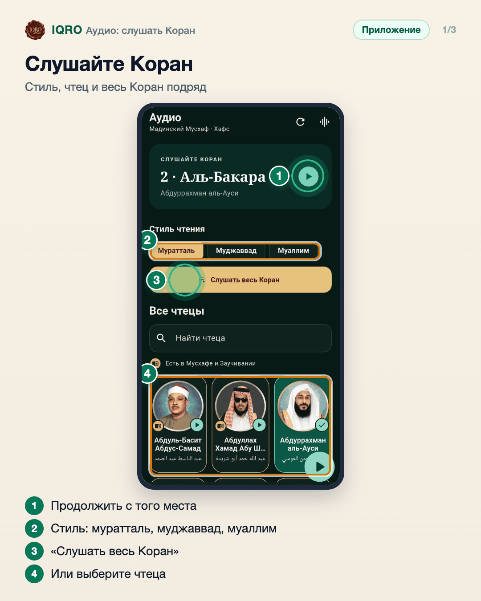
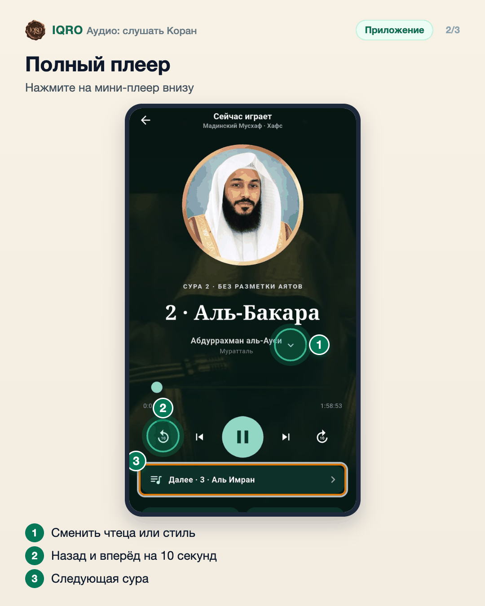
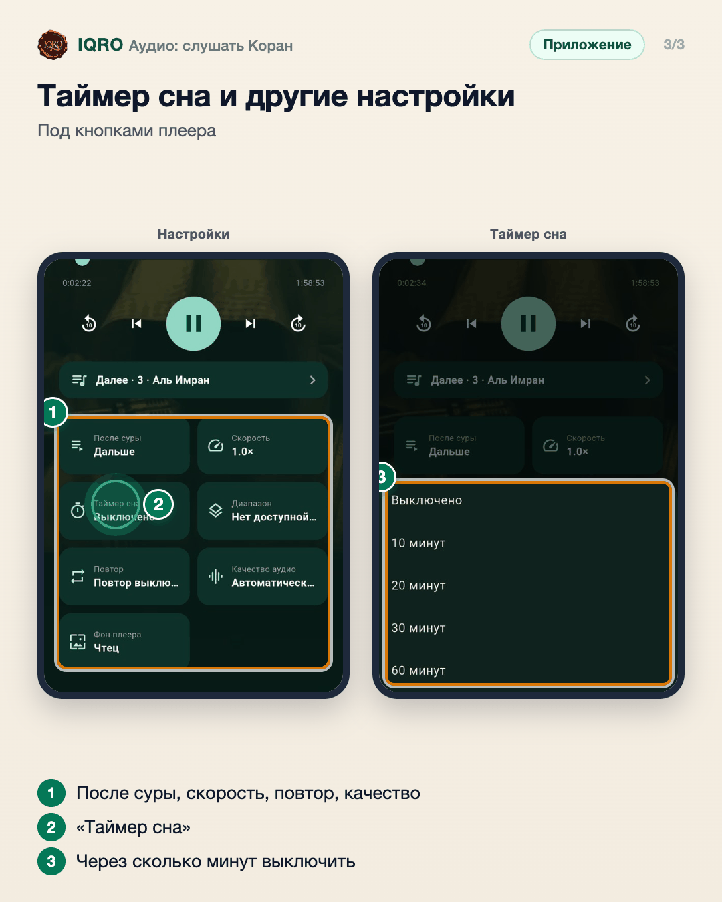

# Аудио: слушать Коран

Во вкладке «Аудио» — чтение Корана десятков чтецов. Выберите стиль: муратталь — обычное чтение, муджаввад — напевное, муаллим — медленное для заучивания, повтор за чтецом. «Слушать весь Коран» включает суры подряд. В полном плеере — смена чтеца, очередь сур, скорость, таймер сна, повтор и качество звука.

**Где найти:** нижняя панель → «Аудио»; полный плеер — нажмите на мини-плеер внизу экрана.

**Сайт и приложение:** на сайте тот же раздел: iqro.forum → «Аудио»; плеер с теми же настройками.

## Слушайте Коран

Вверху — сура, на которой вы остановились: нажмите ▶, чтобы продолжить. Выберите стиль чтения: муратталь — обычное, муджаввад — напевное, муаллим — медленное, удобно повторять за чтецом. «Слушать весь Коран» включает суры подряд, ниже — все чтецы.

## Полный плеер

Полный плеер открывается нажатием на мини-плеер. Стрелка у имени чтеца меняет чтеца и стиль, кнопки по бокам перематывают на 10 секунд, строка «Далее» показывает, какая сура будет следующей.

## Таймер сна и другие настройки

Ниже в плеере: что включать после суры, скорость, таймер сна, повтор, качество звука и фон плеера. Таймер сна выключит чтение через 10, 20, 30 или 60 минут — удобно слушать перед сном.

## Для рилс и подробного рассказа

- `reels/` — кадры 9:16 (1080×1920) по порядку: обложка, по кадру на каждый экран с его шагами, финальный кадр.
- `screens/` — чистые экраны без отметок, в полном размере: из них можно делать свои анимации.
- `video/` — запись экрана телефона, без звука: как это выглядит вживую.

Заголовок для ролика: **Коран в исполнении любимого чтеца**. Текст за кадром — подписи к карточкам выше, по порядку.

---

Основа снимков: Redmi, сборка «IQRO тест» из main 9048ca87, 9 ноября 2026; строка состояния телефона обрезана.
