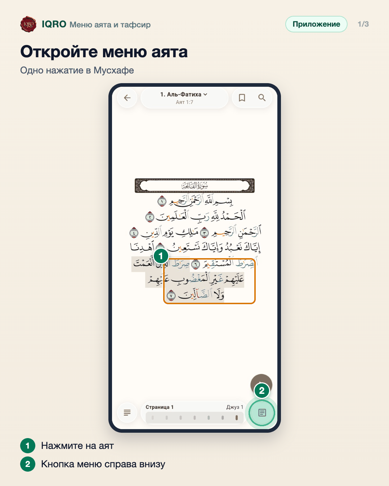
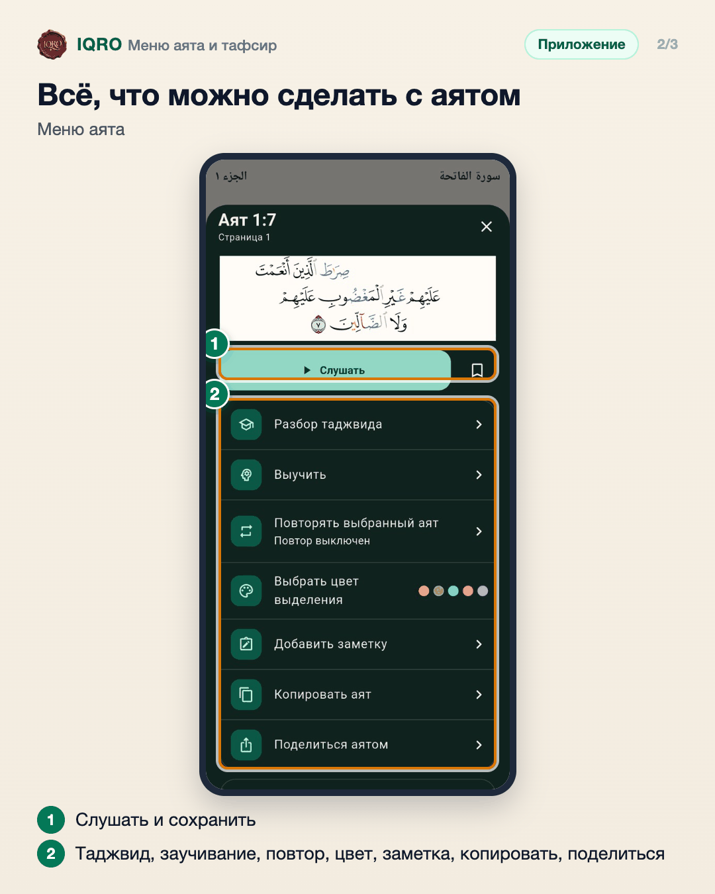
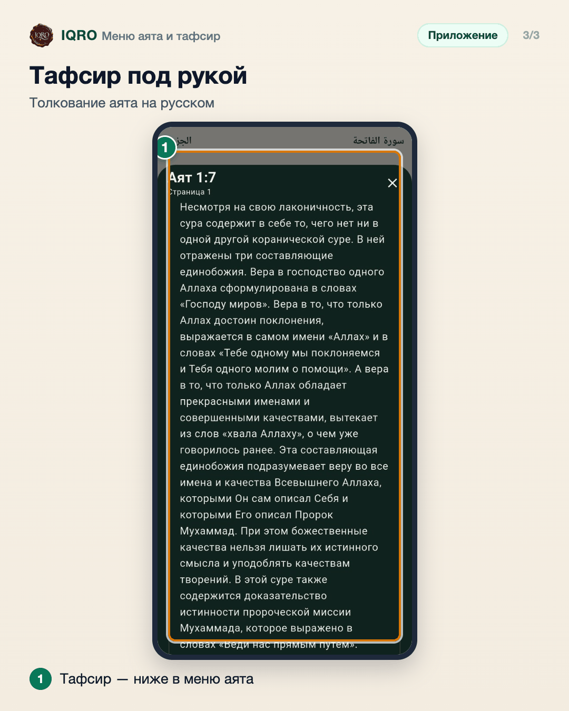

# Меню аята и тафсир

В Мусхафе у каждого аята есть своё меню: прослушать, сохранить, разобрать таджвид, добавить в заучивание, повторять, выделить цветом, добавить заметку, скопировать и поделиться. Ниже в том же окне — тафсир: толкование аята на русском.

**Где найти:** Мусхаф → нажмите на аят → кнопка меню справа внизу.

**Сайт и приложение:** на сайте меню аята открывается нажатием на аят в Мусхафе; тафсир там тот же.

## Откройте меню аята

Нажмите на аят в Мусхафе — он подсветится, а внизу появятся кнопки. Кнопка справа внизу открывает меню этого аята.

## Всё, что можно сделать с аятом

Слушать и сохранить в избранное — сверху. Ниже: разбор таджвида, «Выучить» — добавить в заучивание, повтор выбранного аята, цвет выделения, заметка, копирование и «Поделиться аятом».

## Тафсир под рукой

Прокрутите меню аята ниже — там тафсир: объяснение смысла аята. Не нужно искать книгу — толкование открывается прямо в Мусхафе.

## Для рилс и подробного рассказа

- `reels/` — кадры 9:16 (1080×1920) по порядку: обложка, по кадру на каждый экран с его шагами, финальный кадр.
- `screens/` — чистые экраны без отметок, в полном размере: из них можно делать свои анимации.
- `video/` — запись экрана телефона, без звука: как это выглядит вживую.

Заголовок для ролика: **Всё об аяте в одном окне**. Текст за кадром — подписи к карточкам выше, по порядку.

---

Основа снимков: Redmi, сборка «IQRO тест» из main 9048ca87, 9 ноября 2026; строка состояния телефона обрезана.
