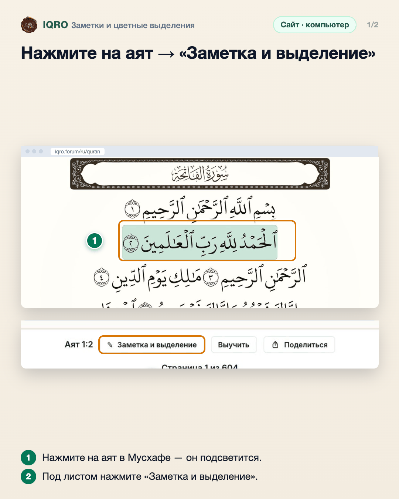
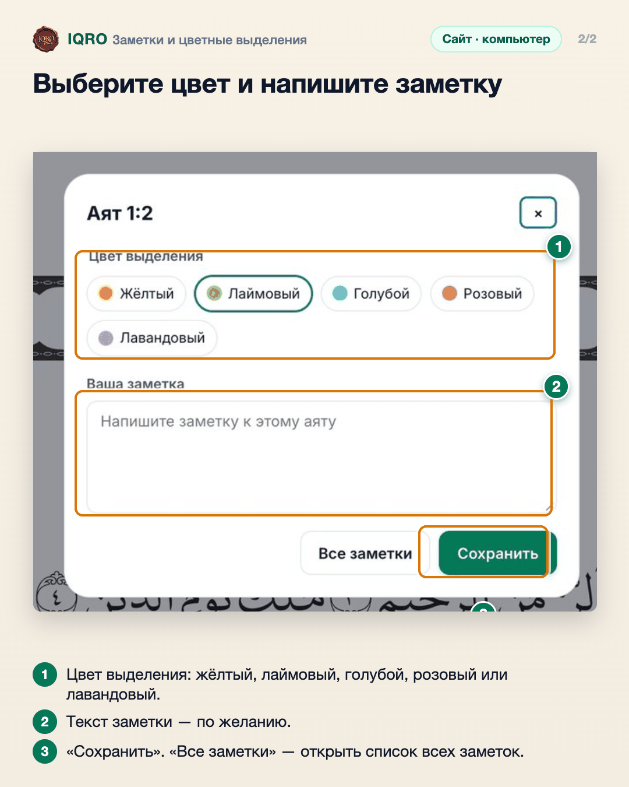

# Заметки и цветные выделения

Аят в Мусхафе можно выделить цветом и записать к нему свою заметку. Все заметки собраны на одной странице, а после входа в аккаунт они есть и в приложении, и на сайте.

**Где найти:** Мусхаф → нажмите на аят → «Заметка и выделение»; все заметки — «Все заметки» или раздел «Заметки».

**Сайт и приложение:** одинаково на сайте и в приложении. Чтобы заметки были на всех устройствах, войдите в аккаунт.

## Нажмите на аят → «Заметка и выделение»

Нажмите на нужный аят в Мусхафе. Под листом появится строка с номером аята — нажмите «Заметка и выделение».

## Выберите цвет и напишите заметку

Выберите цвет — аят на листе будет подсвечен им. Ниже можно написать заметку. Нажмите «Сохранить». Кнопка «Все заметки» открывает раздел со всеми вашими заметками; цвет можно снять там же, где ставили.

## Для рилс и подробного рассказа

- `reels/` — кадры 9:16 (1080×1920) по порядку: обложка, по кадру на каждый экран с его шагами, финальный кадр.
- `screens/` — чистые экраны без отметок, в полном размере: из них можно делать свои анимации.
- `video/` — запись экрана телефона, без звука: как это выглядит вживую.

Заголовок для ролика: **Свои заметки к аятам**. Текст за кадром — подписи к карточкам выше, по порядку.

---

Основа снимков: сайт iqro.forum, 4 ноября 2026.
