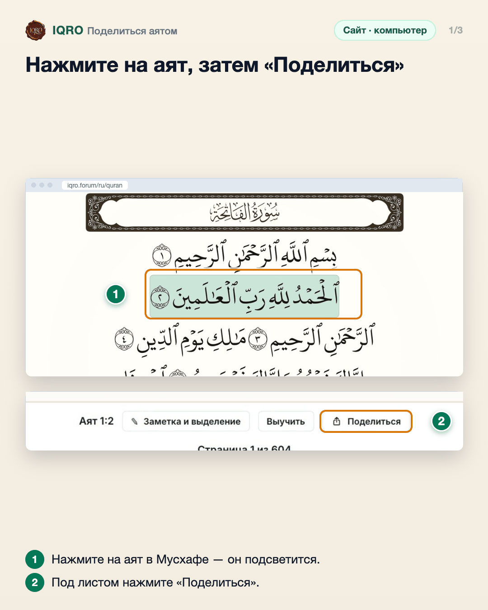
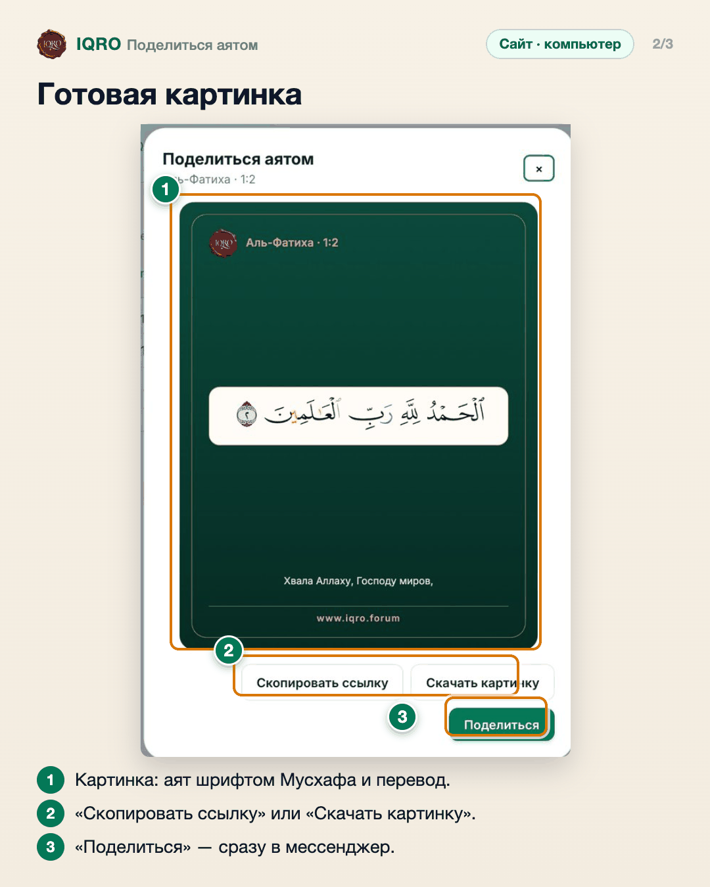
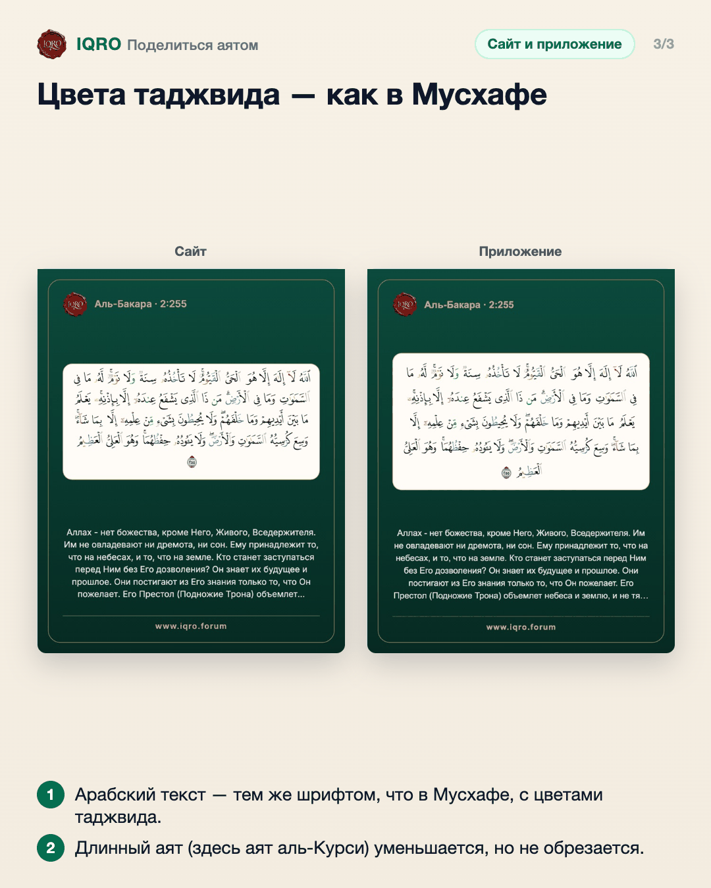

# Поделиться аятом

Любой аят можно отправить красивой картинкой: арабский текст шрифтом Мусхафа с цветами таджвида, смысловой перевод и адрес iqro.forum. Или просто ссылкой и текстом.

**Где найти:** нажмите на аят в Мусхафе или в тексте → «Поделиться» (в приложении — «Поделиться аятом» в меню аята).

**Сайт и приложение:** на сайте кнопка «Поделиться» появляется под листом рядом с номером аята; в приложении — в меню, которое открывается нажатием на аят.

## Нажмите на аят, затем «Поделиться»

На сайте нажмите на нужный аят — он подсветится зелёным. Под листом появится строка «Аят 1:2» с кнопками; нажмите «Поделиться». В текстовом режиме кнопка стоит у каждого аята.

## Готовая картинка

Откроется окно с готовой картинкой. Ссылку можно скопировать, картинку — скачать или сразу отправить кнопкой «Поделиться». Получатель с приложением IQRO откроет ссылку прямо в приложении.

## Цвета таджвида — как в Мусхафе

Так выглядит картинка аята аль-Курси (2:255) с сайта и из приложения: название суры и номер аята, арабский текст шрифтом Мусхафа с цветами таджвида на светлой «бумаге», перевод и www.iqro.forum внизу.

---

Основа снимков: сайт iqro.forum, 4 ноября 2026; готовые картинки — `docs/images/ayah-share-tajweed-2026-11-03/`.
