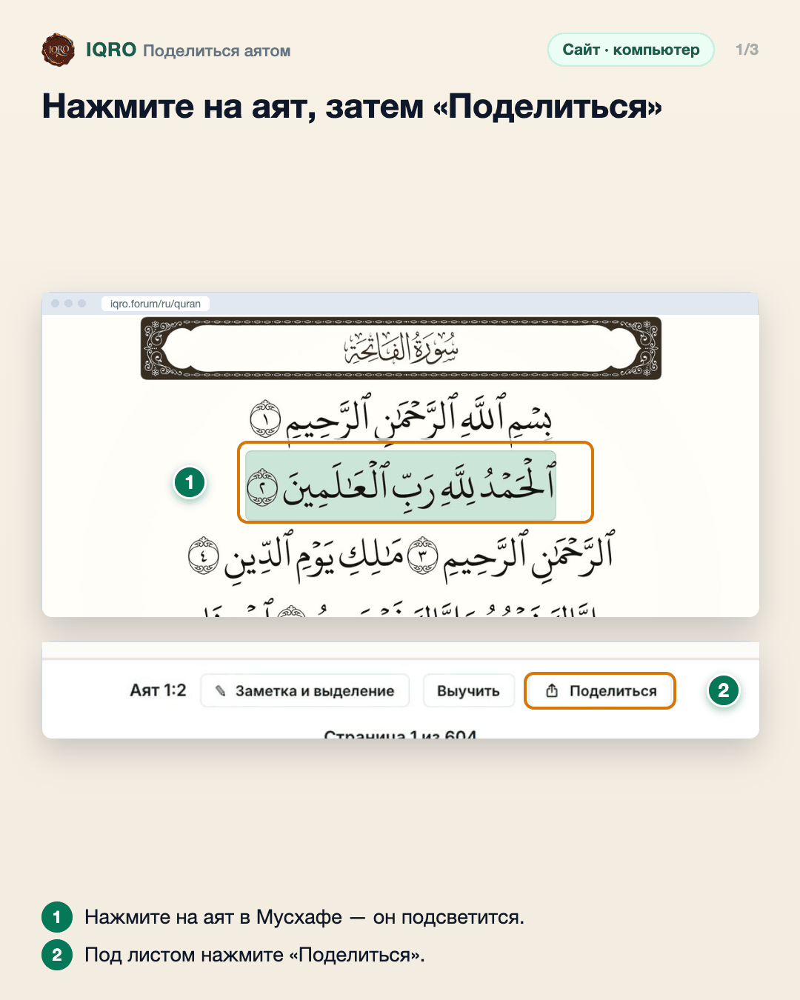
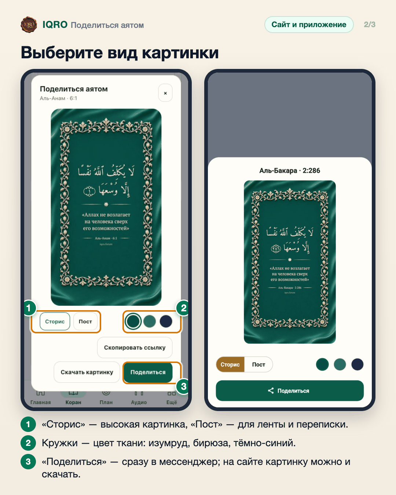
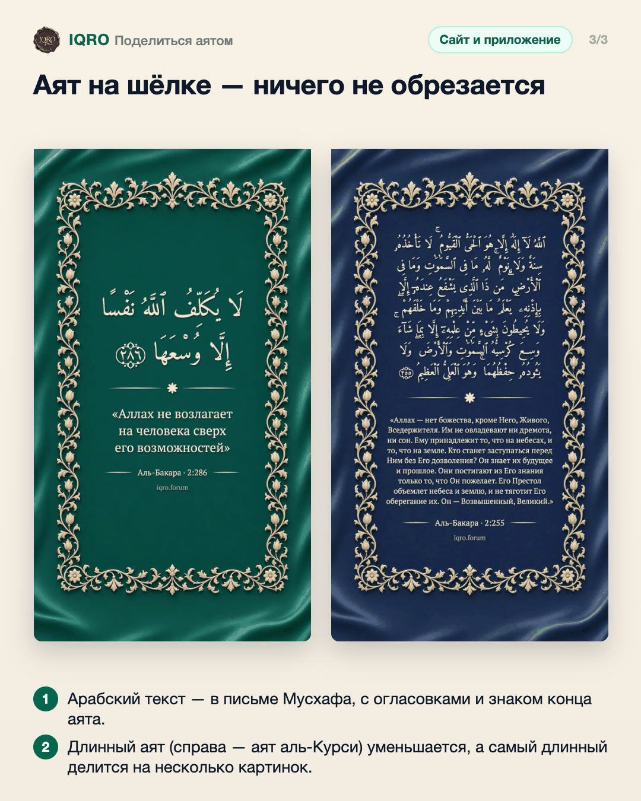

# Поделиться аятом

Любой аят можно отправить красивой картинкой: шёлк с резной рамкой, арабский текст в письме Мусхафа со знаком конца аята, смысловой перевод и адрес iqro.forum. Длинный аят делится на несколько картинок — ничего не обрезается. Или просто ссылкой и текстом.

**Где найти:** нажмите на аят в Мусхафе или в тексте → «Поделиться» (в приложении — «Поделиться аятом» в меню аята).

**Сайт и приложение:** на сайте кнопка «Поделиться» появляется под листом рядом с номером аята; в приложении — в меню, которое открывается нажатием на аят. Окно с картинкой, выбором формата и цвета одинаковое.

## Нажмите на аят, затем «Поделиться»

На сайте нажмите на нужный аят — он подсветится зелёным. Под листом появится строка «Аят 1:2» с кнопками; нажмите «Поделиться». В текстовом режиме кнопка стоит у каждого аята.

## Выберите вид картинки

Откроется окно с готовой картинкой — на сайте (слева) и в приложении (справа). Выберите форму и цвет ткани: выбор запомнится. Затем «Поделиться»; на сайте картинку можно скачать, а ссылку скопировать. Получатель с приложением IQRO откроет ссылку прямо в приложении.

## Аят на шёлке — ничего не обрезается

Так выглядит картинка: шёлк с резной рамкой, арабский текст в письме Мусхафа со знаком конца аята, перевод в кавычках, название суры с номером аята и iqro.forum. Короткий аят стоит крупно; длинный уменьшается, а если не помещается — делится на несколько картинок с пометкой «1/2, 2/2».

## Для рилс и подробного рассказа

- `reels/` — кадры 9:16 (1080×1920) по порядку: обложка, по кадру на каждый экран с его шагами, финальный кадр.
- `screens/` — чистые экраны без отметок, в полном размере: из них можно делать свои анимации.

Заголовок для ролика: **Поделитесь аятом**. Текст за кадром — подписи к карточкам выше, по порядку.

---

Основа снимков: сайт (тестовый стенд) и приложение (снимки из тестов), 18 ноября 2026; готовые картинки — `docs/images/share-card-2026-11-18/`.
