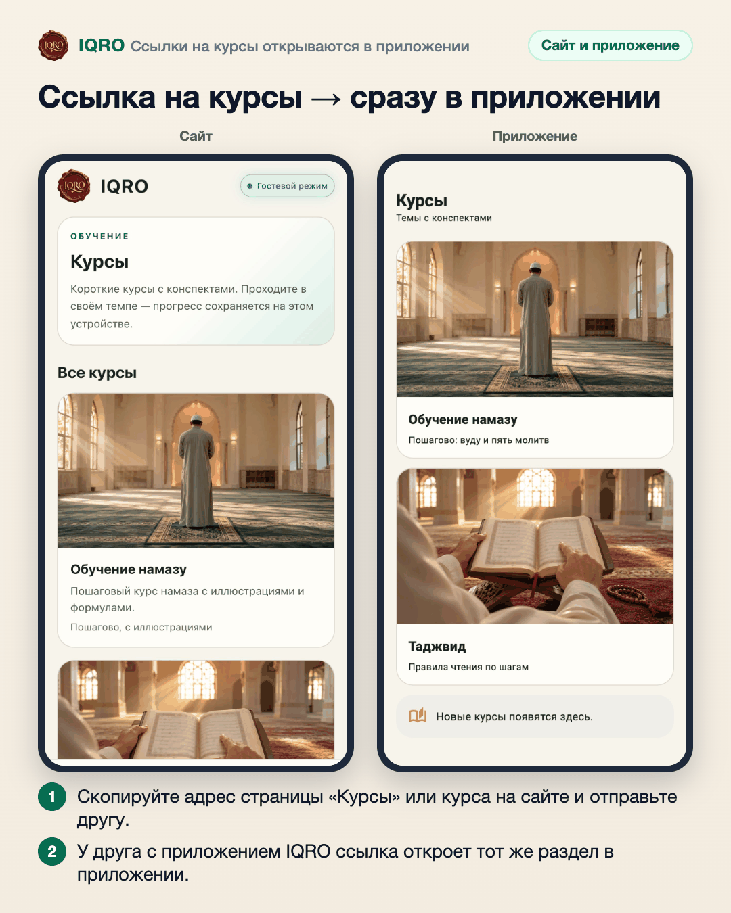

# Ссылки на курсы открываются в приложении

Если вам прислали ссылку на раздел «Курсы», на курс или на тему курса с сайта IQRO, а приложение IQRO установлено, ссылка откроется прямо в приложении — на том же месте.

**Где найти:** любая ссылка вида iqro.forum/ru/courses… — из мессенджера, почты или браузера.

**Сайт и приложение:** без приложения ссылка открывается на сайте. В приложении это работает начиная с версии 1.0.9.

## Ссылка на курсы → сразу в приложении

Адрес раздела «Курсы», отдельного курса или темы можно скопировать на сайте и отправить. Если у получателя установлено приложение IQRO (версия 1.0.9 и новее), по нажатию на ссылку откроется приложение — сразу в этом разделе.

---

Основа снимков: сайт iqro.forum, 11 ноября 2026; экран приложения — снимок из тестов приложения с обложками сайта, 11 ноября 2026.
