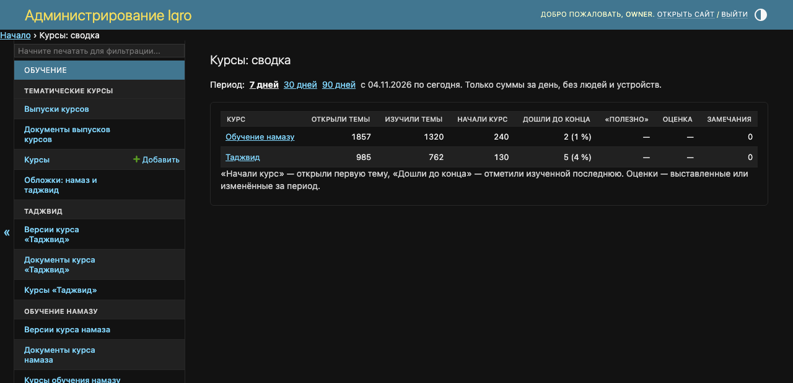
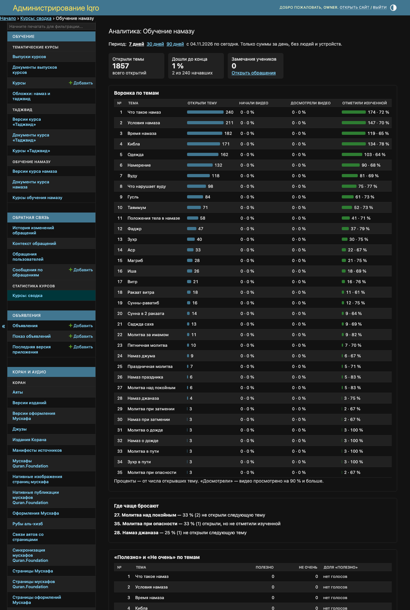

# Статистика курсов: намаз и таджвид

Это страница для владельца и редакторов, не для постов пользователям. С 11.11.2026 «Статистика курсов» в админке считает и встроенные курсы — «Обучение намазу» и «Таджвид», наравне с курсами каталога.

**Где найти:** админка → «Курсы»: сверху таблица всех курсов с короткими цифрами и ссылкой «Полная сводка» ([как это выглядит](../admin-courses/README.md)). Сама сводка — «Статистика и оценки курсов» в разделах «Обучение» и «Обращения и отзывы».

**Откуда цифры:** сайт и приложение присылают обезличенные события: открыли урок, начали и досмотрели видео, завершили урок. Сервер хранит только суммы за день — без человека, устройства и адреса. Цифры копятся с версий сайта и приложения, в которых появилась отправка; более ранние просмотры не учтены.

Снимки сделаны на локальной копии с примерными цифрами, не с рабочего сайта. С 12.11.2026 в сводке есть третья строка — раздел «Имена Аллаха»: [как читать его цифры](../names-stats/README.md).

## Сводка по всем курсам

Первые две строки — «Обучение намазу» и «Таджвид», ниже курсы каталога. Период — 7, 30 или 90 дней. «Начали курс» — открыли первый урок, «Дошли до конца» — завершили последний. Оценки и «Полезно» у встроенных курсов нет, там прочерк.

## Аналитика одного курса

Нажмите на название курса в сводке. Видно, сколько раз открыли каждый урок и сколько раз его завершили, на каких уроках чаще бросают и как отличаются сайт, Android и iOS.
