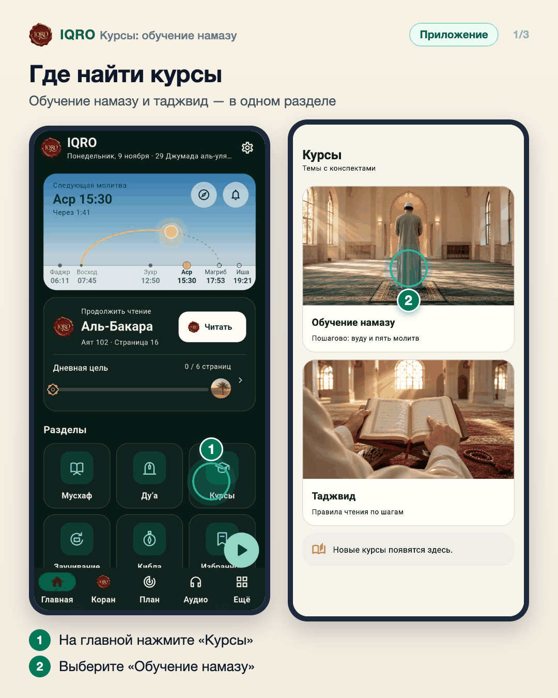
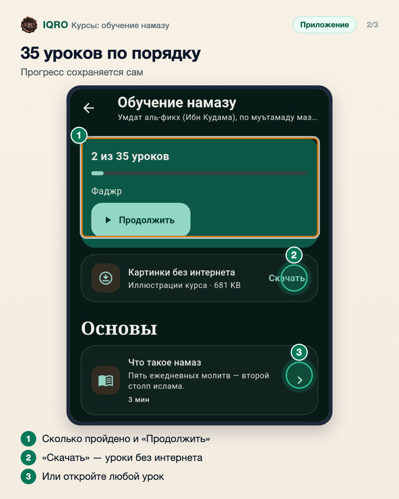
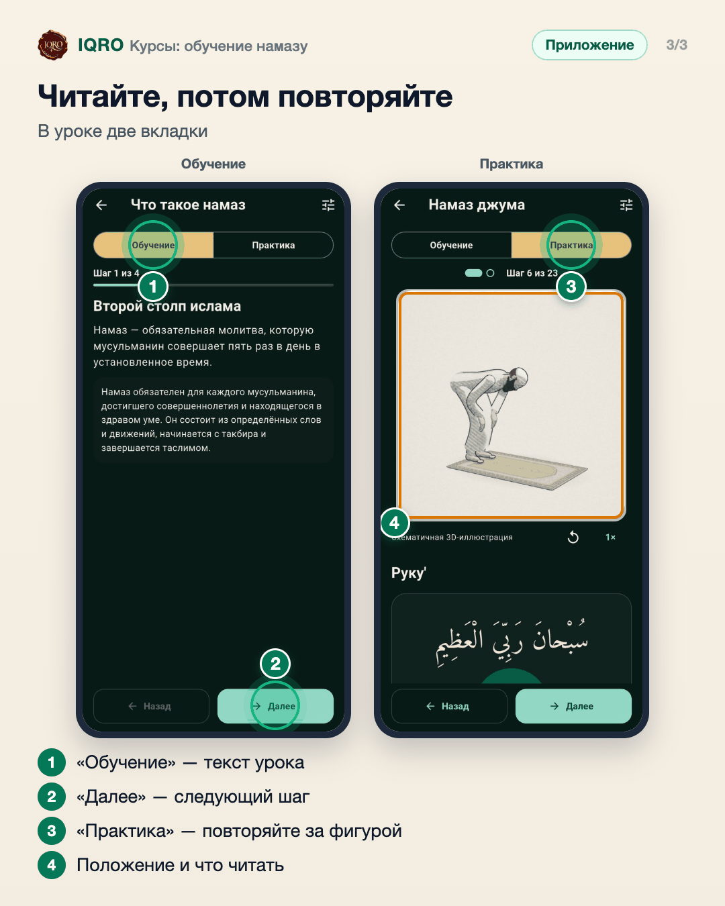

# Курсы: обучение намазу

В разделе «Курсы» — обучение намазу и таджвид по шагам. Курс «Обучение намазу» — 35 коротких уроков: от условий намаза до пяти молитв, джума и праздничного намаза. В каждом уроке две вкладки: «Обучение» — текст по шагам, «Практика» — 3D-фигура показывает каждое положение, а под ней то, что читать. Приложение помнит, где вы остановились.

**Где найти:** главная → плитка «Курсы» (или «Ещё» → «Курсы»).

**Сайт и приложение:** на сайте те же курсы: iqro.forum → «Курсы» в шапке.

## Где найти курсы

На главной нажмите плитку «Курсы». Там два курса: «Обучение намазу» и «Таджвид». Новые курсы будут появляться здесь же.

## 35 уроков по порядку

Вверху курса видно, сколько уроков пройдено, и кнопка «Продолжить» — она откроет урок, на котором вы остановились. Картинки курса можно скачать, чтобы уроки открывались без интернета.

## Читайте, потом повторяйте

«Обучение» — текст урока по шагам, кнопка «Далее» ведёт к следующему. «Практика» — 3D-фигура показывает каждое положение намаза, а под ней — что читать по-арабски.

## Для рилс и подробного рассказа

- `reels/` — кадры 9:16 (1080×1920) по порядку: обложка, по кадру на каждый экран с его шагами, финальный кадр.
- `screens/` — чистые экраны без отметок, в полном размере: из них можно делать свои анимации.
- `video/` — запись экрана телефона, без звука: как это выглядит вживую.

Заголовок для ролика: **Учим намаз по шагам**. Текст за кадром — подписи к карточкам выше, по порядку.

---

Основа снимков: Redmi, сборка «IQRO тест» из main 9048ca87, 9 ноября 2026; строка состояния телефона обрезана; список курсов с новыми обложками — снимок из тестов приложения, 11 ноября 2026.
