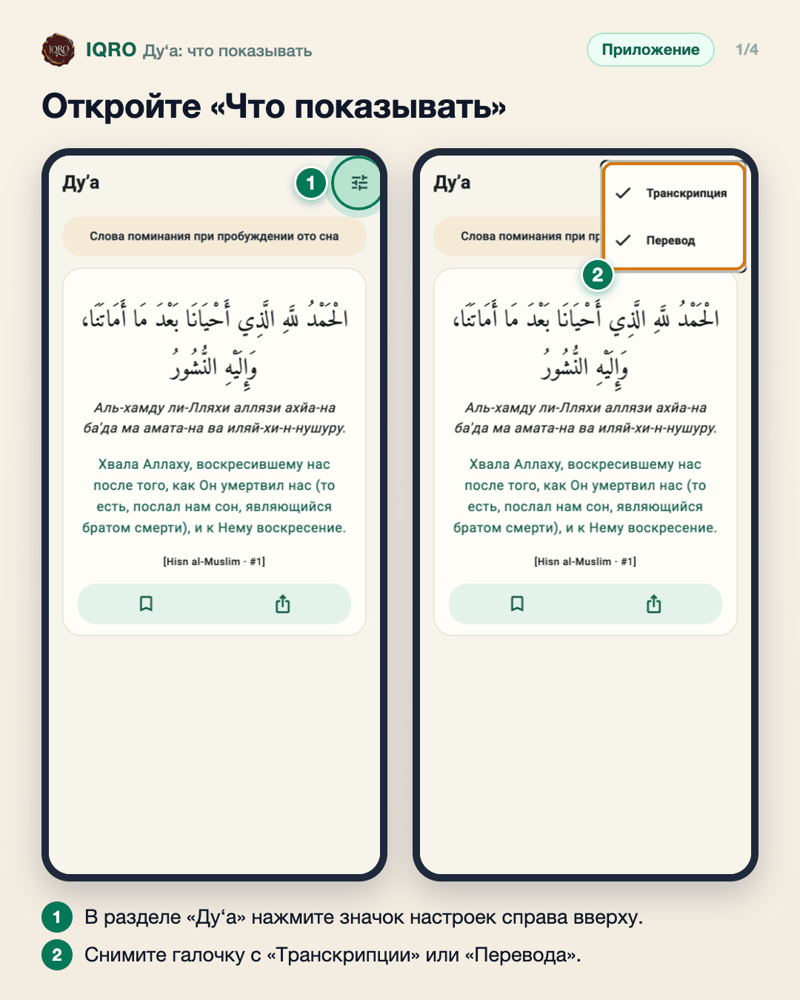
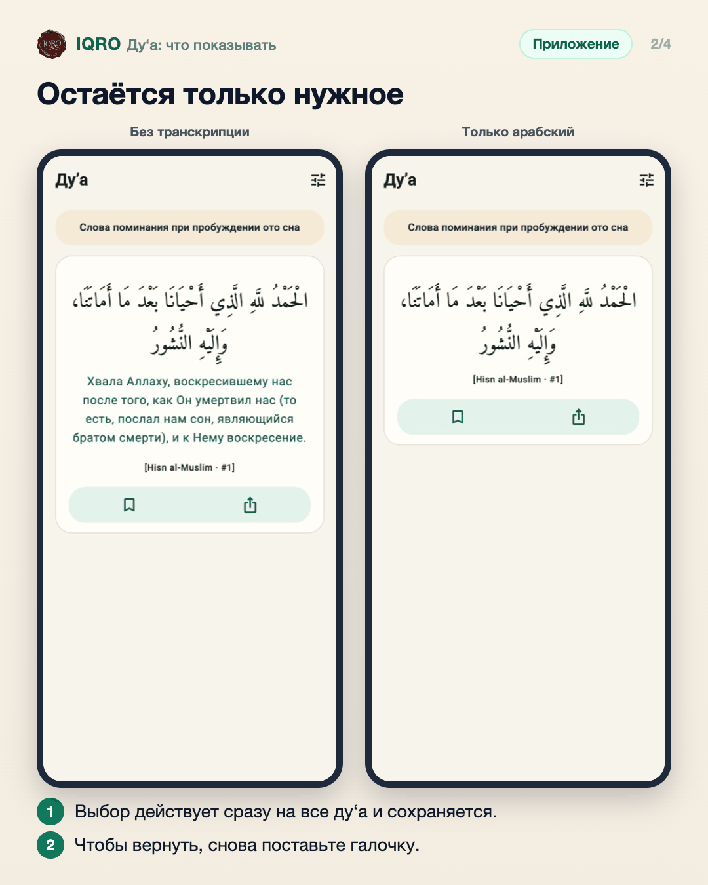
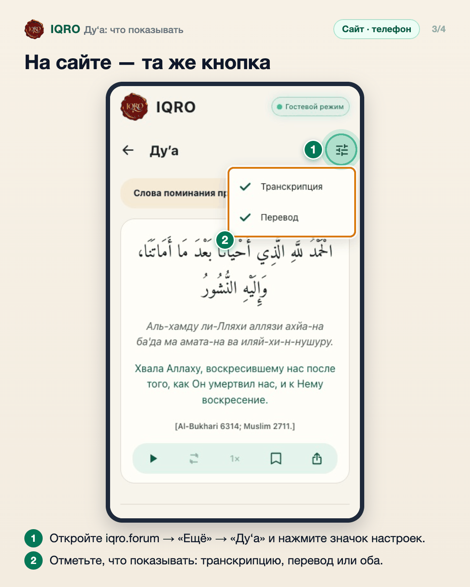
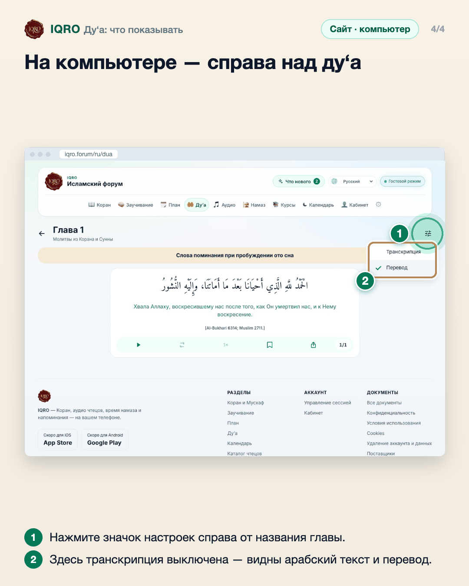

# Ду‘а: что показывать

В разделе «Ду‘а» можно скрыть транскрипцию или перевод и оставить только арабский текст. Выбор сразу действует на все ду‘а и запоминается на устройстве.

**Где найти:** раздел «Ду‘а» → значок настроек справа вверху (в приложении: «Ещё» → «Ду‘а»).

**Сайт и приложение:** работает одинаково. В арабском интерфейсе кнопки нет: там нет транскрипции и перевода.

## Откройте «Что показывать»

В приложении откройте «Ещё» → «Ду‘а» и нажмите значок настроек справа вверху. Появятся два пункта с галочками: «Транскрипция» и «Перевод». Уберите галочку с того, что не нужно.

## Остаётся только нужное

Слева скрыта транскрипция, справа — и транскрипция, и перевод: остался только арабский текст. Выбор действует на все ду‘а и сохраняется на телефоне. Чтобы вернуть, снова поставьте галочку.

## На сайте — та же кнопка

На сайте с телефона: «Ещё» → «Ду‘а», значок настроек справа от заголовка. Пункты те же, выбор запоминается в браузере.

## На компьютере — справа над ду‘а

На компьютере кнопка там же — справа от названия главы. На снимке транскрипция выключена: остались арабский текст и перевод.

## Для рилс и подробного рассказа

- `reels/` — кадры 9:16 (1080×1920) по порядку: обложка, по кадру на каждый экран с его шагами, финальный кадр.

Заголовок для ролика: **Ду‘а так, как удобно вам**. Текст за кадром — подписи к карточкам выше, по порядку.

---

Основа снимков: `docs/images/dua-display-options-2026-11-03/` (приложение на Redmi, сайт iqro.forum).
