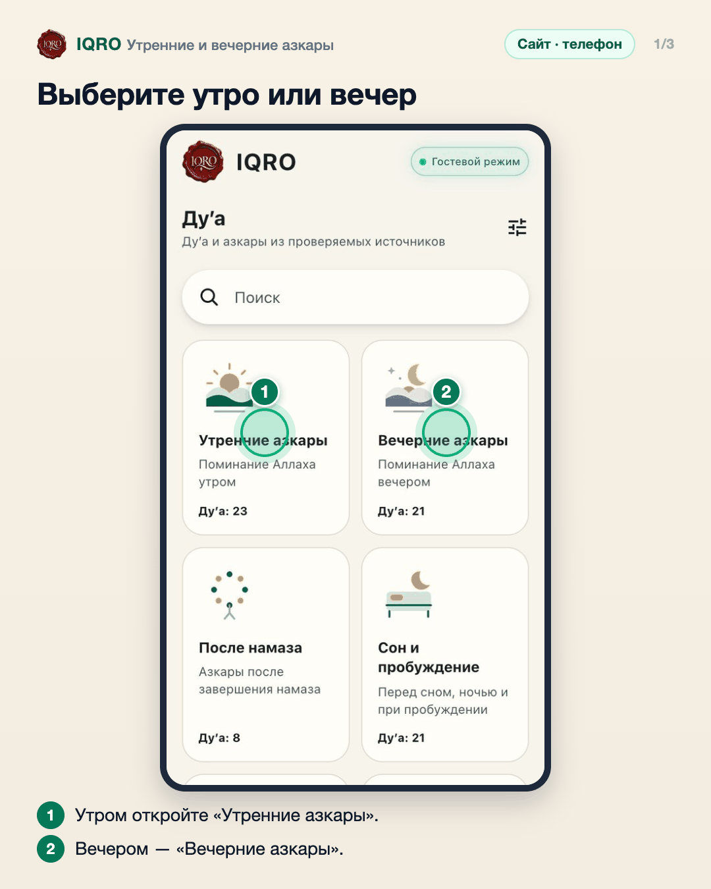
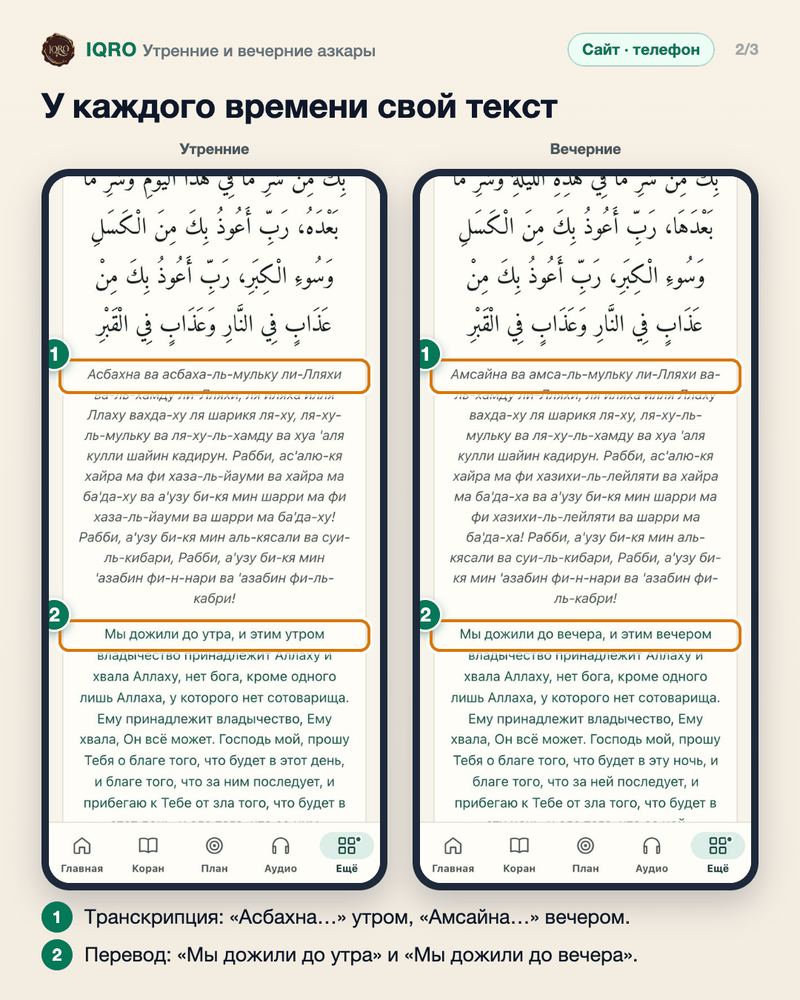
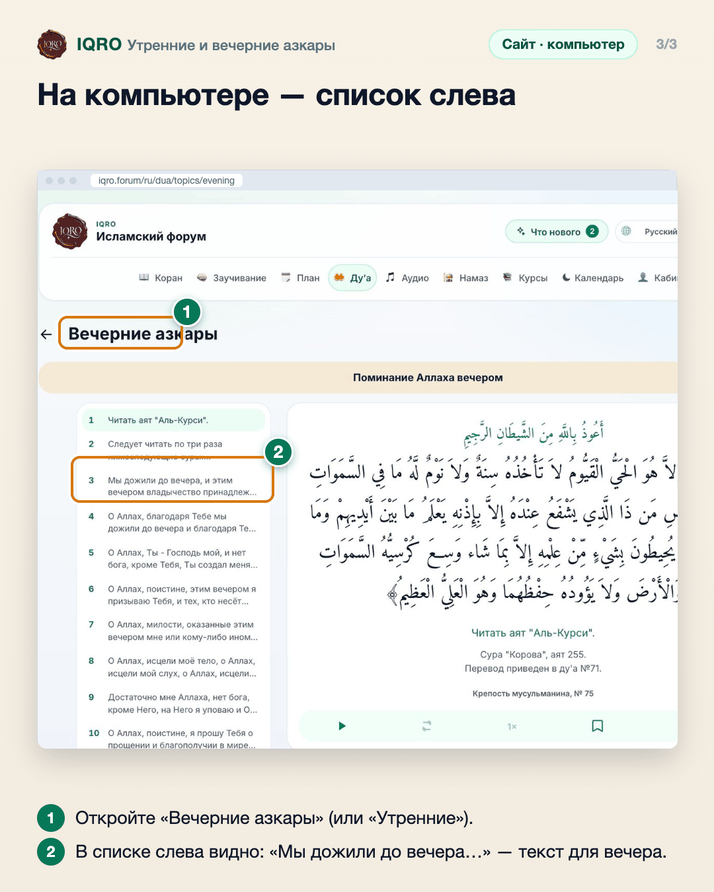

# Утренние и вечерние азкары

Утренние и вечерние азкары теперь — два отдельных списка. В каждом текст для своего времени: утром «Мы дожили до утра…», вечером «Мы дожили до вечера…», без сносок про другое время.

**Где найти:** раздел «Ду‘а» → карточки «Утренние азкары» и «Вечерние азкары» (в приложении: «Ещё» → «Ду‘а»).

**Сайт и приложение:** одинаково на сайте и в приложении.

## Выберите утро или вечер

В разделе «Ду‘а» первые две карточки — «Утренние азкары» и «Вечерние азкары». Откройте ту, что подходит по времени.

## У каждого времени свой текст

Одно и то же ду‘а в двух списках: утром читается «Асбахна ва асбаха-ль-мульку…» («Мы дожили до утра…»), вечером — «Амсайна ва амса-ль-мульку…» («Мы дожили до вечера…»). Больше не нужно мысленно заменять слова по сноске.

## На компьютере — список слева

На компьютере слева список всех ду‘а темы, справа — выбранное. В вечернем списке уже вечерние слова, в утреннем — утренние.

## Для рилс и подробного рассказа

- `reels/` — кадры 9:16 (1080×1920) по порядку: обложка, по кадру на каждый экран с его шагами, финальный кадр.

Заголовок для ролика: **Утренние и вечерние азкары**. Текст за кадром — подписи к карточкам выше, по порядку.

---

Основа снимков: сайт iqro.forum, 4 ноября 2026.
