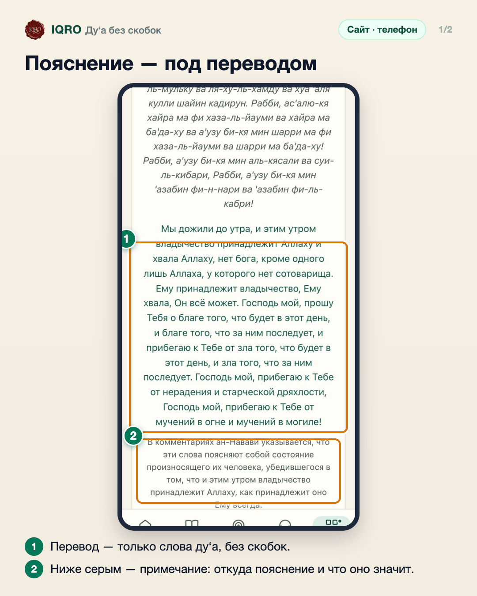
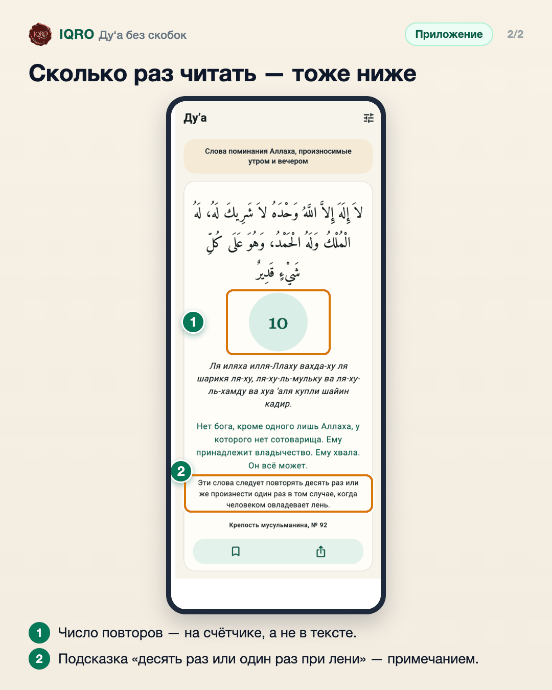

# Ду‘а без скобок

Тексты ду‘а стали чище: в арабском, транскрипции и переводе нет вставок в скобках. Пояснения — сколько раз читать, когда и почему — вынесены отдельным примечанием серым шрифтом под переводом.

**Где найти:** любое ду‘а в разделе «Ду‘а», например в «Утренних азкарах».

**Сайт и приложение:** одинаково на сайте и в приложении.

## Пояснение — под переводом

Перевод теперь содержит только сами слова ду‘а. Пояснение (здесь — из комментариев ан-Навави) стоит отдельно под переводом серым шрифтом.

## Сколько раз читать — тоже ниже

В приложении так же: указание «десять раз» больше не стоит в скобках внутри арабского текста и перевода. Сколько раз повторять, показывает счётчик, а подробности — примечание под переводом.

## Для рилс и подробного рассказа

- `reels/` — кадры 9:16 (1080×1920) по порядку: обложка, по кадру на каждый экран с его шагами, финальный кадр.

Заголовок для ролика: **Ду‘а без лишнего**. Текст за кадром — подписи к карточкам выше, по порядку.

---

Основа снимков: сайт iqro.forum, 4 ноября 2026; приложение — `docs/images/dua-text-without-brackets-2026-11-04/`.
