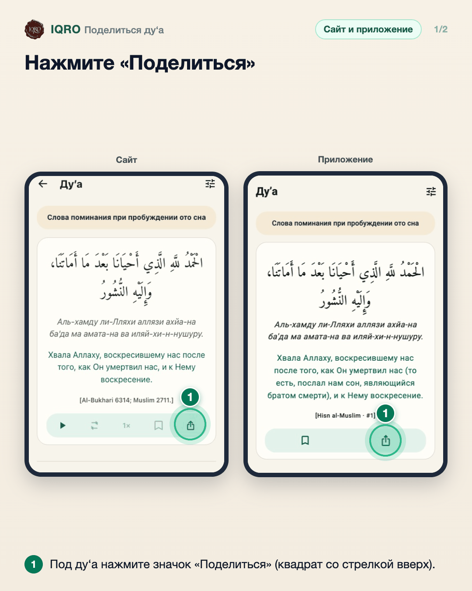
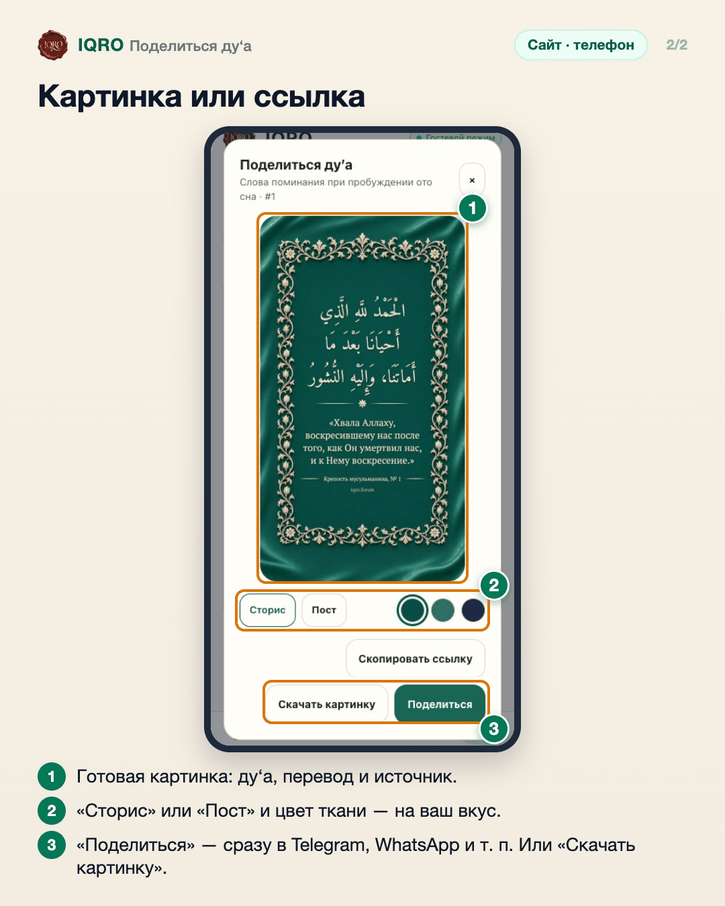

# Поделиться ду‘а

Любое ду‘а можно отправить картинкой или ссылкой: на шёлке с резной рамкой — арабский текст, перевод и источник, внизу адрес iqro.forum.

**Где найти:** значок «Поделиться» под каждым ду‘а.

**Сайт и приложение:** окно с картинкой, выбором формата и цвета одинаковое; на сайте картинку можно ещё скачать, а ссылку скопировать.

## Нажмите «Поделиться»

Значок «Поделиться» есть под каждым ду‘а — на сайте (слева) и в приложении (справа).

## Картинка или ссылка

Откроется окно с готовой картинкой. Выберите форму и цвет ткани, затем отправьте картинку через «Поделиться» или скачайте её; ссылку на ду‘а можно скопировать. Длинное ду‘а делится на несколько картинок. Ссылка у получателя с приложением IQRO откроется прямо в приложении.

## Для рилс и подробного рассказа

- `reels/` — кадры 9:16 (1080×1920) по порядку: обложка, по кадру на каждый экран с его шагами, финальный кадр.

Заголовок для ролика: **Поделитесь ду‘а**. Текст за кадром — подписи к карточкам выше, по порядку.

---

Основа снимков: сайт (тестовый стенд), 18 ноября 2026: `docs/images/share-card-2026-11-18/`; первый шаг — `docs/images/dua-display-options-2026-11-03/`.
