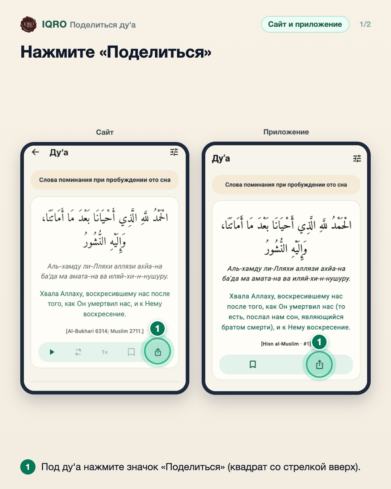
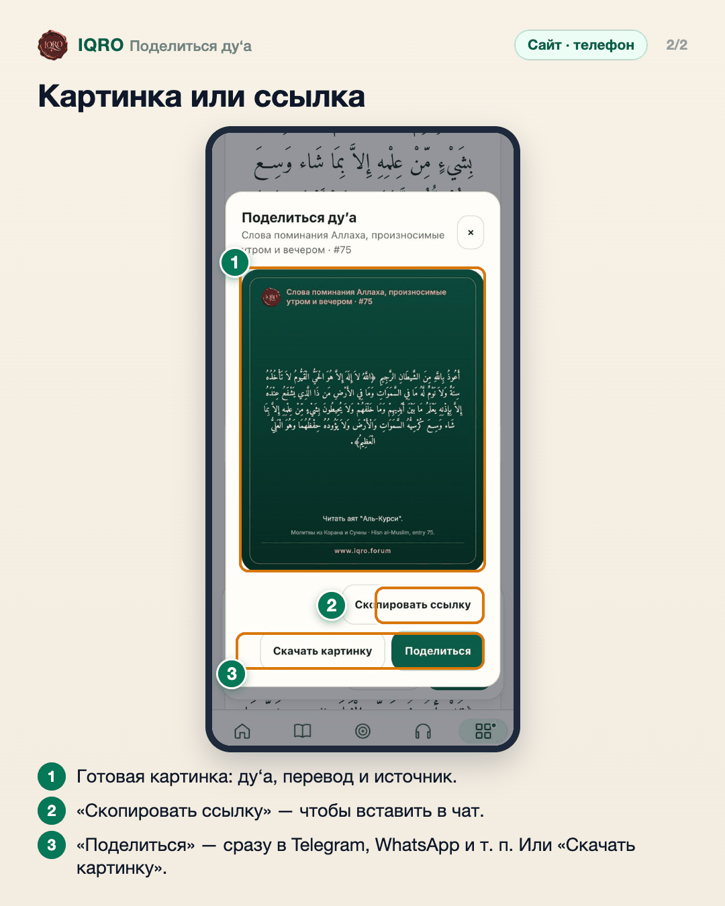

# Поделиться ду‘а

Любое ду‘а можно отправить картинкой или ссылкой: на картинке арабский текст, перевод и источник, внизу адрес iqro.forum.

**Где найти:** значок «Поделиться» под каждым ду‘а.

**Сайт и приложение:** на сайте окно с картинкой и кнопками «Скопировать ссылку», «Скачать картинку», «Поделиться»; в приложении та же кнопка открывает отправку картинкой или текстом.

## Нажмите «Поделиться»

Значок «Поделиться» есть под каждым ду‘а — на сайте (слева) и в приложении (справа).

## Картинка или ссылка

Откроется окно с готовой картинкой. Можно скопировать ссылку на это ду‘а, скачать картинку или сразу отправить её через «Поделиться». Ссылка на ду‘а у получателя с приложением IQRO откроется прямо в приложении.

## Для рилс и подробного рассказа

- `reels/` — кадры 9:16 (1080×1920) по порядку: обложка, по кадру на каждый экран с его шагами, финальный кадр.

Заголовок для ролика: **Поделитесь ду‘а**. Текст за кадром — подписи к карточкам выше, по порядку.

---

Основа снимков: сайт iqro.forum, 4 ноября 2026; `docs/images/dua-display-options-2026-11-03/`.
