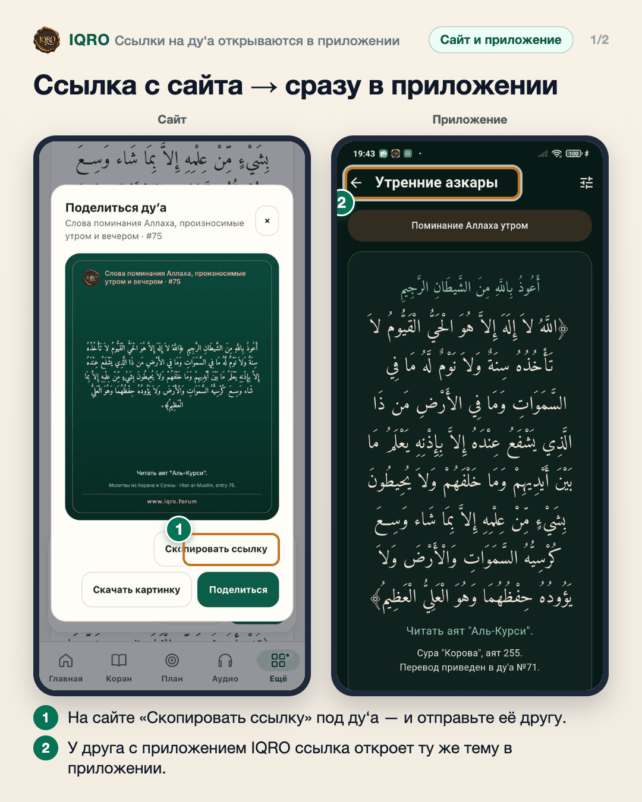
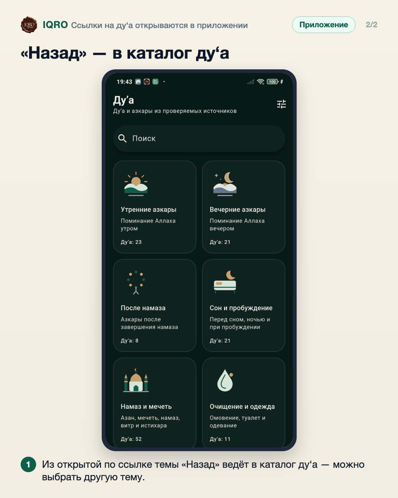

# Ссылки на ду‘а открываются в приложении

Если вам прислали ссылку на тему ду‘а с сайта IQRO (например, «Утренние азкары»), а приложение IQRO установлено, ссылка откроется прямо в приложении — на той же теме.

**Где найти:** любая ссылка вида iqro.forum/ru/dua/… — из мессенджера, почты или браузера.

**Сайт и приложение:** без приложения ссылка просто открывается на сайте. «Назад» в приложении ведёт в каталог ду‘а.

## Ссылка с сайта → сразу в приложении

Ссылку на ду‘а или тему можно скопировать на сайте («Поделиться» → «Скопировать ссылку») и отправить. Если у получателя установлено приложение IQRO, по нажатию на ссылку откроется приложение — сразу на этой теме, здесь «Утренние азкары».

## «Назад» — в каталог ду‘а

Если нажать «Назад», откроется каталог ду‘а со всеми темами — как будто вы сами зашли в «Ду‘а».

---

Основа снимков: сайт iqro.forum и Redmi, IQRO Test 1.0.4 (сборка из main 59c9b99b), 4 ноября 2026.
