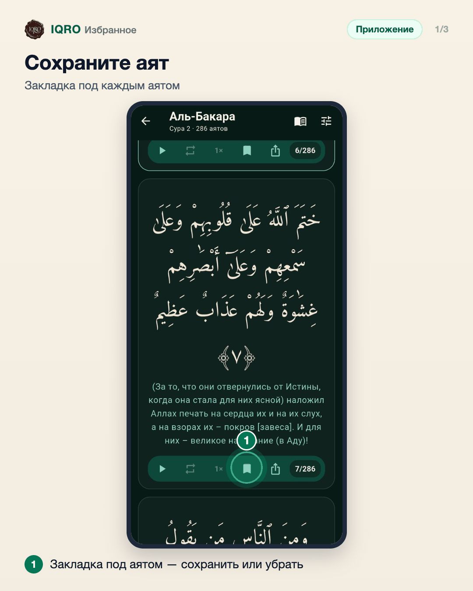
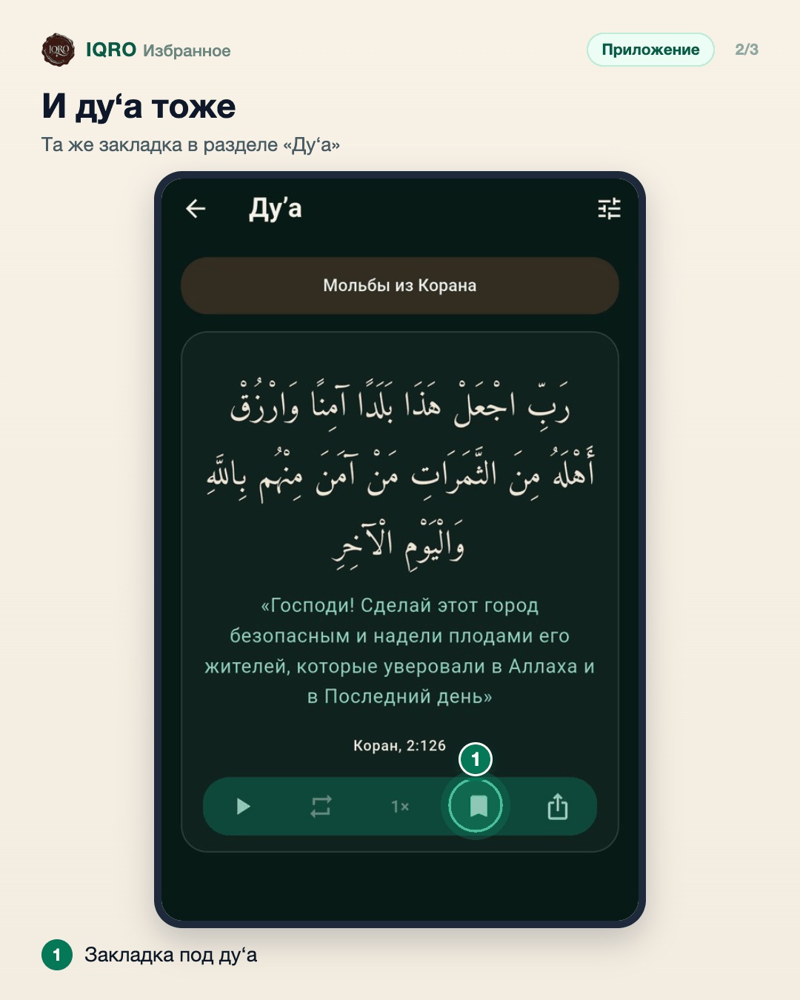
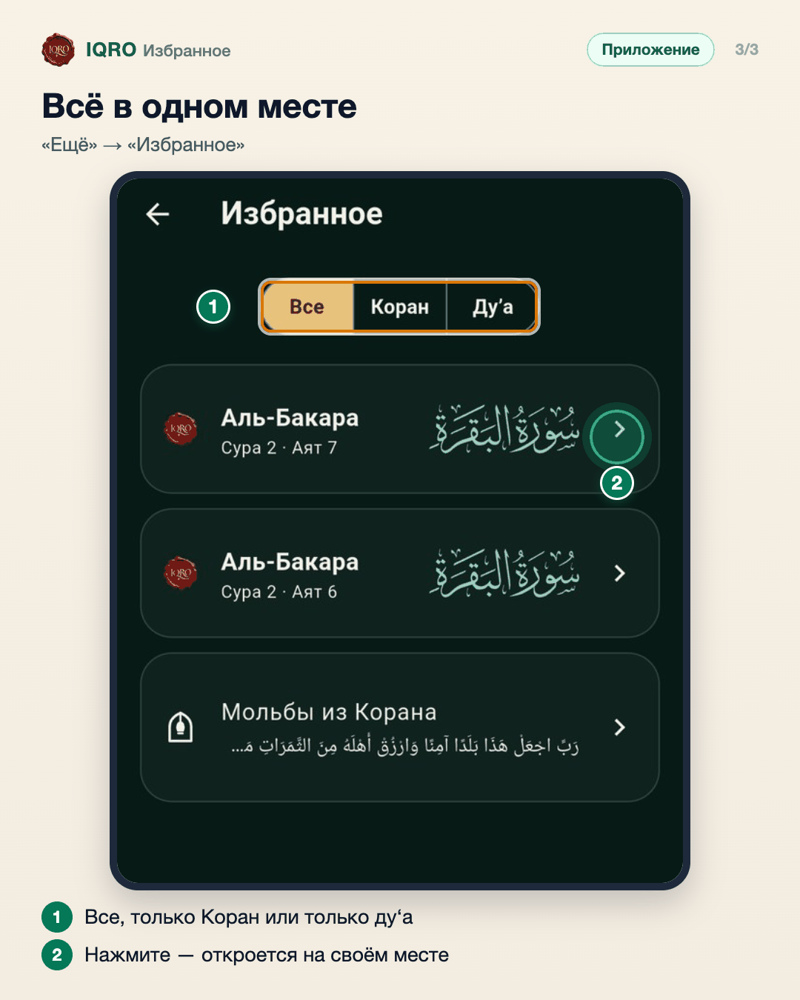

# Избранное

Любой аят и любое ду‘а можно сохранить одним нажатием на закладку. Всё сохранённое собирается в «Избранном»: там можно оставить только Коран или только ду‘а, а нажатие открывает аят или ду‘а на своём месте.

**Где найти:** закладка — в строке кнопок под аятом или ду‘а; список — «Ещё» → «Избранное».

**Сайт и приложение:** на сайте закладки те же; если вы вошли в аккаунт, избранное общее для сайта и приложения.

## Сохраните аят

Под каждым аятом — строка кнопок. Нажмите закладку: она станет закрашенной, и аят попадёт в «Избранное». Нажмите ещё раз — уберёте.

## И ду‘а тоже

У каждого ду‘а такая же строка кнопок. Закладка сохраняет ду‘а в «Избранное» — удобно для тех, что читаете каждый день.

## Всё в одном месте

В «Избранном» сохранённые аяты и ду‘а. Вверху можно оставить только Коран или только ду‘а. Нажмите на строку — аят откроется в Коране на своём месте, ду‘а — в своём разделе.

## Для рилс и подробного рассказа

- `reels/` — кадры 9:16 (1080×1920) по порядку: обложка, по кадру на каждый экран с его шагами, финальный кадр.
- `screens/` — чистые экраны без отметок, в полном размере: из них можно делать свои анимации.
- `video/` — запись экрана телефона, без звука: как это выглядит вживую.

Заголовок для ролика: **Любимые аяты под рукой**. Текст за кадром — подписи к карточкам выше, по порядку.

---

Основа снимков: Redmi, сборка «IQRO тест» из main 9048ca87, 9 ноября 2026; строка состояния телефона обрезана. Аят 2:7 добавлен для съёмки и потом убран.
