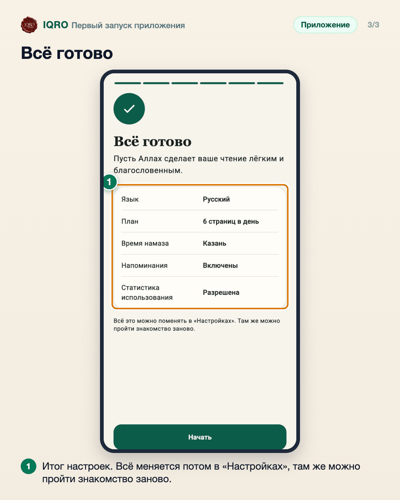

# Первый запуск приложения

При первом запуске IQRO за минуту знакомит с собой и настраивается под вас: язык, цель и дневная норма чтения, город для времени намаза и напоминания. Всё это можно поменять потом в «Настройках».

**Где найти:** открывается само при первой установке; пройти заново — «Ещё» → «Настройки» → «Пройти знакомство заново».

**Сайт и приложение:** это приложение (Android и iPhone). На сайте знакомства нет.

## Язык и ваша цель

Сначала выберите язык: русский, английский, арабский или турецкий. Затем отметьте, что для вас главное, — главный экран и план подстроятся. Ползунком задайте дневную норму чтения.

## Город и напоминания о намазе

Для времени намаза и киблы нужен ваш город: определите его по геолокации или выберите из списка — координаты не покидают телефон. На следующем шаге можно включить уведомления о каждом из пяти намазов.

## Всё готово

В конце — итог: язык, план, город, напоминания. Нажмите «Начать». Любой пункт можно поменять в «Настройках»; там же знакомство можно пройти заново.

---

Основа снимков: снимки онбординга из общей папки заметок (октябрь 2026).
