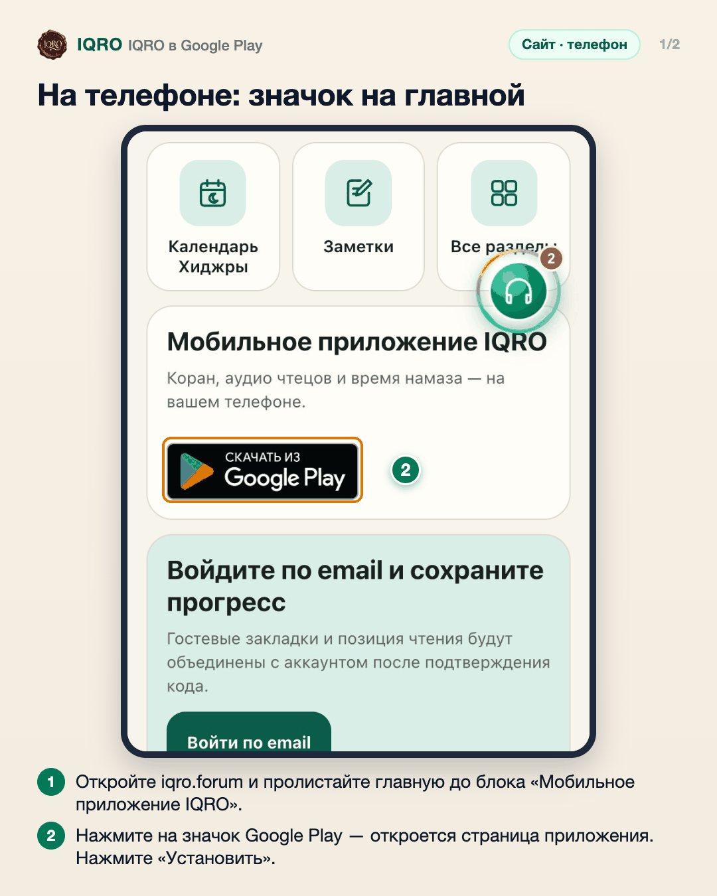
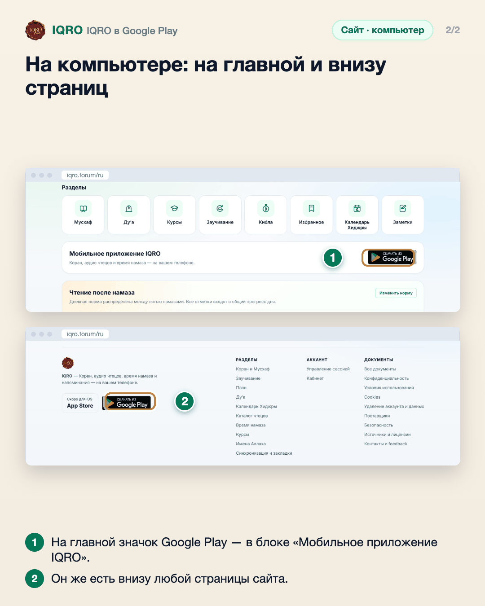

# IQRO в Google Play

Приложение IQRO для Android можно установить прямо с сайта: нажмите на значок Google Play — откроется страница приложения в магазине.

**Где найти:** главная страница сайта iqro.forum — под разделами; на компьютере значок есть ещё и внизу каждой страницы.

**Сайт и приложение:** значок есть только на сайте — он ведёт в приложение. Для iPhone приложение пока готовится.

## На телефоне: значок на главной

Откройте iqro.forum на телефоне с Android, пролистайте главную до блока «Мобильное приложение IQRO» и нажмите на значок Google Play. Откроется страница приложения — останется нажать «Установить».

## На компьютере: на главной и внизу страниц

На компьютере значок Google Play стоит на главной и внизу каждой страницы. Нажмите на него — страница приложения откроется в новой вкладке; оттуда приложение можно отправить на свой телефон.

---

Основа снимков: сайт iqro.forum (локальная сборка с включённой плашкой), 22 ноября 2026.
