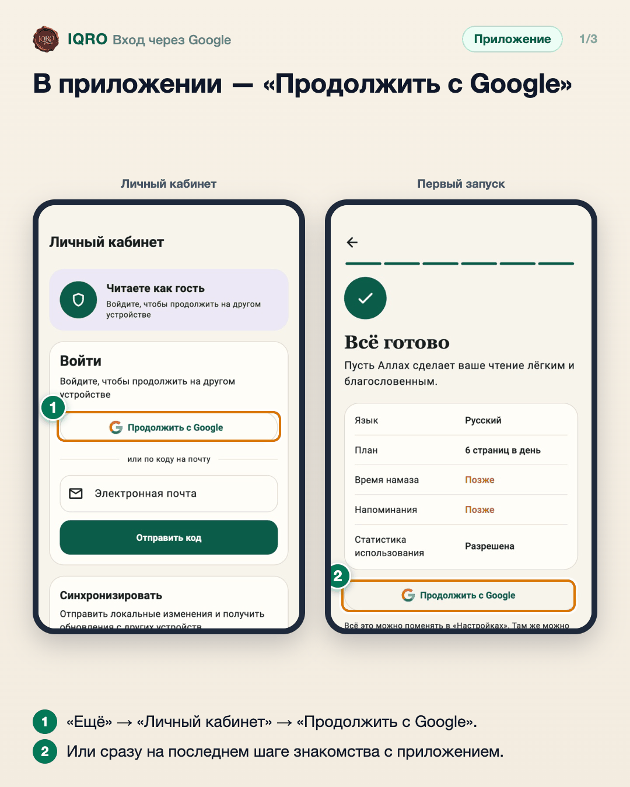
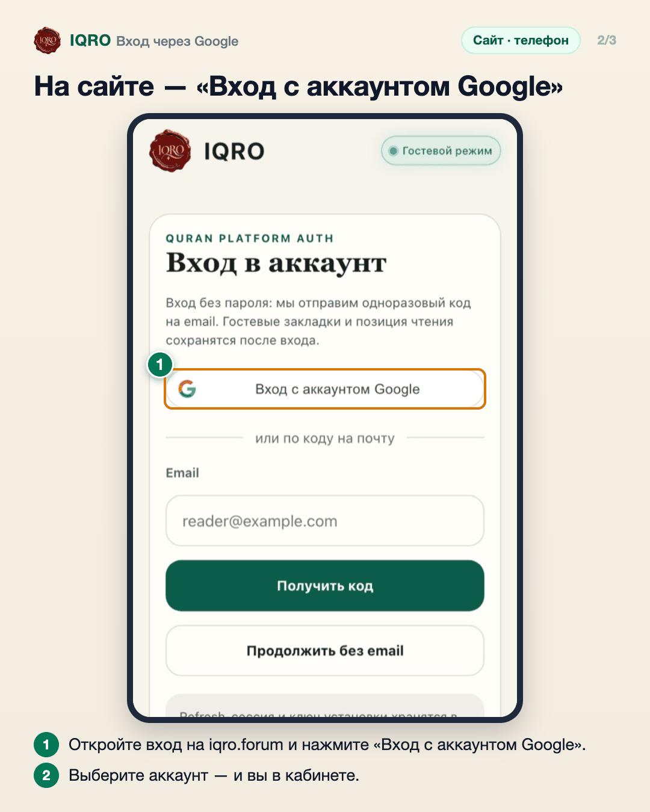
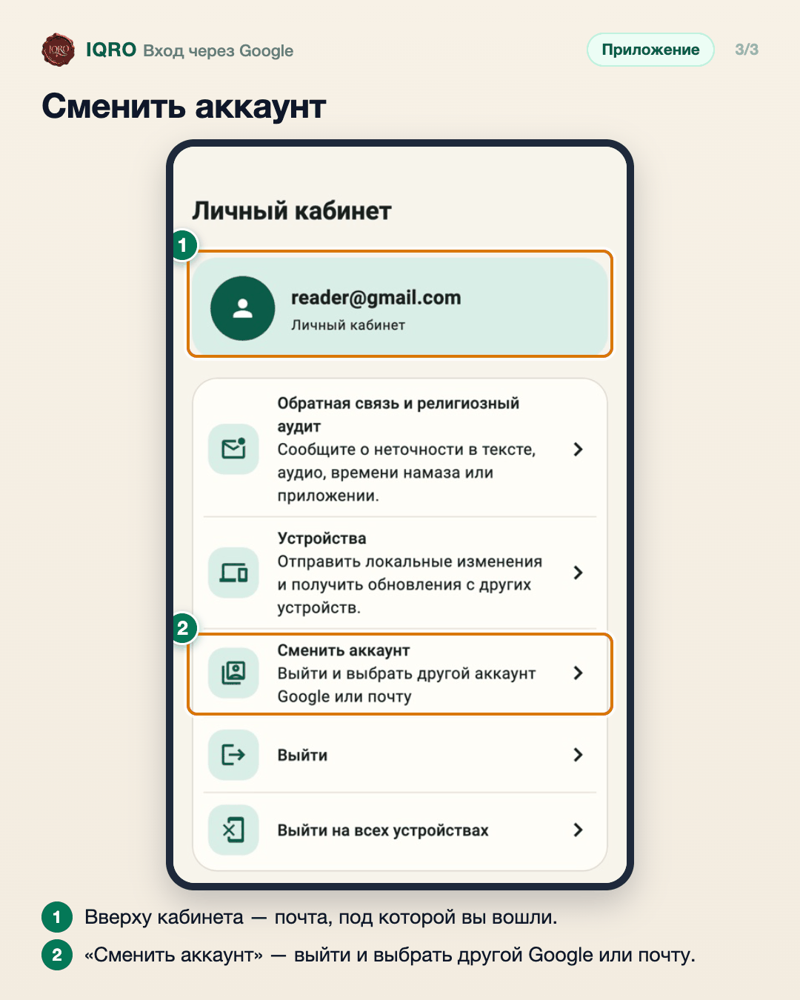

# Вход через Google

Войти в IQRO можно одним нажатием через аккаунт Google — без пароля и кода из письма. После входа закладки, заметки и место чтения сохраняются и появляются на других устройствах.

**Где найти:** сайт: «Войти» или «Кабинет»; приложение: «Ещё» → «Личный кабинет», а также последний шаг знакомства при первом запуске.

**Сайт и приложение:** кнопка есть и на сайте, и в приложении. Вход по коду на почту остаётся.

## В приложении — «Продолжить с Google»

В приложении откройте «Ещё» → «Личный кабинет» и нажмите «Продолжить с Google», затем выберите свой аккаунт. При первом запуске та же кнопка есть на последнем шаге знакомства.

## На сайте — «Вход с аккаунтом Google»

На сайте кнопка «Вход с аккаунтом Google» стоит первой на странице входа. Ниже по-прежнему можно войти кодом из письма.

## Сменить аккаунт

После входа вверху «Личного кабинета» видна почта аккаунта. Чтобы войти под другим, нажмите «Сменить аккаунт».

## Для рилс и подробного рассказа

- `reels/` — кадры 9:16 (1080×1920) по порядку: обложка, по кадру на каждый экран с его шагами, финальный кадр.

Заголовок для ролика: **Вход через Google**. Текст за кадром — подписи к карточкам выше, по порядку.

---

Основа снимков: `docs/images/google-sign-in-2026-10-27/`.
