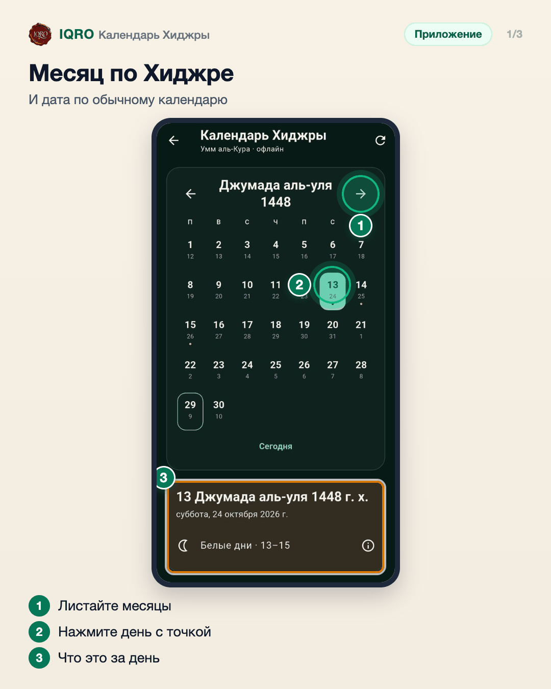
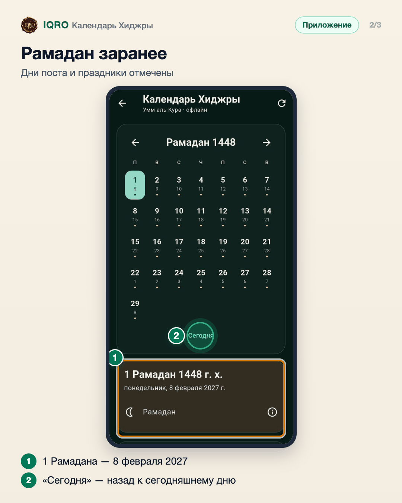
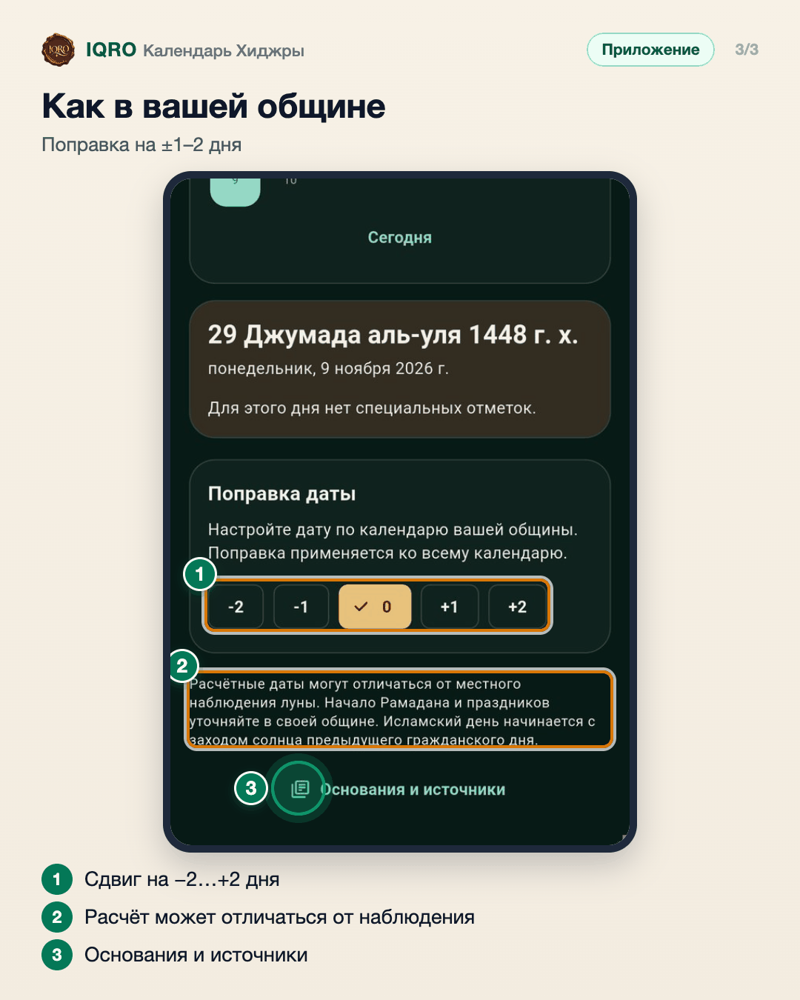

# Календарь Хиджры

Календарь Хиджры по Умм аль-Кура работает без интернета. Под каждым днём — дата по обычному календарю, точками отмечены особые дни: Белые дни, Рамадан, праздники. Нажмите на день — ниже будет, что это за день. Если ваша община начинает месяц на день раньше или позже, дату можно поправить на ±1–2 дня.

**Где найти:** «Ещё» → «Календарь Хиджры»; дата по Хиджре есть и на главной под названием приложения.

**Сайт и приложение:** на сайте тот же календарь: iqro.forum → «Календарь».

## Месяц по Хиджре

Стрелками листайте месяцы. Под числом по Хиджре — число по обычному календарю, точка — особый день. Нажмите на день: ниже появится, что это за день, например Белые дни — 13, 14 и 15 числа, когда желательно поститься.

## Рамадан заранее

Перелистайте до Рамадана — весь месяц отмечен точками, а под днём видно дату по обычному календарю: 1 Рамадана 1448 — 8 февраля 2027 года по расчёту Умм аль-Кура. «Сегодня» возвращает к текущему дню.

## Как в вашей общине

Расчётная дата может отличаться от наблюдения луны там, где вы живёте. В «Поправке даты» сдвиньте календарь на день-два, и он совпадёт с вашей общиной. Ниже — откуда взяты даты.

## Для рилс и подробного рассказа

- `reels/` — кадры 9:16 (1080×1920) по порядку: обложка, по кадру на каждый экран с его шагами, финальный кадр.
- `screens/` — чистые экраны без отметок, в полном размере: из них можно делать свои анимации.
- `video/` — запись экрана телефона, без звука: как это выглядит вживую.

Заголовок для ролика: **Когда Рамадан 1448?**. Текст за кадром — подписи к карточкам выше, по порядку.

---

Основа снимков: Redmi, сборка «IQRO тест» из main 9048ca87, 9 ноября 2026; строка состояния телефона обрезана.
