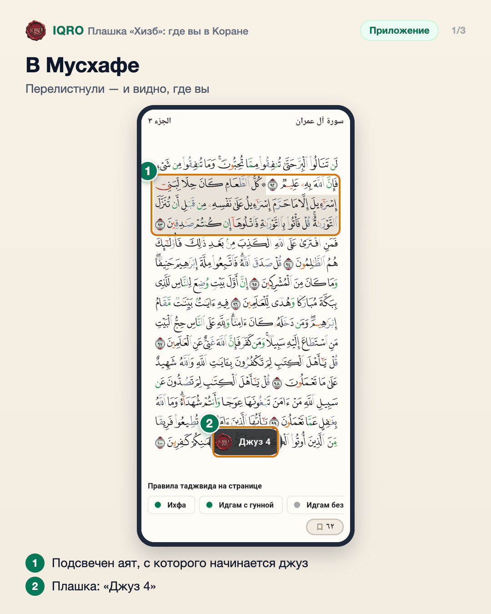
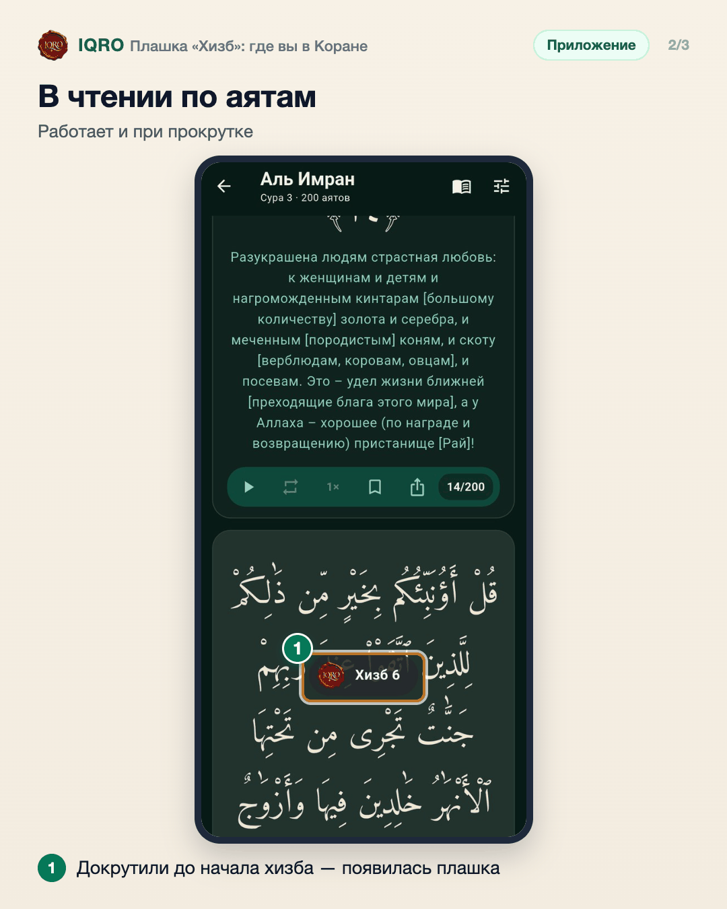
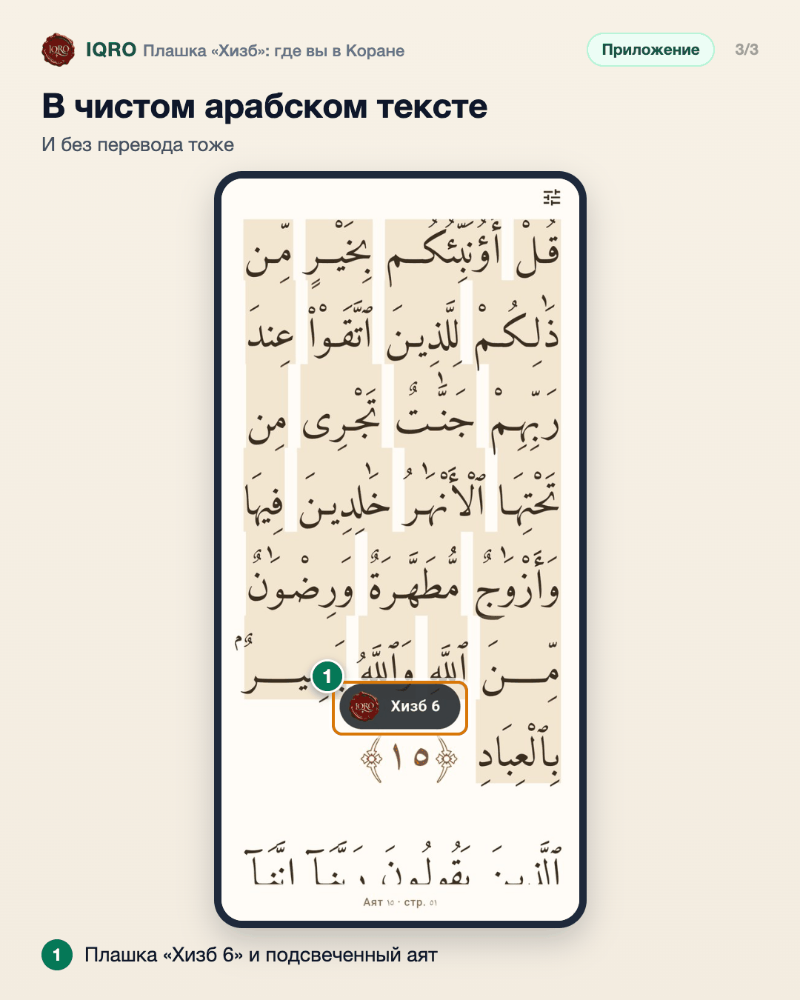

# Плашка «Хизб»: где вы в Коране

Коран делится на 30 джузов, каждый джуз — на 2 хизба, каждый хизб — на 4 четверти. В печатном Мусхафе начало четверти отмечено значком ۞. Когда вы доходите до такого места, поверх текста на пару секунд появляется плашка с печатью IQRO — «Джуз 5», «Хизб 6», «¼ Хизб 9», «½ Хизб 9» или «¾ Хизб 9» — и подсвечивается аят, с которого начинается эта часть.

**Где найти:** «Мусхаф» — при перелистывании страниц; «Коран» → «Текст» → сура — при прокрутке аятов, в том числе в чистом арабском тексте (свайп вправо по аяту). Плашка показывается каждый раз, когда вы возвращаетесь к этому месту. Ничего включать не нужно.

**Сайт и приложение:** на сайте то же самое: iqro.forum → «Коран» — в Мусхафе, в чтении по аятам и в сплошном арабском тексте.

## В Мусхафе

Если на странице начинается новая четверть хизба, поверх текста появляется плашка с названием места, а аят, с которого она начинается, подсвечивается. Через пару секунд плашка исчезает сама. Вернулись на эту страницу — она покажется снова.

## В чтении по аятам

В тексте с переводом плашка появляется, когда вы докрутили до аята, с которого начинается четверть. Карточка этого аята на пару секунд становится светлее.

## В чистом арабском тексте

В сплошном арабском тексте (свайп вправо по аяту) плашка появляется так же — когда вы докрутили до аята, с которого начинается четверть. Слова этого аята на пару секунд подсвечиваются.

## Для рилс и подробного рассказа

- `reels/` — кадры 9:16 (1080×1920) по порядку: обложка, по кадру на каждый экран с его шагами, финальный кадр.
- `screens/` — чистые экраны без отметок, в полном размере: из них можно делать свои анимации.
- `video/` — запись экрана телефона, без звука: как это выглядит вживую.

Заголовок для ролика: **Дошли до нового хизба?**. Текст за кадром — подписи к карточкам выше, по порядку.

---

Основа снимков: Redmi, сборка «IQRO тест» из ветки claude/hizb-marker-toast, 10 ноября 2026; строка состояния телефона обрезана.
