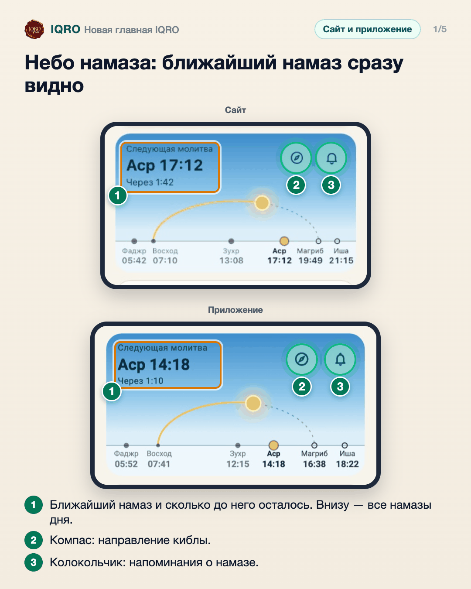
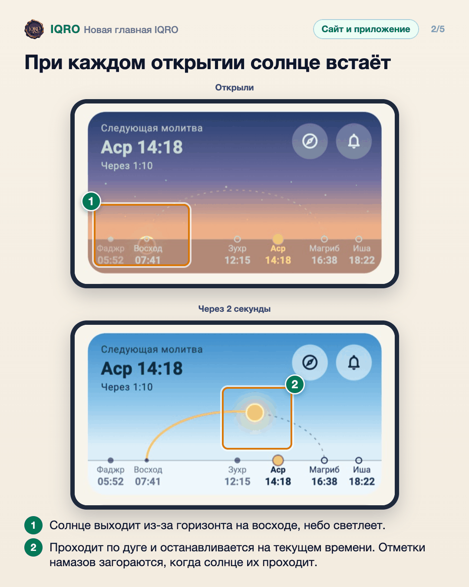
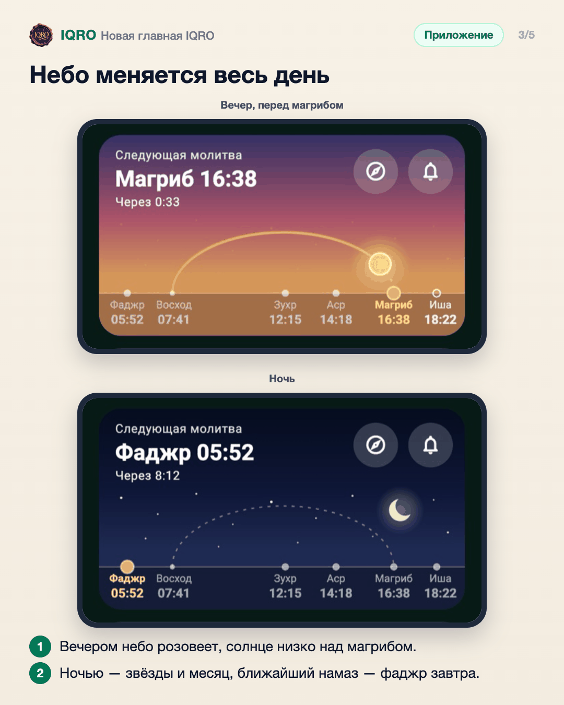
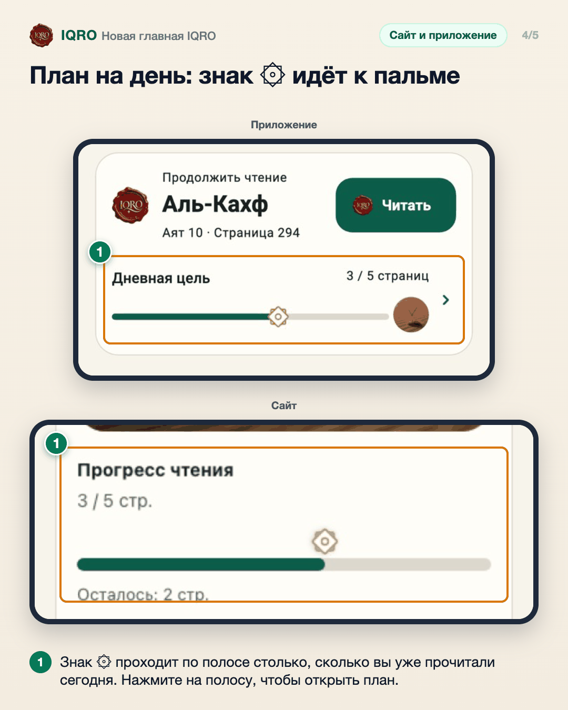
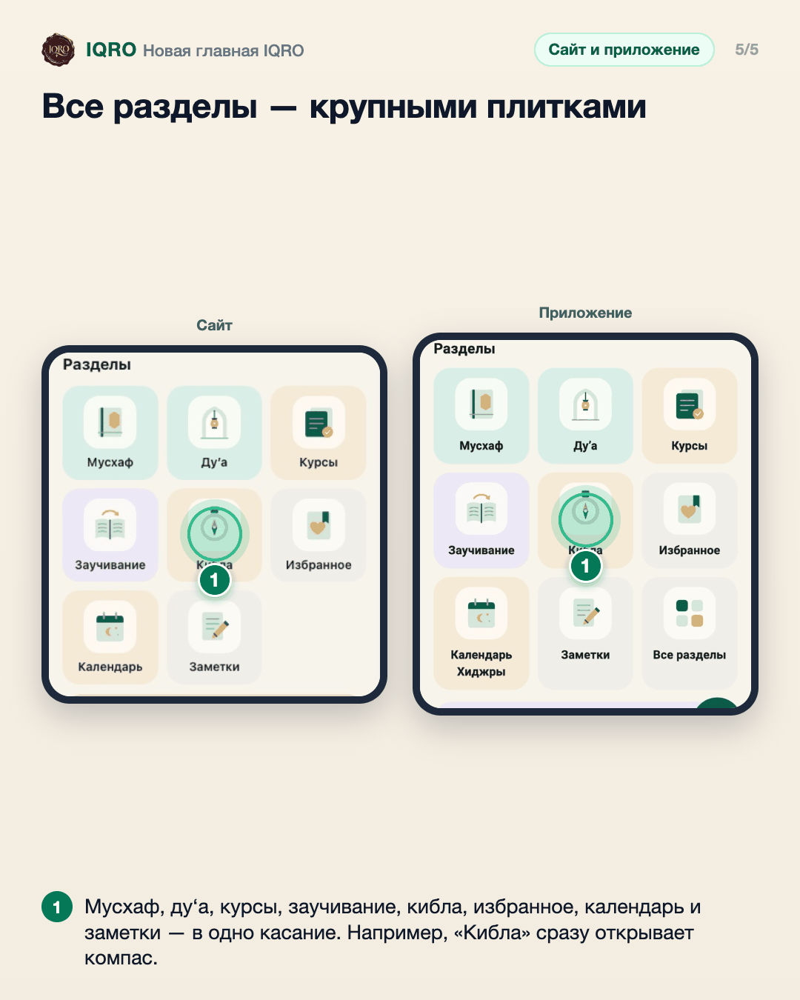

# Новая главная IQRO

Главная стала спокойнее. Сверху небо дня: солнце и луна на одной орбите и время намазов, ниже чтение с места остановки и план на день, а все разделы собраны в крупные плитки с тонкими значками.

**Где найти:** первый экран приложения и главная страница сайта iqro.forum.

**Сайт и приложение:** одинаково на сайте и в приложении. На компьютере плитки разделов стоят в один ряд. На сайте знак ۞ идёт по полосе в карточке «Сегодня».

## Небо намаза: ближайший намаз сразу видно

Сверху на главной — небо сегодняшнего дня. Солнце и луна стоят друг напротив друга на одной орбите: днём наверху солнце, золотая дуга — его путь с восхода, ночью — луна. Внизу все намазы дня, ближайший выделен золотом. Нажмите на небо, чтобы открыть время намаза, на компас — чтобы найти киблу.

## При открытии солнце и луна меняются местами

Каждый раз, когда вы открываете IQRO, орбита за 6 секунд доворачивается от последнего восхода или заката до нынешнего времени — видно, как солнце и луна меняются местами. Если в телефоне выключены анимации, всё сразу стоит на месте.

## Небо меняется весь день

Цвет неба идёт за настоящим временем вашего города: рассвет, день, закат и ночь. Восход и магриб берутся из расписания намаза: в эти минуты солнце и луна стоят на горизонте, так что небо совпадает с тем, что за окном.

## План на день: знак ۞ идёт к пальме

Под «Продолжить чтение» — план на день. При открытии знак ۞ (им в Мусхафе отмечают четверти хизба) проезжает по полосе до сегодняшнего прогресса, в конце его ждёт пальма, которая растёт вместе с вашей привычкой читать.

## Все разделы — спокойными плитками

Ниже — все разделы IQRO плитками с тонкими значками в одну линию. В приложении девятая плитка «Все разделы» ведёт в «Ещё», там же теперь «Загрузки».

## Для рилс и подробного рассказа

- `reels/` — кадры 9:16 (1080×1920) по порядку: обложка, по кадру на каждый экран с его шагами, финальный кадр.
- `screens/` — чистые экраны без отметок, в полном размере: из них можно делать свои анимации.
- `video/` — запись экрана телефона, без звука: как это выглядит вживую.

Заголовок для ролика: **Главная IQRO**. Текст за кадром — подписи к карточкам выше, по порядку.

---

Основа снимков: приложение — `clients/iqro_mobile/test/features/home_screenshots_test.dart`; сайт — локальная сборка с расписанием iqro.forum, 7 ноября 2026.
