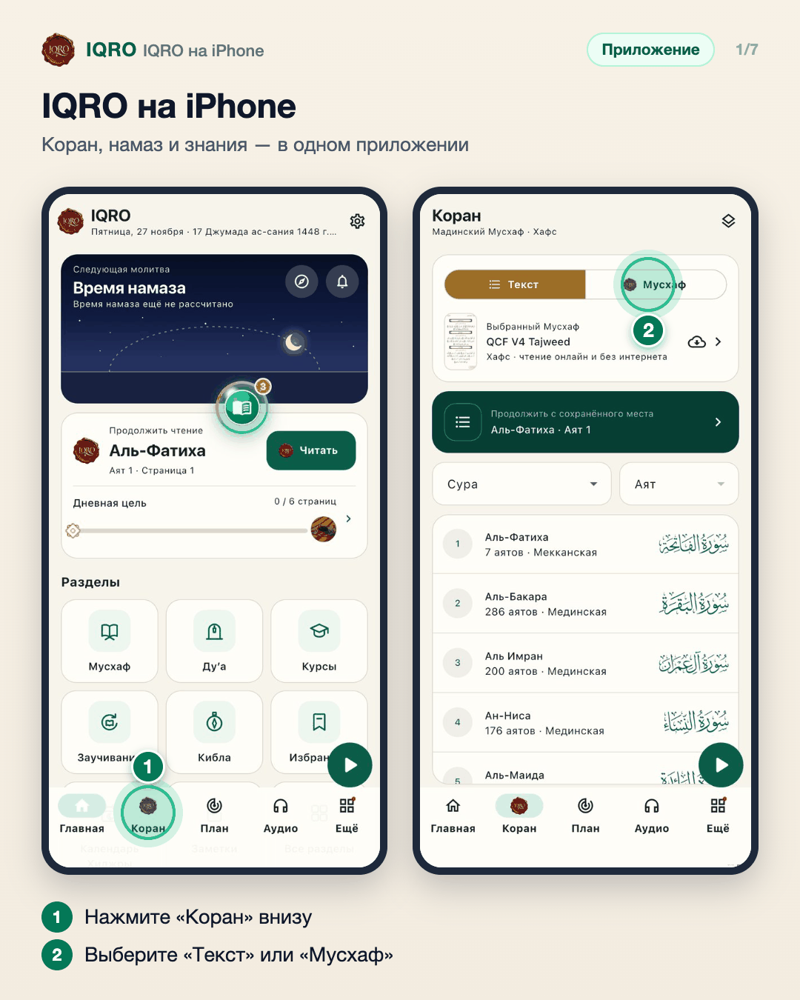
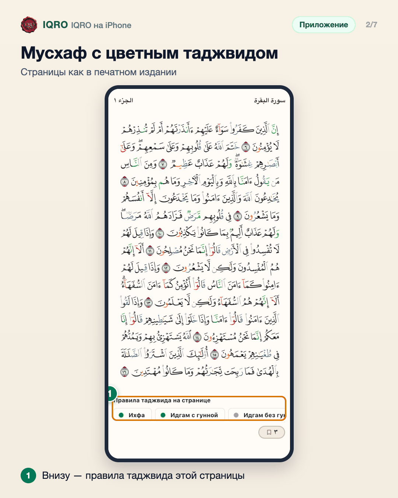
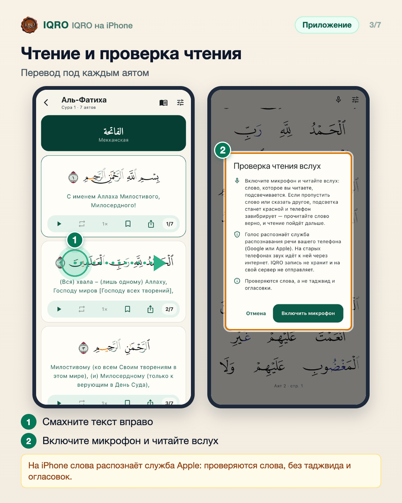
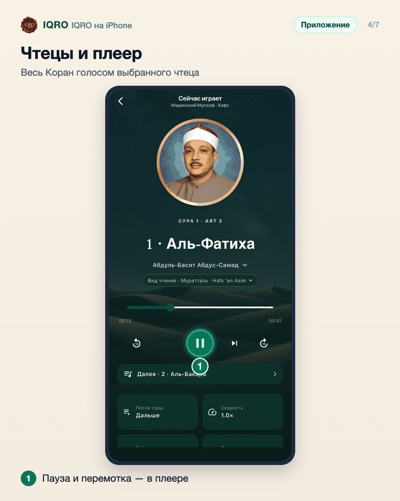
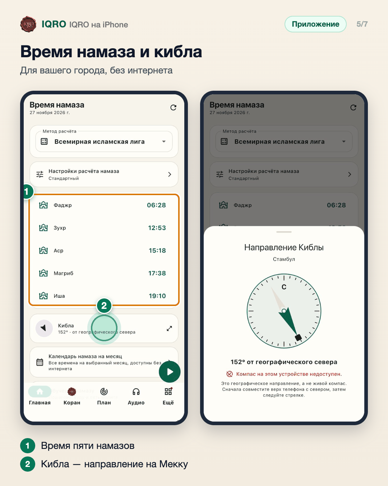
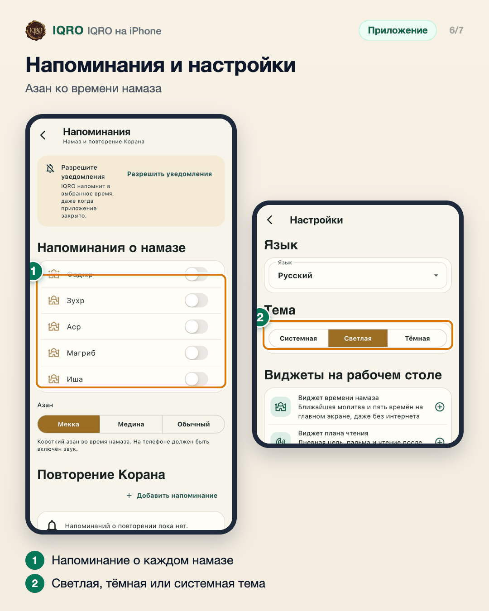
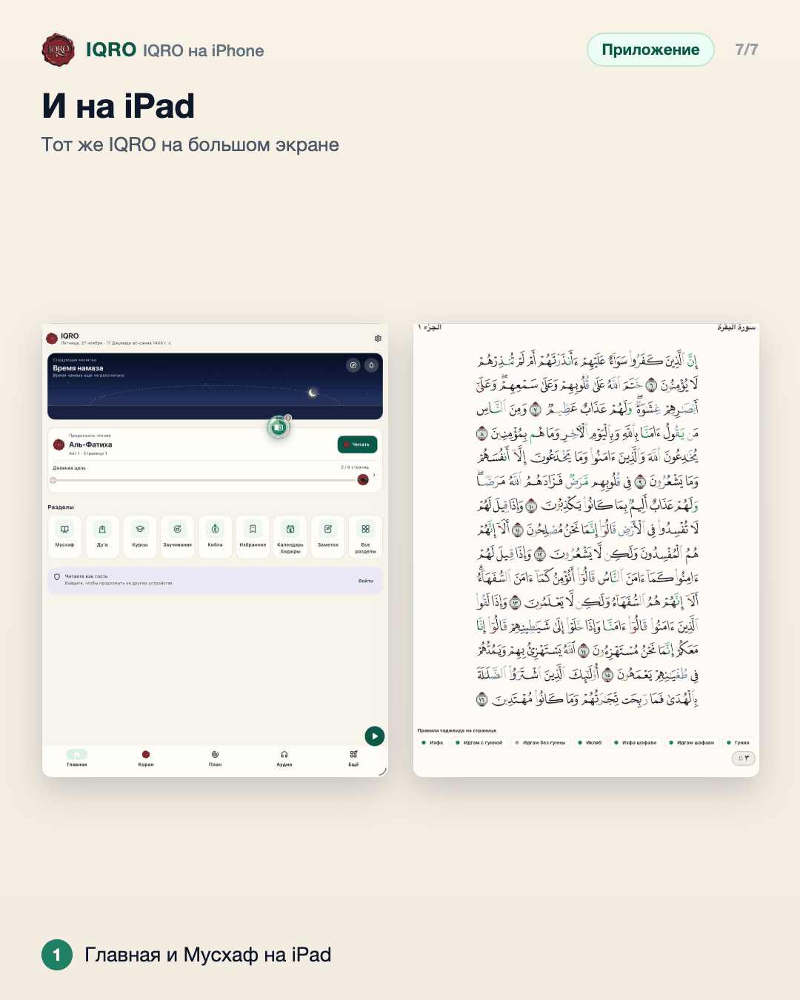

# IQRO на iPhone

IQRO готовится к выходу на iPhone и iPad: Коран и Мусхаф с цветным таджвидом, чтение с переводом, чтецы и плеер, время намаза с киблой, напоминания и проверка чтения вслух — те же разделы, что в приложении для Android. Экраны сняты на симуляторах iPhone 17 Pro Max и iPad Pro 13″ с iOS 26.2.

**Где найти:** App Store → «IQRO» (после выхода; до этого — TestFlight по приглашению).

**Сайт и приложение:** на iPhone проверку чтения вслух ведёт служба распознавания речи Apple: она отмечает прочитанные слова, но, в отличие от Android, не подсказывает ошибки таджвида и огласовок.

## IQRO на iPhone

На главной — ближайший намаз, продолжение чтения и дневная цель. Во вкладке «Коран» можно читать текст с переводом или листать страницы Мусхафа.

## Мусхаф с цветным таджвидом

Мусхаф QCF V4 показывает правила таджвида цветом прямо в тексте. Внизу страницы — какие правила на ней встречаются; нажатие на слово объясняет правило.

## Чтение и проверка чтения

В режиме «Текст» под каждым аятом — перевод. Смахните текст вправо — откроется чтение вслух; кнопка микрофона включает проверку: прочитанные слова подсвечиваются.

## Чтецы и плеер

Во вкладке «Аудио» выберите чтеца или «Слушать весь Коран». В плеере — пауза, перемотка, скорость и переход к следующей суре.

## Время намаза и кибла

Выберите город из списка или по геопозиции — приложение посчитает время пяти намазов. Карточка «Кибла» показывает направление на Мекку от вашего города.

## Напоминания и настройки

В «Напоминаниях» включите напоминание о каждом намазе и выберите азан. В «Настройках» — язык, тема и виджеты для рабочего стола.

## И на iPad

На iPad открывается то же приложение: главная, Мусхаф во всю страницу, чтение с переводом.

## Для рилс и подробного рассказа

- `reels/` — кадры 9:16 (1080×1920) по порядку: обложка, по кадру на каждый экран с его шагами, финальный кадр.
- `screens/` — чистые экраны без отметок, в полном размере: из них можно делать свои анимации.
- `video/` — запись экрана телефона, без звука: как это выглядит вживую.

Заголовок для ролика: **IQRO теперь на iPhone**. Текст за кадром — подписи к карточкам выше, по порядку.

---

Основа снимков: симуляторы iPhone 17 Pro Max и iPad Pro 13″ (M5), iOS 26.2, в GitHub Actions (workflow «iOS simulators»), сборка из ветки claude/ios-native-ci-48c512, 27 ноября 2026; строка состояния обрезана; данные — с iqro.forum, город Стамбул выбран из списка.
