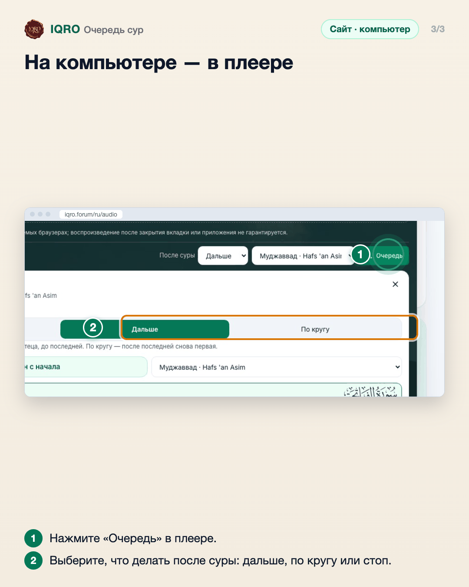

# Очередь сур

Чтение не обрывается после одной суры: плеер сам переходит к следующей. В очереди можно выбрать, что делать после суры — остановиться, играть дальше или по кругу, — и запустить весь Коран с начала.

**Где найти:** полный плеер → «Очередь» (на компьютере — кнопка «Очередь» в плеере).

**Сайт и приложение:** одинаково на сайте и в приложении; в приложении в полном плеере ещё есть плитка «После суры».

## Откройте «Очередь»

Откройте полный плеер и нажмите «Очередь». Вверху выберите, что делать после суры: «Стоп», «Дальше» (следующая сура) или «По кругу». Кнопка «Весь Коран с начала» запускает чтение с первой суры. Ниже — список сур: нажмите любую, чтобы перейти к ней.

## В приложении — так же

В приложении очередь открывается из полного плеера (строка «Далее …»). Те же три режима после суры и кнопка «Весь Коран с начала».

## На компьютере — в плеере

На компьютере очередь открывается кнопкой «Очередь» в развёрнутом плеере.

---

Основа снимков: сайт iqro.forum, 4 ноября 2026; приложение и компьютер — `docs/images/listening-queue-2026-10-26/`.
