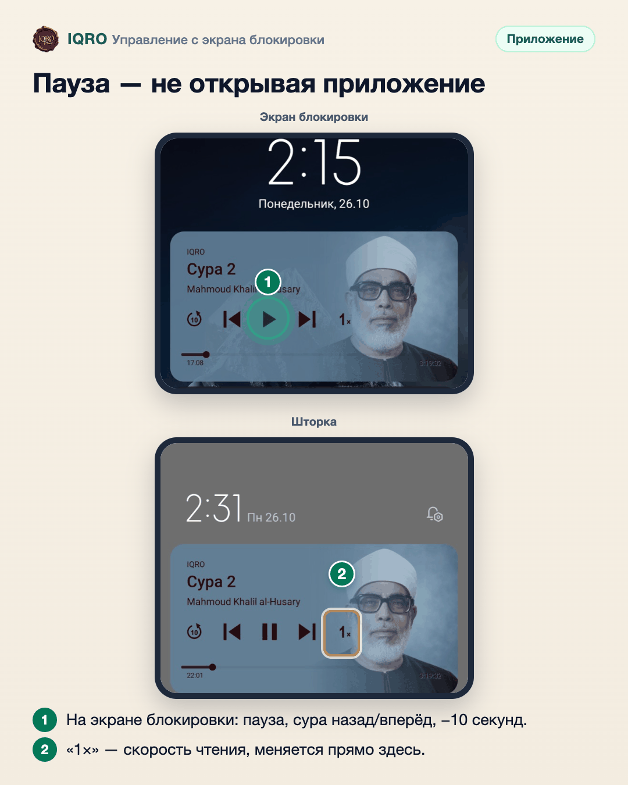

# Управление с экрана блокировки

Чтение Корана продолжает играть при выключенном экране. На экране блокировки и в шторке уведомлений — карточка IQRO: пауза, предыдущая и следующая сура, перемотка на 10 секунд и скорость.

**Где найти:** включите чтение во вкладке «Аудио» и заблокируйте телефон или потяните шторку уведомлений. Для плеера Мусхафа и уроков на карточке только пауза и воспроизведение.

**Сайт и приложение:** это приложение. На сайте браузер тоже может показать пульт, но играть после закрытия вкладки не обещает.

## Пауза — не открывая приложение

На экране блокировки карточка IQRO показывает суру и чтеца. Кнопки: назад на 10 секунд, предыдущая сура, пауза/воспроизведение, следующая сура и скорость. Скорость, выбранная здесь, сохраняется и в самом плеере.

## Для рилс и подробного рассказа

- `reels/` — кадры 9:16 (1080×1920) по порядку: обложка, по кадру на каждый экран с его шагами, финальный кадр.

Заголовок для ролика: **Коран с экрана блокировки**. Текст за кадром — подписи к карточкам выше, по порядку.

---

Основа снимков: `docs/images/media-controls-2026-10-26/` (Redmi).
