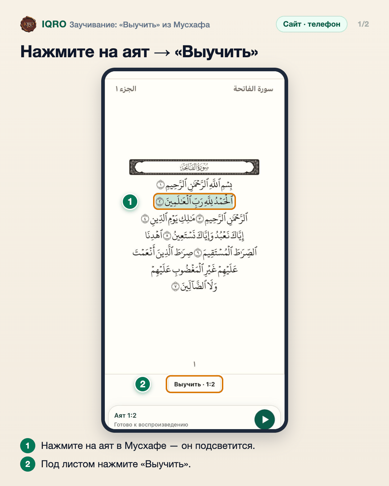
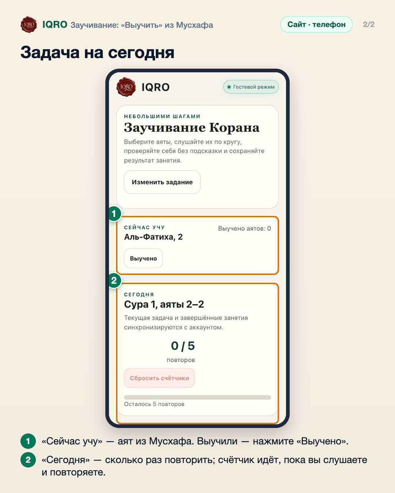

# Заучивание: «Выучить» из Мусхафа

Любой аят можно сразу отправить в заучивание прямо из Мусхафа. IQRO составит задачу на сегодня: послушать и повторить аят нужное число раз, а потом отметить его выученным.

**Где найти:** Мусхаф → нажмите на аят → «Выучить»; список и задача — в разделе «Заучивание» (в приложении — «Выучить» в меню аята).

**Сайт и приложение:** одинаково на сайте и в приложении; в приложении сохранённая копия занятия видна на главной.

## Нажмите на аят → «Выучить»

В Мусхафе нажмите на аят, который хотите выучить, — он подсветится, а под листом появится кнопка «Выучить · 1:2» с номером аята. Нажмите её.

## Задача на сегодня

Откроется «Заучивание Корана». В блоке «Сейчас учу» — выбранный аят; когда запомните, нажмите «Выучено». Ниже — задача на сегодня: аяты и счётчик повторов (по умолчанию 5). «Изменить задание» — выбрать другой отрывок и число повторов.

---

Основа снимков: сайт iqro.forum, 4 ноября 2026.
