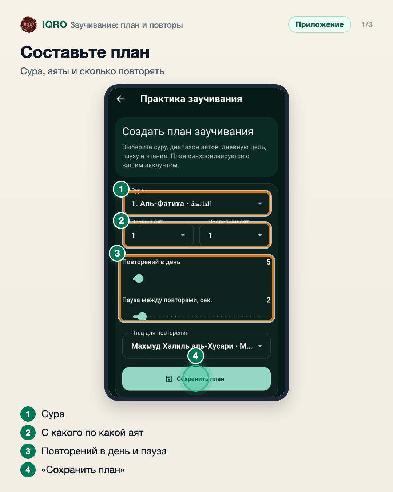
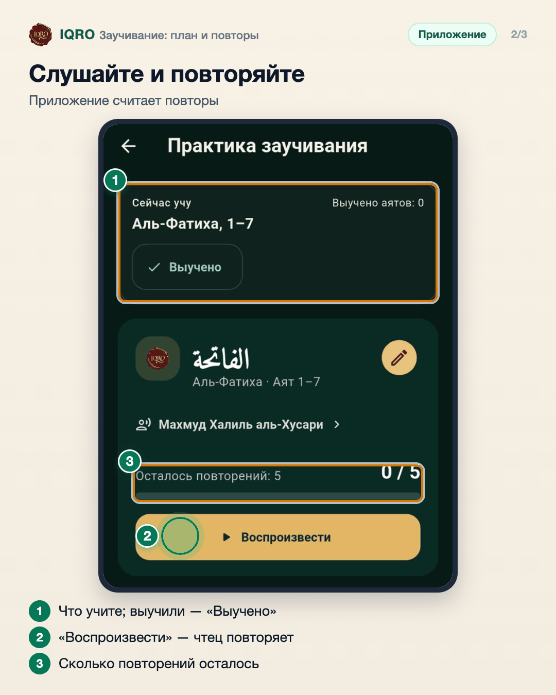
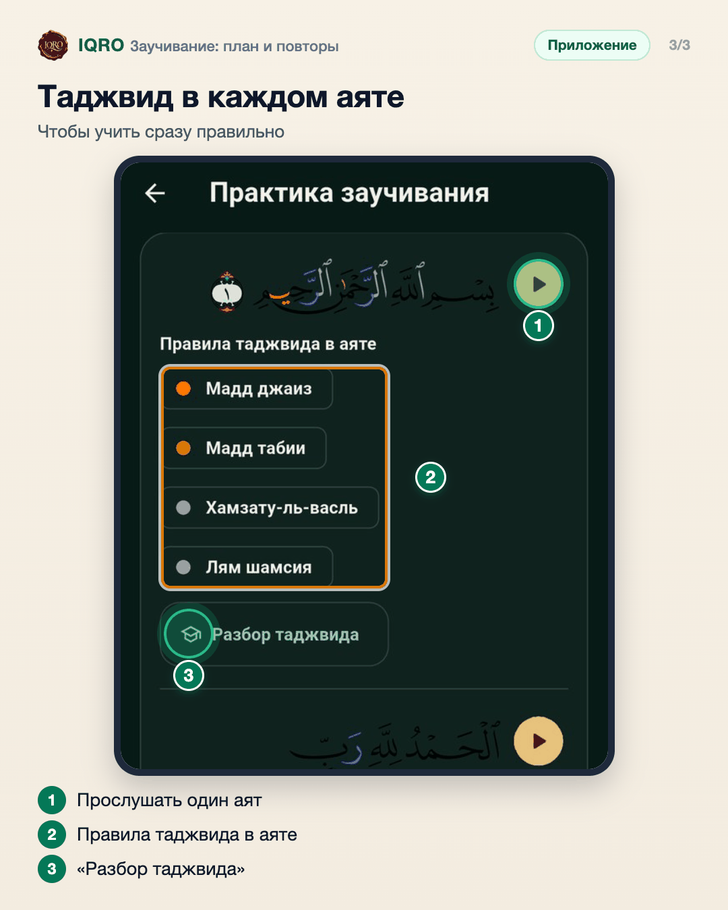

# Заучивание: план и повторы

В «Заучивании» вы составляете план: сура, с какого по какой аят, сколько повторений в день, пауза между повторами и чтец. Приложение читает выбранные аяты нужное число раз и считает повторы, а под каждым аятом показывает правила таджвида в нём. Когда выучили — отметьте «Выучено».

**Где найти:** «Ещё» → «Заучивание».

**Сайт и приложение:** на сайте тот же раздел: iqro.forum → «Заучивание»; если вы вошли в аккаунт, план общий.

## Составьте план

Выберите суру и диапазон аятов, сколько раз в день повторять и паузу между повторами — за паузу удобно повторить самому. Ниже выберите чтеца и нажмите «Сохранить план».

## Слушайте и повторяйте

Вверху — что вы учите сейчас. «Воспроизвести» — чтец читает аяты, приложение считает, сколько повторений осталось на сегодня. Выучили — нажмите «Выучено».

## Таджвид в каждом аяте

Ниже — каждый аят отдельно: его можно прослушать одной кнопкой, под ним — правила таджвида, которые в нём есть, и «Разбор таджвида» с объяснением.

## Для рилс и подробного рассказа

- `reels/` — кадры 9:16 (1080×1920) по порядку: обложка, по кадру на каждый экран с его шагами, финальный кадр.
- `screens/` — чистые экраны без отметок, в полном размере: из них можно делать свои анимации.
- `video/` — запись экрана телефона, без звука: как это выглядит вживую.

Заголовок для ролика: **Учим суру наизусть**. Текст за кадром — подписи к карточкам выше, по порядку.

---

Основа снимков: Redmi, сборка «IQRO тест» из main 9048ca87, 9 ноября 2026; строка состояния телефона обрезана. План по аль-Фатихе создан для съёмки.
