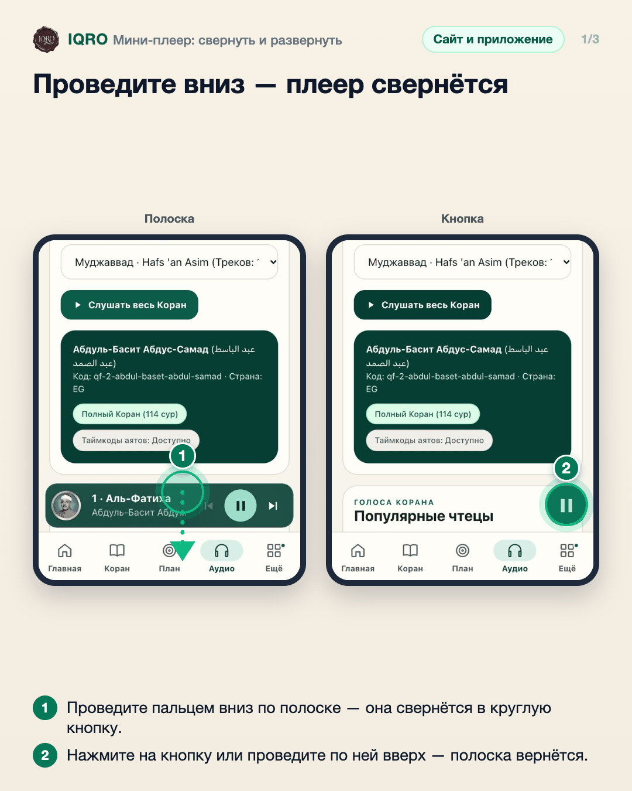
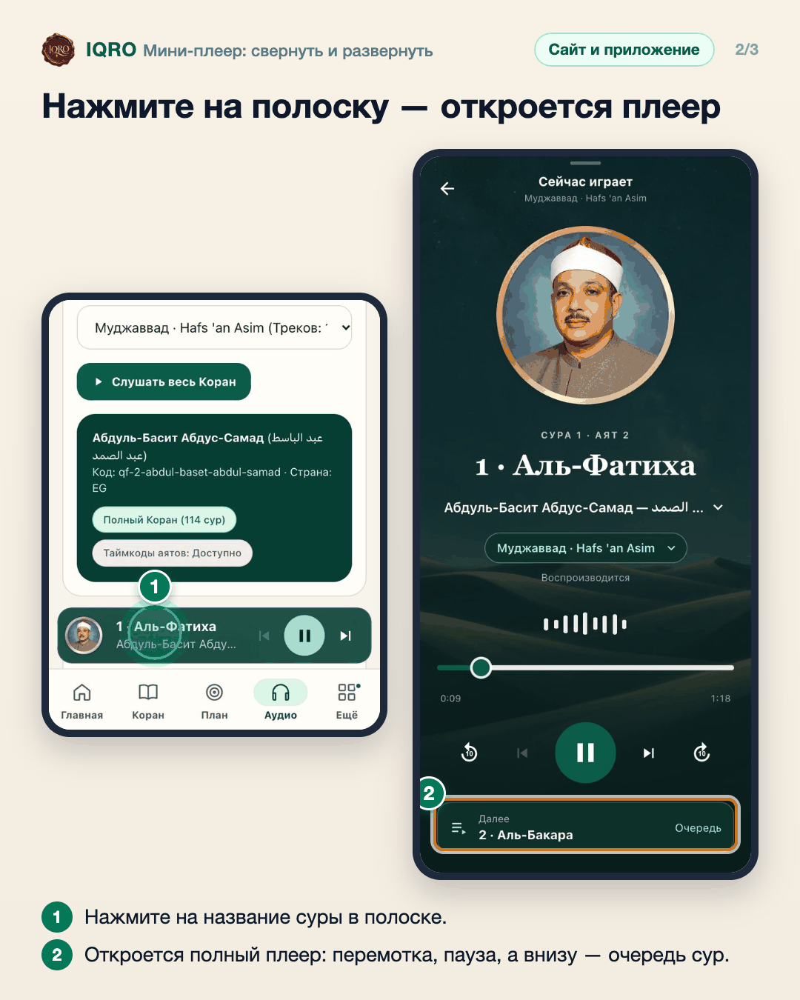
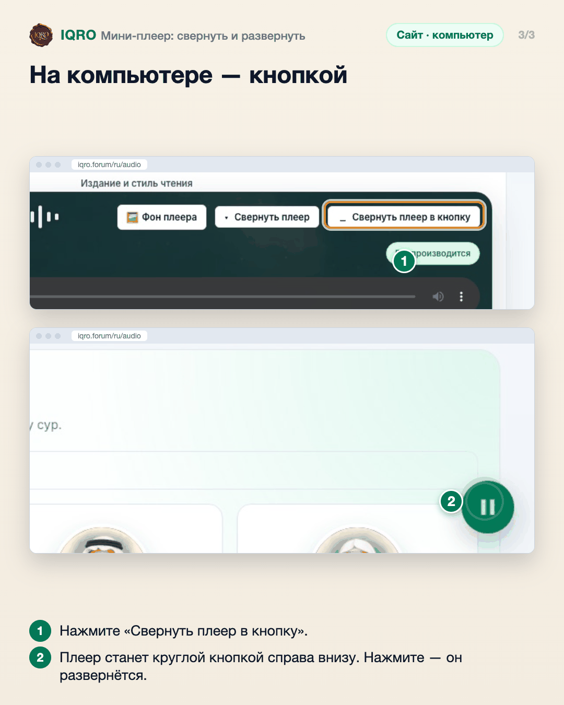

# Мини-плеер: свернуть и развернуть

Пока звучит Коран, внизу экрана остаётся мини-плеер. Его можно свернуть в маленькую круглую кнопку, чтобы он не закрывал страницу, и развернуть обратно одним движением.

**Где найти:** внизу экрана, как только включено любое чтение («Аудио» → чтец → сура или «Слушать весь Коран»).

**Сайт и приложение:** на телефоне — на сайте и в приложении одинаковые жесты (смахнуть полоску в любую сторону — свернуть, коснуться кнопки — развернуть). На компьютере плеер сворачивается кнопкой «Свернуть плеер в кнопку».

## Проведите вниз — плеер свернётся

Проведите пальцем по полоске плеера в любую сторону, например вниз, — она свернётся в круглую кнопку в углу, и звук продолжит играть. Чтобы вернуть полоску, нажмите на кнопку. На сайте с телефона и в приложении — одинаково.

## Нажмите на полоску — откроется плеер

Касание названия суры в полоске открывает полный плеер с перемоткой на 10 секунд, переходом между сурами и очередью внизу.

## На компьютере — кнопкой

На компьютере у плеера есть кнопка «Свернуть плеер в кнопку». После неё остаётся круглая кнопка в правом нижнем углу: звук играет дальше, а нажатие возвращает плеер.

## Для рилс и подробного рассказа

- `reels/` — кадры 9:16 (1080×1920) по порядку: обложка, по кадру на каждый экран с его шагами, финальный кадр.

Заголовок для ролика: **Плеер не мешает читать**. Текст за кадром — подписи к карточкам выше, по порядку.

---

Основа снимков: сайт iqro.forum, 4 ноября 2026; компьютер — `docs/images/desktop-player-fold-2026-11-03/`.
