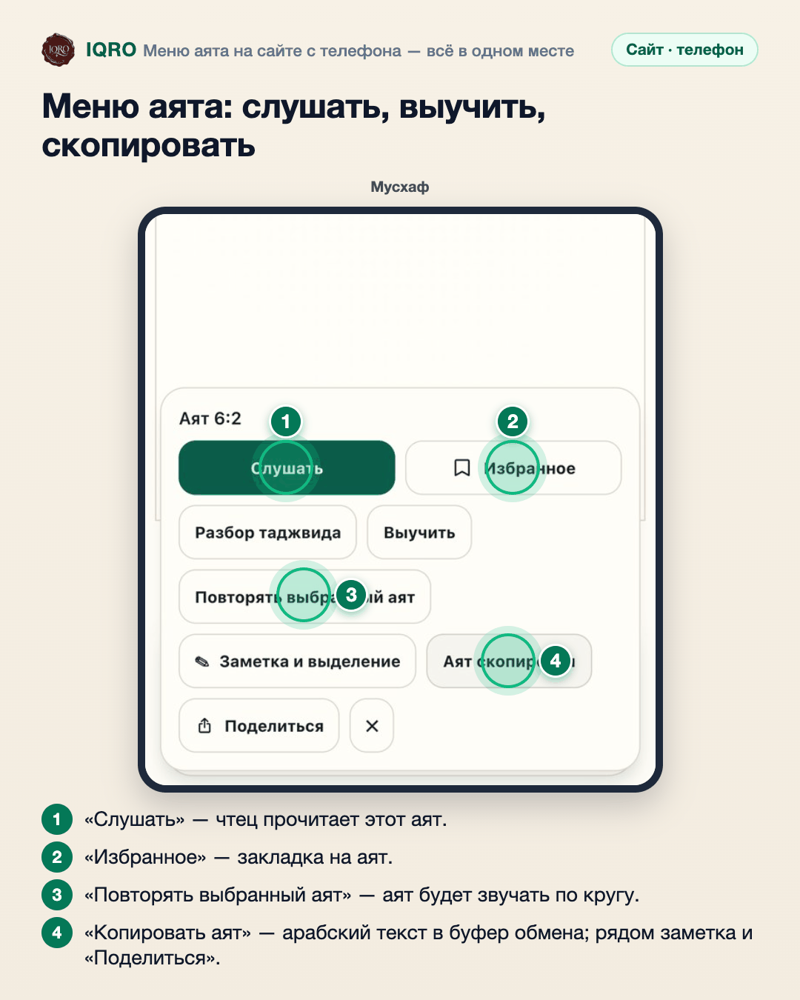

# Меню аята на сайте с телефона — всё в одном месте

В Мусхафе на сайте с телефона меню аята теперь собрано как в приложении: послушать аят, добавить в избранное, разобрать таджвид, выучить, включить повтор, оставить заметку, скопировать и поделиться.

**Где найти:** сайт iqro.forum с телефона: «Коран» → Мусхаф → нажмите на номер аята в конце аята.

**Сайт и приложение:** те же действия и в том же порядке, что в приложении. Цвет выделения и заметка на сайте — одна кнопка «Заметка и выделение». Масштаба, списка закладок и выбора Мусхафа в этом меню на сайте пока нет. В текстовом режиме кнопка «Копировать» стоит в ряду кнопок под номером аята.

## Меню аята: слушать, выучить, скопировать

Нажмите на номер аята в Мусхафе — откроется меню. «Слушать» читает этот аят, «Избранное» ставит закладку, «Копировать аят» кладёт арабский текст в буфер.

---

Основа снимков: сайт — локальная сборка, телефон 390×844, тестовые данные, 17 ноября 2026.
