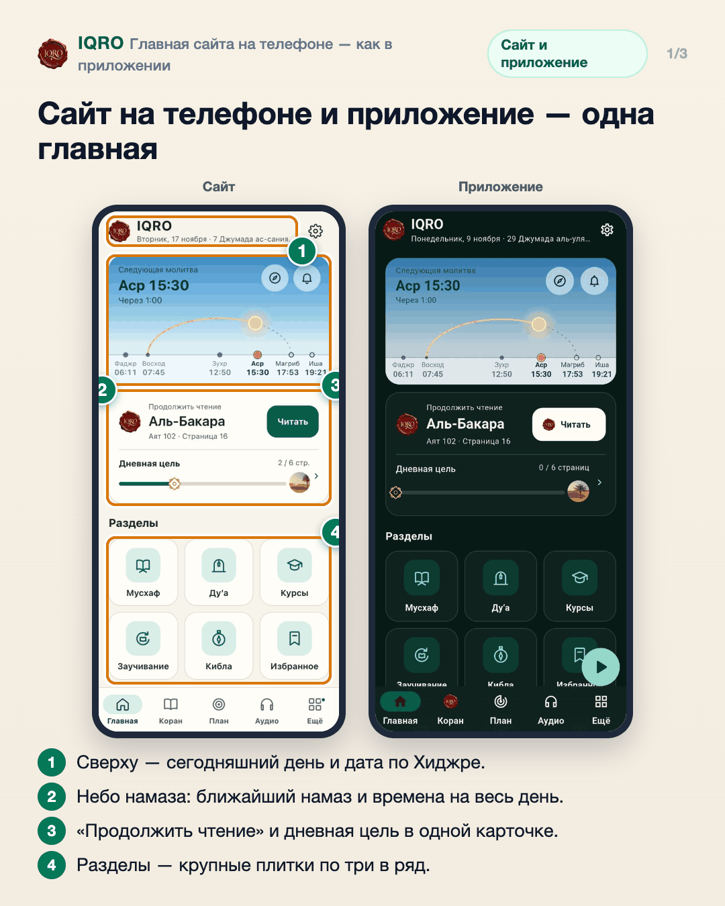
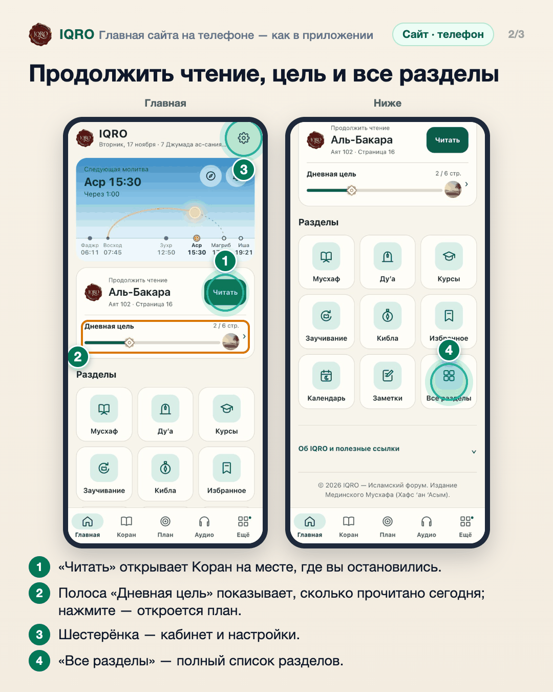
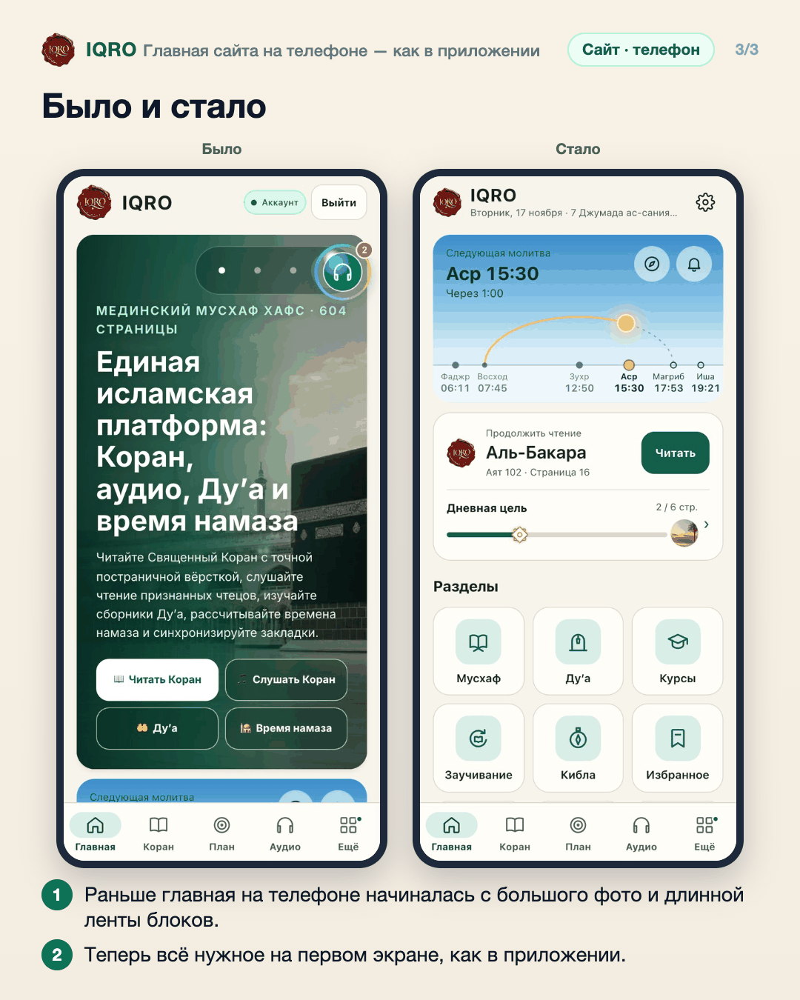

# Главная сайта на телефоне — как в приложении

Главная iqro.forum на телефоне теперь выглядит как главная приложения: дата сверху, небо намаза, «Продолжить чтение» с дневной целью и девять плиток разделов. Большое фото и длинная лента блоков остались только на компьютере.

**Где найти:** главная страница сайта iqro.forum, открытая с телефона.

**Сайт и приложение:** на телефоне сайт и приложение выглядят одинаково. На компьютере главная сайта не изменилась. Шестерёнка на сайте пока открывает «Кабинет», а плитка «Все разделы» — список «Ещё».

## Сайт на телефоне и приложение — одна главная

Главная сайта на телефоне теперь такая же, как в приложении: дата, небо намаза, «Продолжить чтение» с дневной целью и плитки разделов.

## Продолжить чтение, цель и все разделы

«Читать» возвращает к месту, где вы остановились. Полоса под ним — дневная цель: нажмите, чтобы открыть план. Шестерёнка ведёт в кабинет, «Все разделы» — к полному списку.

## Было и стало

Раньше главная на телефоне начиналась с большого фото и длинной ленты блоков. Теперь всё нужное на первом экране. На компьютере главная осталась прежней.

---

Основа снимков: сайт — локальная сборка, телефон 390×844, тестовые данные, 17 ноября 2026; приложение — снимок из `docs/guides/home/screens/`.
