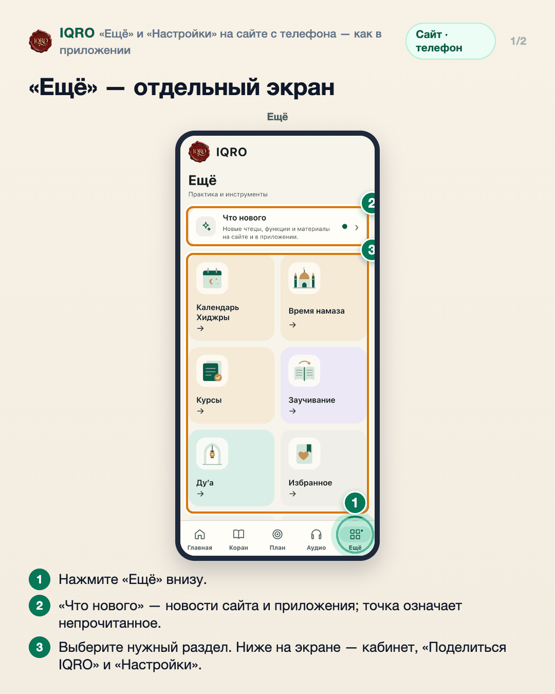
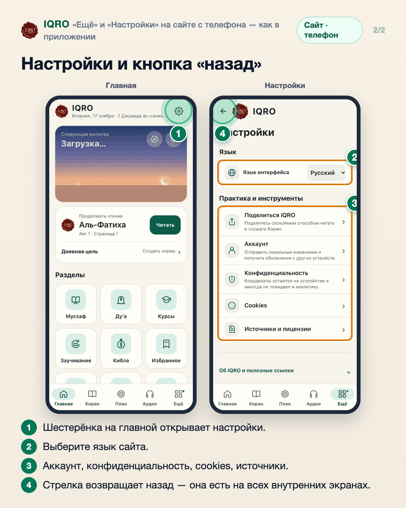

# «Ещё» и «Настройки» на сайте с телефона — как в приложении

На сайте с телефона вкладка «Ещё» теперь открывает отдельный экран, как в приложении: новости, все инструменты крупными карточками и аккаунт. Появился экран «Настройки», а на внутренних экранах — кнопка «назад».

**Где найти:** сайт iqro.forum с телефона: нижняя вкладка «Ещё»; настройки — шестерёнка на главной или «Ещё» → «Настройки».

**Сайт и приложение:** экран «Ещё» устроен как в приложении. В настройках сайта есть язык и ссылки; выбора темы, офлайн-хранилища, вибрации и виджетов на сайте нет.

## «Ещё» — отдельный экран

Вкладка «Ещё» открывает экран со всеми инструментами: «Что нового», календарь, время намаза, курсы, заучивание, ду‘а, избранное, заметки, Имена Аллаха. Ниже — кабинет, «Поделиться» и «Настройки».

## Настройки и кнопка «назад»

Шестерёнка на главной открывает настройки: язык, аккаунт, конфиденциальность. Стрелка слева вверху возвращает на предыдущий экран.

---

Основа снимков: сайт — локальная сборка, телефон 390×844, тестовые данные, 17 ноября 2026.
