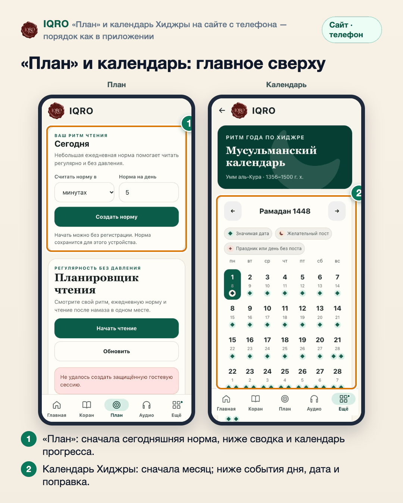

# «План» и календарь Хиджры на сайте с телефона — порядок как в приложении

На сайте с телефона «План» теперь начинается с пальмы и сегодняшней нормы, а календарь Хиджры — с месяца и событий выбранного дня, как в приложении.

**Где найти:** сайт iqro.forum с телефона: вкладка «План»; «Ещё» → «Календарь Хиджры».

**Сайт и приложение:** порядок блоков как в приложении. На сайте в календаре дополнительно есть поле григорианской даты.

## «План» и календарь: главное сверху

«План» открывается сегодняшней нормой и пальмой, ниже — история и календарь прогресса. В календаре Хиджры сначала месяц и события дня, а дата и поправка — под ними.

---

Основа снимков: сайт — локальная сборка, телефон 390×844, тестовые данные, 17 ноября 2026.
