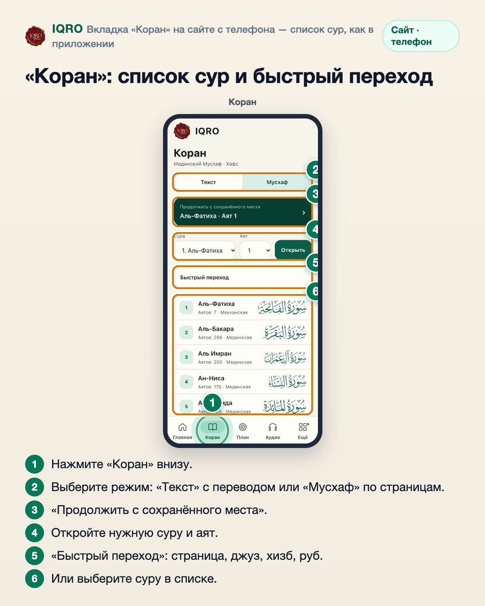

# Вкладка «Коран» на сайте с телефона — список сур, как в приложении

На сайте с телефона вкладка «Коран» теперь открывает экран со списком сур, как в приложении: выбор режима «Текст» или «Мусхаф», продолжение с сохранённого места, переход к суре и аяту и быстрый переход по странице, джузу и хизбу.

**Где найти:** сайт iqro.forum с телефона: нижняя вкладка «Коран».

**Сайт и приложение:** экран устроен как в приложении. Выбора издания Мусхафа на этом экране сайта пока нет — он остаётся в настройках чтения.

## «Коран»: список сур и быстрый переход

Вкладка «Коран» открывает список сур. Сверху выберите, как читать — «Текст» или «Мусхаф»; тёмная карточка возвращает к месту, где вы остановились.

---

Основа снимков: сайт — локальная сборка, телефон 390×844, тестовые данные, 17 ноября 2026.
