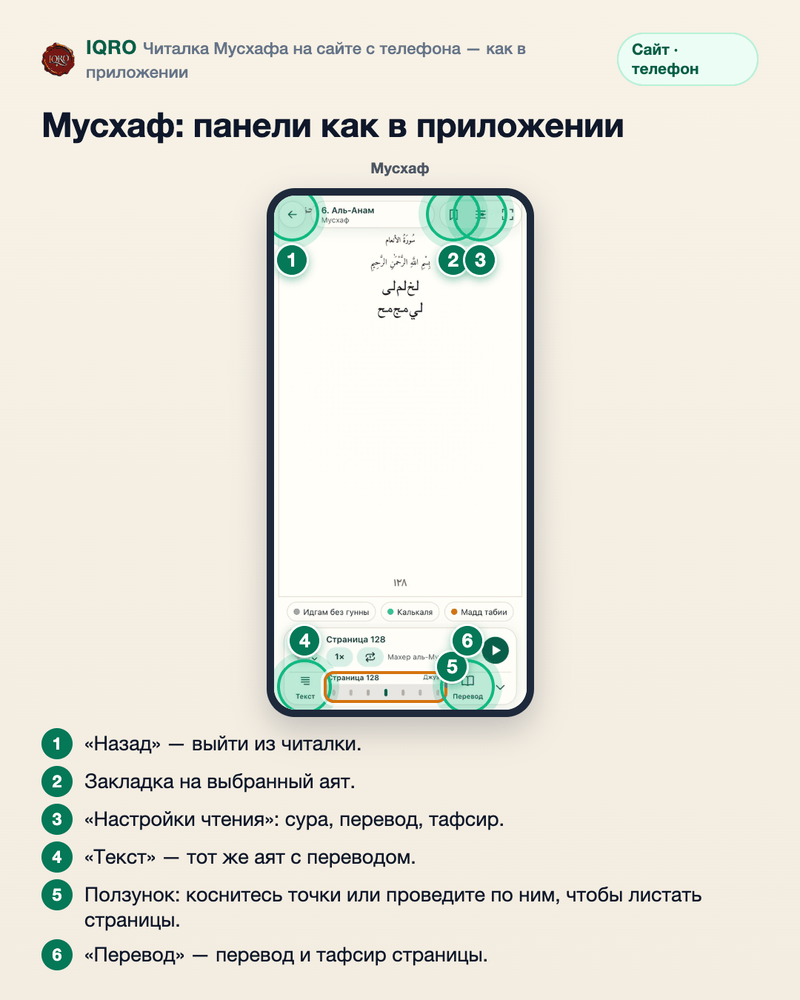

# Читалка Мусхафа на сайте с телефона — как в приложении

Мусхаф на сайте с телефона получил панели как в приложении: сверху кнопка «назад», название суры, закладка и настройки; снизу плеер и ряд «Текст — ползунок страниц — Перевод». Касание страницы прячет и возвращает панели.

**Где найти:** сайт iqro.forum с телефона: «Коран» → выберите суру (режим «Мусхаф»).

**Сайт и приложение:** расположение как в приложении. На сайте дополнительно есть значки «Настройки чтения» и «На весь экран» сверху и стрелка «Свернуть меню» внизу. Масштаба и списка закладок в читалке сайта пока нет.

## Мусхаф: панели как в приложении

Сверху — «назад», сура и выбранный аят, закладка. Снизу — плеер, «Текст», ползунок страниц с номером джуза и «Перевод». Коснитесь страницы, чтобы убрать панели и читать.

---

Основа снимков: сайт — локальная сборка, телефон 390×844, тестовые данные, 17 ноября 2026.
