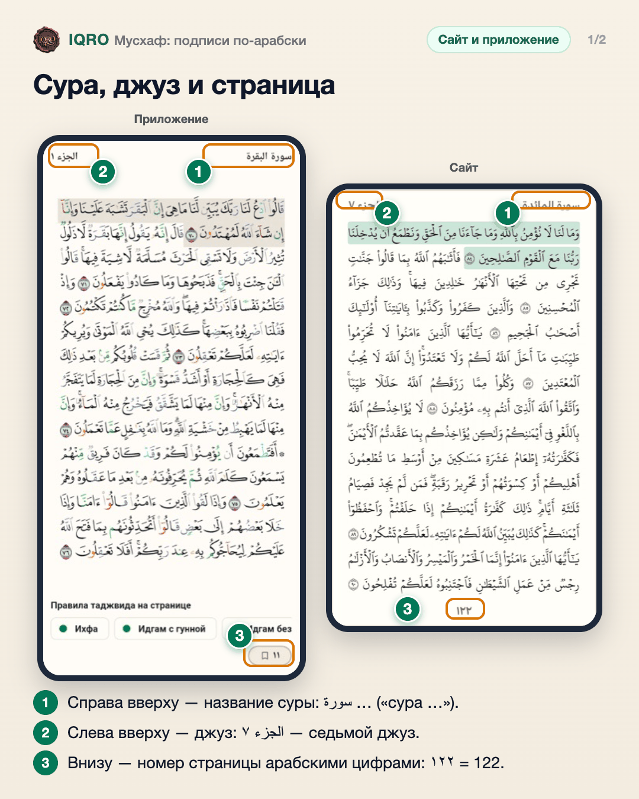
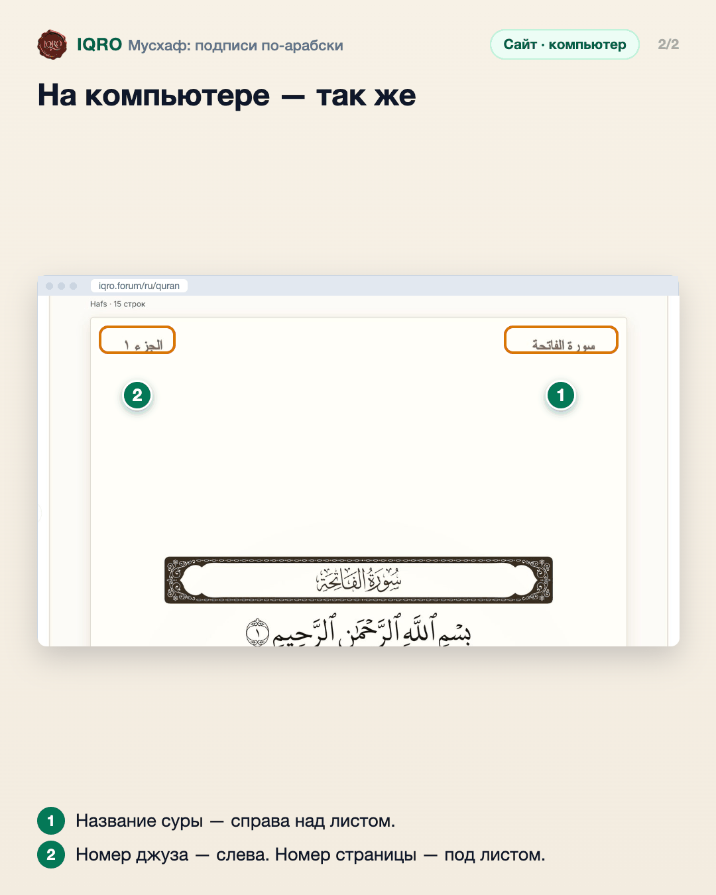

# Мусхаф: подписи по-арабски

Над листом Мусхафа — название суры и номер джуза, внизу — номер страницы. Теперь они по-арабски и крупнее, как в печатном Мусхафе, и не прижаты к строкам.

**Где найти:** «Коран» → режим «Мусхаф», на каждом листе.

**Сайт и приложение:** одинаково на сайте и в приложении. В приложении номер страницы стоит в кнопке закладки внизу справа.

## Сура, джуз и страница

Подписи листа — как в печатном Мусхафе: справа вверху название суры, слева вверху номер джуза, внизу номер страницы. Всё арабскими буквами и цифрами (١٢٢ — это 122).

## На компьютере — так же

На компьютере подписи стоят над листом так же: сура справа, джуз слева, номер страницы внизу.

## Для рилс и подробного рассказа

- `reels/` — кадры 9:16 (1080×1920) по порядку: обложка, по кадру на каждый экран с его шагами, финальный кадр.
- `screens/` — чистые экраны без отметок, в полном размере: из них можно делать свои анимации.

Заголовок для ролика: **Мусхаф по-арабски**. Текст за кадром — подписи к карточкам выше, по порядку.

---

Основа снимков: `docs/images/mushaf-labels-size-2026-11-03/`; компьютер — сайт iqro.forum, 4 ноября 2026.
