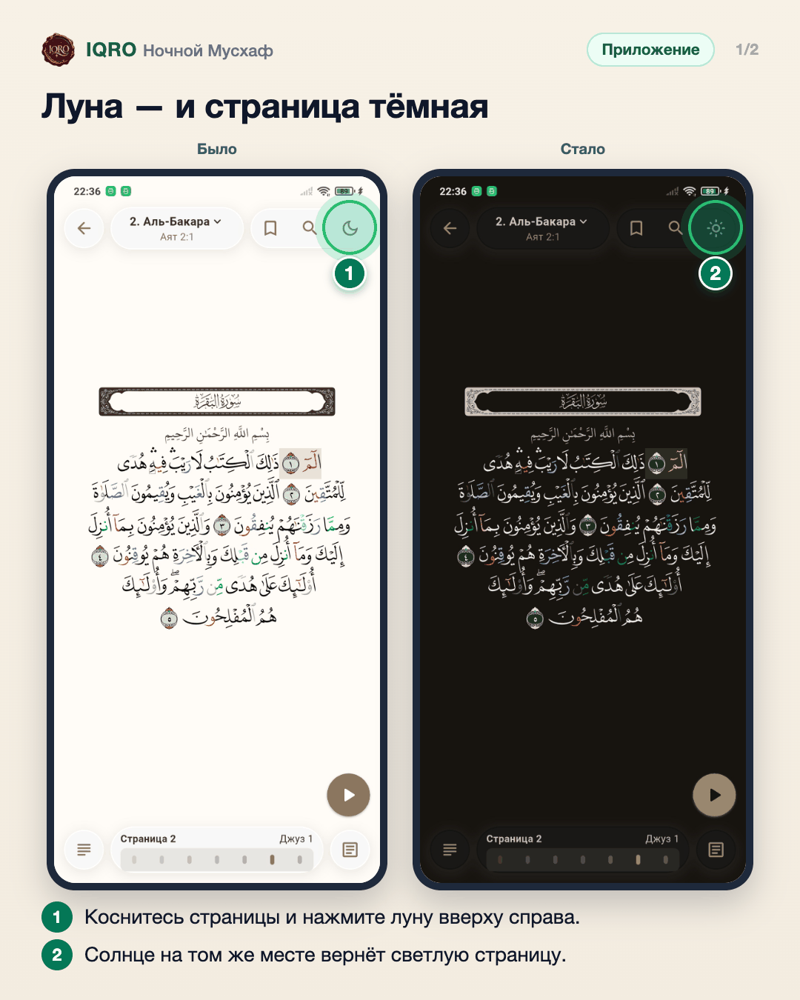
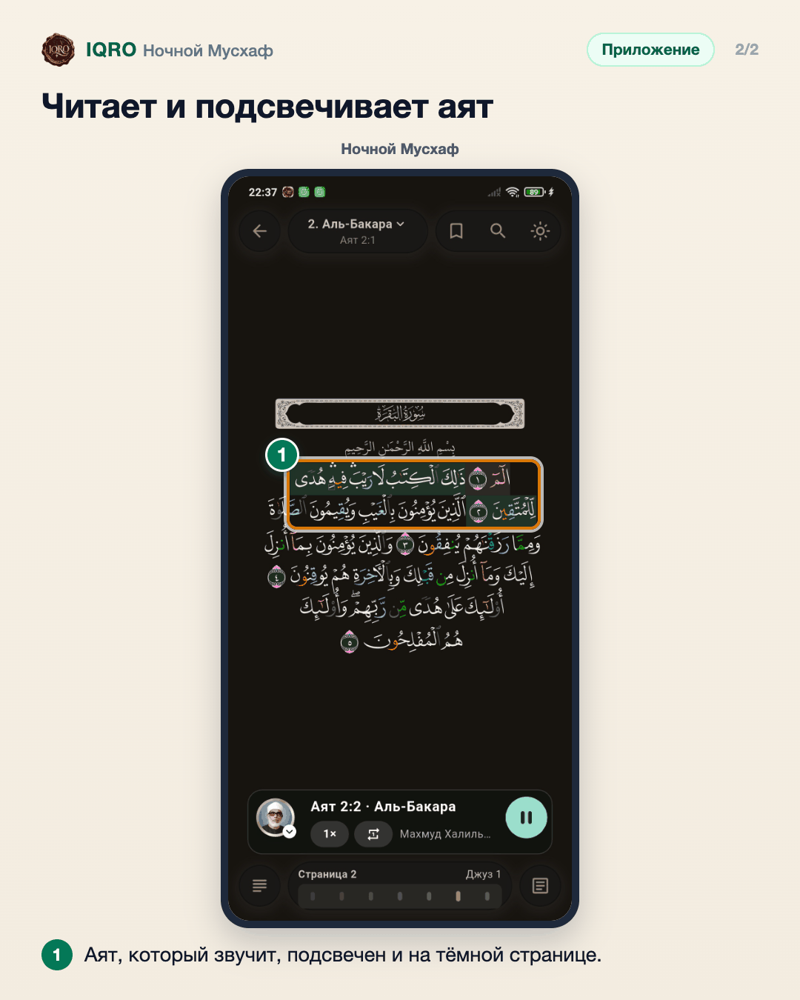

# Ночной Мусхаф

Страницу Мусхафа можно сделать тёмной: бумага становится тёмной, буквы светлыми, а цвета таджвида и ваши выделения остаются на месте. Удобно читать ночью и в темноте, экран не слепит.

**Где найти:** откройте Мусхаф, коснитесь страницы, чтобы появились панели, и нажмите луну в правом верхнем углу. Чтобы вернуть светлую страницу, нажмите там же солнце.

**Сайт и приложение:** это приложение. На сайте ночного Мусхафа пока нет.

## Луна — и страница тёмная

Одно нажатие — и Мусхаф тёмный. Цвета таджвида сохраняются. Выбор запоминается: в следующий раз Мусхаф откроется таким же.

## Читает и подсвечивает аят

В ночном режиме работает всё то же: плеер читает страницу и подсвечивает аят, закладки, поиск и переход к суре на своих местах.

---

Основа снимков: снимки с Redmi Note 7, тестовая сборка веток claude/app-ux-layout и claude/app-ux-media-session, 19 ноября 2026.
