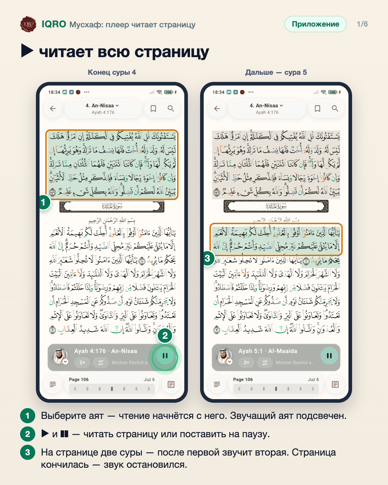
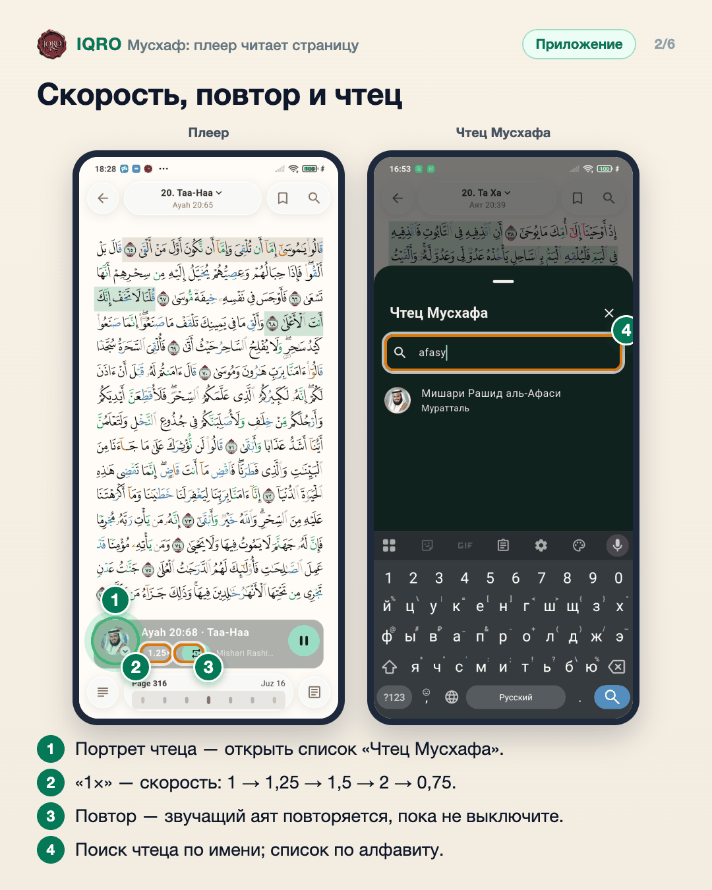
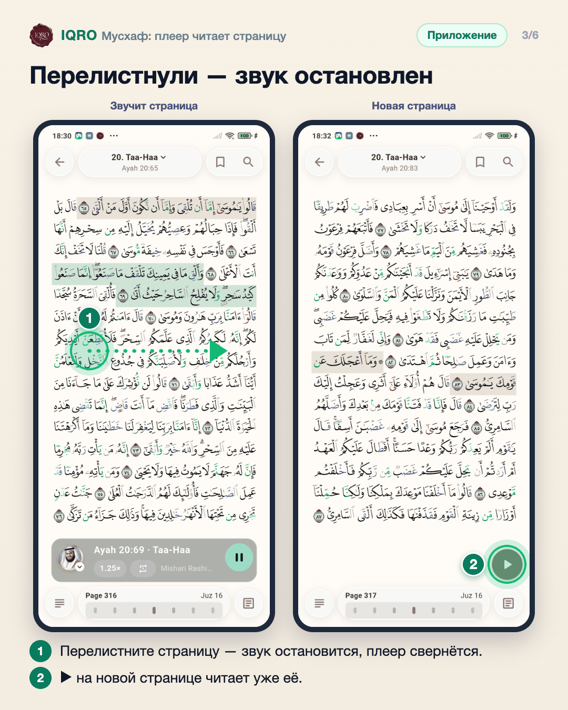
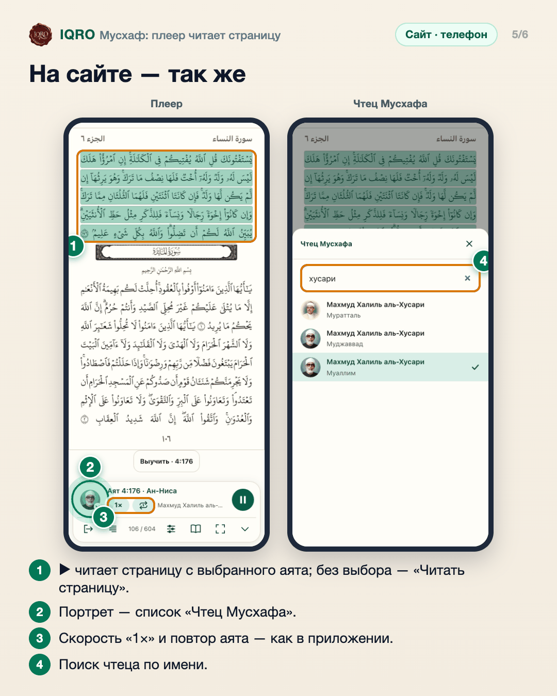
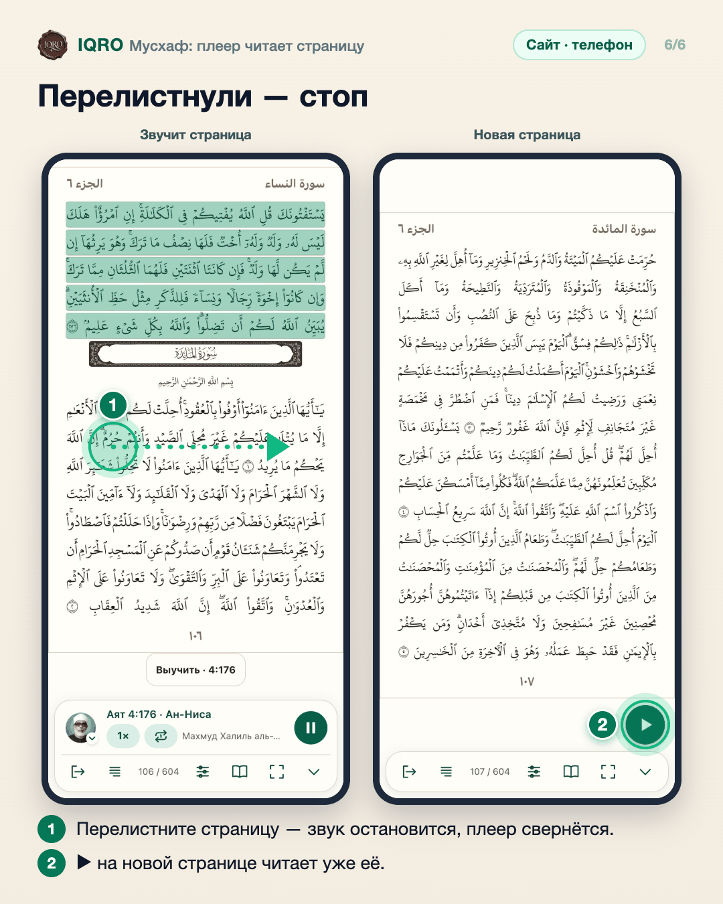

# Мусхаф: плеер читает страницу

В Мусхафе кнопка ▶ читает открытую страницу: от выбранного аята до последнего аята страницы, а если на странице две суры — обе по порядку. Перелистнули — звук останавливается. В плеере есть скорость и повтор аята, а чтеца выбирают нажатием на его портрет.

**Где найти:** «Коран» → Мусхаф: коснитесь аята и нажмите ▶. Плеер появится внизу страницы.

**Сайт и приложение:** одинаково в приложении и на сайте с телефона или планшета (полноэкранный Мусхаф). На сайте без выбранного аята кнопка называется «Читать страницу» и читает страницу с первого аята.

## ▶ читает всю страницу

Коснитесь аята и нажмите ▶: Мусхаф читает с этого аята до конца открытой страницы, подряд, звучащий аят подсвечен. Если на странице кончается одна сура и начинается другая, после первой зазвучит вторая. На последнем аяте страницы чтение останавливается.

## Скорость, повтор и чтец

Нажмите на портрет чтеца — откроется список «Чтец Мусхафа»: только чтецы с разметкой по аятам, по алфавиту, с поиском. Выбор запоминается для Мусхафа. «1×» меняет скорость по кругу, как в плеере «Аудио». Значок повтора держит звучащий аят: он повторяется, пока повтор не выключить, а потом чтение продолжится до конца страницы.

## Перелистнули — звук остановлен

Звук не уходит за пределы открытой страницы: если перелистнуть страницу — свайпом, полосой страниц или переходом к суре или аяту, — чтение остановится, а плеер свернётся в круглую кнопку. На новой странице ▶ читает уже её. Сам плеер можно свернуть смахиванием в любую сторону — тогда звук продолжит играть.

## Меню аята без «Сейчас играет»

В меню аята (кнопка справа внизу) остались масштаб, закладки и заметки. Пункт «Сейчас играет» убран: он открывал плеер вкладки «Аудио», а не чтецов Мусхафа. Чтеца Мусхафа можно сменить и здесь, в поле «Выберите чтеца», — список тоже по алфавиту.

## На сайте — так же

На сайте с телефона или планшета плеер Мусхафа такой же, как в приложении: ▶ читает открытую страницу с выбранного аята (без выбора кнопка называется «Читать страницу»), обе суры, если их две. Портрет чтеца открывает список «Чтец Мусхафа», под заголовком — скорость и повтор аята.

## Перелистнули — стоп

Как в приложении: перелистнули страницу — чтение остановилось, плеер свернулся в круглую кнопку над нижней панелью. ▶ на новой странице читает её. Смахивание по плееру тоже сворачивает его, но звук при этом продолжает играть.

## Для рилс и подробного рассказа

- `reels/` — кадры 9:16 (1080×1920) по порядку: обложка, по кадру на каждый экран с его шагами, финальный кадр.

Заголовок для ролика: **Мусхаф читает вслух**. Текст за кадром — подписи к карточкам выше, по порядку.

---

Основа снимков: Redmi Note 7, сборка ветки claude/mushaf-player, данные iqro.forum (интерфейс приложения на телефоне был английским); сайт — телефон 390×844, данные iqro.forum, 5 ноября 2026.
