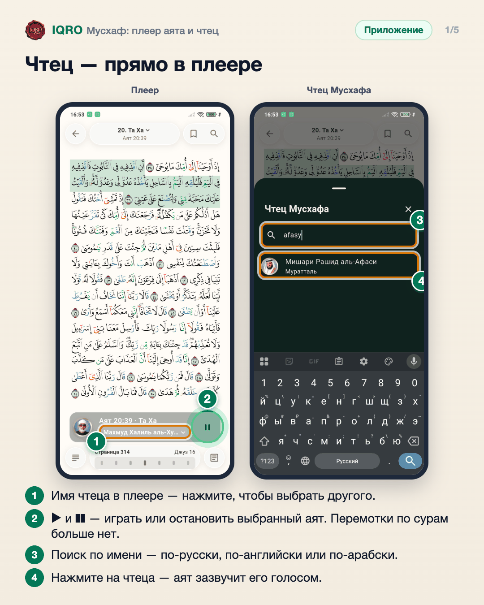
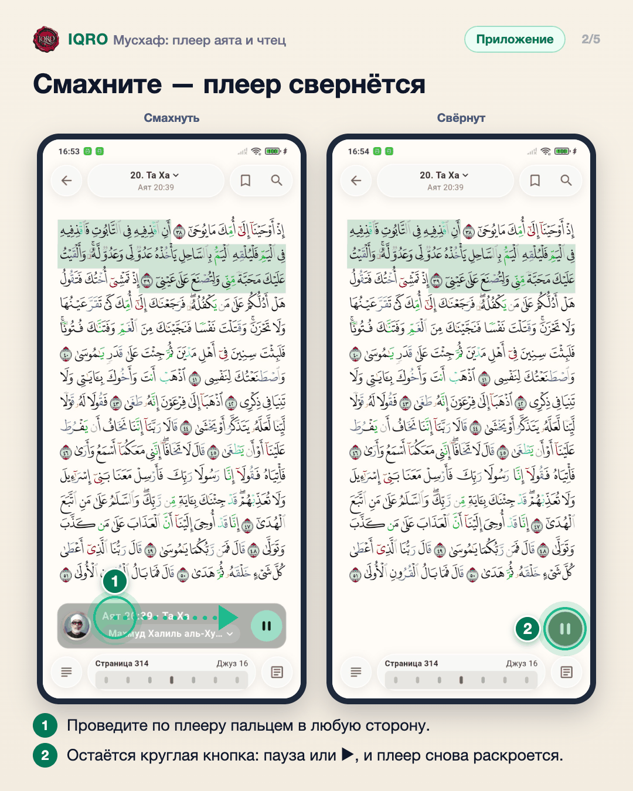
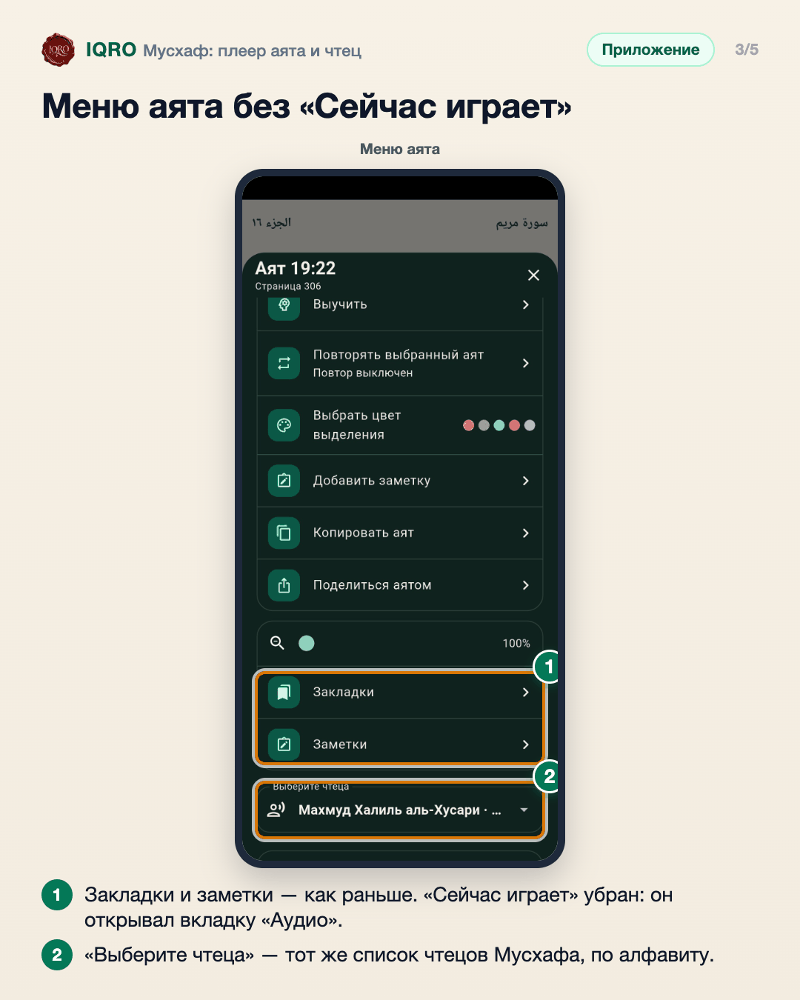
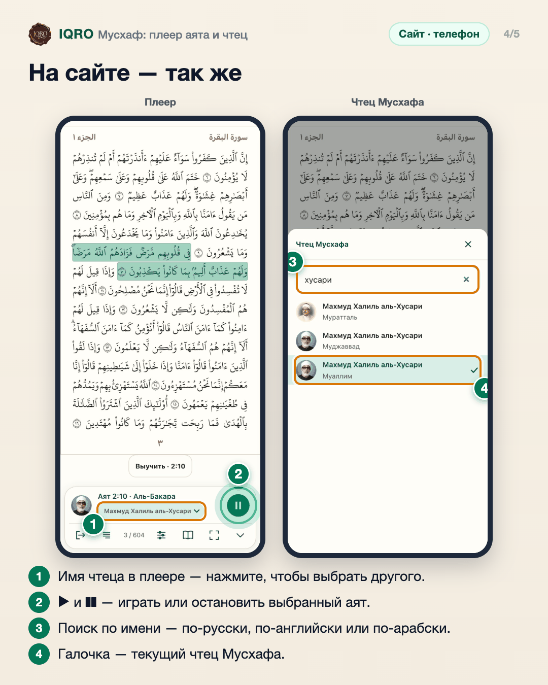
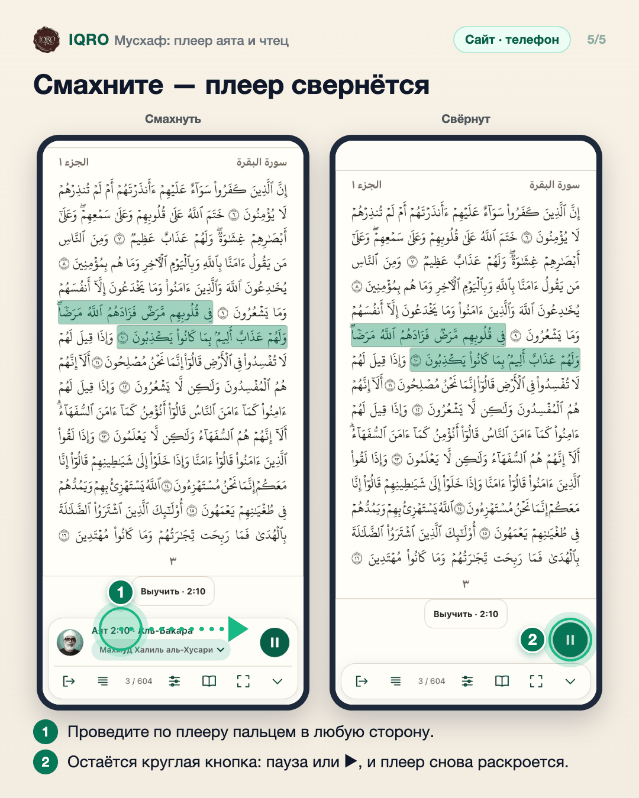

# Мусхаф: плеер аята и чтец

В Мусхафе плеер играет аят, выбранный на странице. Имя чтеца в плеере — кнопка: нажмите, чтобы выбрать другого чтеца из списка по алфавиту. Плеер можно смахнуть — он свернётся в круглую кнопку, а аят продолжит звучать.

**Где найти:** «Коран» → Мусхаф: коснитесь аята и нажмите ▶. Плеер появится внизу страницы.

**Сайт и приложение:** одинаково в приложении и на сайте с телефона или планшета (полноэкранный Мусхаф).

## Чтец — прямо в плеере

Выберите аят на странице Мусхафа и нажмите ▶ — внизу появится плеер: номер аята, портрет и имя чтеца. Кнопок перемотки по сурам больше нет: плеер играет тот аят, который вы выбрали. Нажмите на имя чтеца — откроется список «Чтец Мусхафа»: только чтецы с разметкой по аятам, по алфавиту, с поиском. Если аят звучит, он начнётся заново голосом нового чтеца. Выбор запоминается для Мусхафа; чтец во вкладке «Аудио» не меняется.

## Смахните — плеер свернётся

Смахните плеер в любую сторону, как мини-плеер во вкладке «Аудио», — он свернётся в круглую кнопку справа, а аят продолжит звучать. Отдельной стрелки для сворачивания больше нет. Нажмите на кнопку, чтобы поставить на паузу или включить аят, — плеер снова раскроется.

## Меню аята без «Сейчас играет»

В меню аята (кнопка справа внизу) остались масштаб, закладки и заметки. Пункт «Сейчас играет» убран: он открывал плеер вкладки «Аудио», а не чтецов Мусхафа. Чтеца Мусхафа можно сменить и здесь, в поле «Выберите чтеца», — список тоже по алфавиту.

## На сайте — так же

На сайте с телефона или планшета плеер Мусхафа такой же, как в приложении: аят, портрет и имя чтеца, кнопка ▶. Перемотки по сурам нет. Имя чтеца открывает список «Чтец Мусхафа» — только чтецы с разметкой по аятам, по алфавиту, с поиском. Выбор запоминается для Мусхафа; чтец во вкладке «Аудио» не меняется.

## Смахните — плеер свернётся

Смахните плеер в любую сторону — он свернётся в круглую кнопку справа, а аят продолжит звучать. Нажмите на кнопку, чтобы поставить на паузу или включить аят, — плеер снова раскроется.

---

Основа снимков: Redmi Note 7, сборка ветки claude/mushaf-player, данные iqro.forum; сайт — телефон 390×844, данные iqro.forum, 5 ноября 2026.
